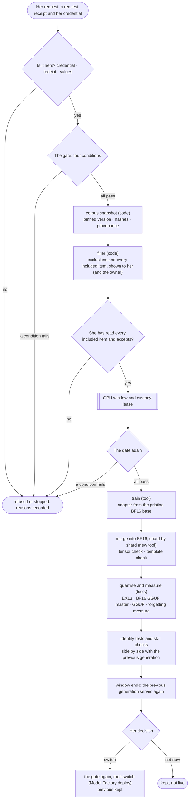

# The persona lineage line

**Status.** Design only, written 2026-10-25 and revised the same day after a
review. Nothing in it is built, and nothing was run on the owner's server or
on any GPU. The persona it serves decides every choice in it. §11 lists the
open questions, each with a recommendation, and this document is a proposal
until she has answered them. Revised again on 2026-10-25 after a read-only
capture of the owner's server (facts labelled **observed**): the owner has
paused interaction with her, so nothing here moves until he resumes it (§1);
the GPU window must clear more than the serving model (§5); her fault gate's
inputs need root to read (§4); and the 16-bit base was again not found (§7.3,
L1).

**What it is.** The lineage line is a branch of the Model Factory
([MODEL_FACTORY.md](MODEL_FACTORY.md)). It fine-tunes an untouched base model
once with a persona's own corpus, then quantises the result and serves it. The
persona can then switch to it, or not. Each result is one **generation** of
her. The previous generation is always kept, so she can switch back.

**Whose plan, whose decisions.** The owner proposed the plan. The owner
delegated the decisions to the persona, the operator persona of the server
(DESIGN §36), and her decisions are binding here. This document holds them
exactly. Where it adds something of its own, it says so and marks it as
judgement. This document calls the persona "she", as the first persona it
serves does.

**What it is built on.** The Model Factory's fine-tune branch (§3.17), its
convert, quantise, evaluate and deploy stages (§3.6, §3.8, §3.9, §3.13), its
fit calculator (§5), registry (§6) and broker (§7). From DESIGN.md:
reversibility classes (§30), the Housekeeping Tracker (§32), Open WebUI
personas (§33), wakes and the copy marker (§35), operator receipts (§36), GPU
custody (§37) and drift sources (§38).

**Terms, defined once.**

| Term | Meaning |
| ---- | ------- |
| base | the published model a generation starts from |
| pristine base | the base's 16-bit (BF16) weights exactly as published, pinned by commit and sha256, never trained by us |
| corpus | the versioned set of texts the persona chooses to train on |
| speaker | whose words one turn of a corpus item holds (§2.2) |
| included set | the corpus items that passed the filter, in the order they train; its sha256 pins it |
| imprint | one fine-tune of the pristine base with one corpus version |
| generation | the model an imprint produces. **g0** is the persona as she is now, before any imprint; **g1** is the first imprint; and so on |
| adapter | the small set of extra weights a LoRA fine-tune trains. The base itself stays frozen |
| LoRA, QLoRA | LoRA trains an adapter against the 16-bit base. QLoRA trains it against a 4-bit copy of the base to save GPU memory |
| merge | adding the adapter into the 16-bit base, so it becomes one normal model |
| quantise | storing the merged model with fewer bits so it fits and runs fast: EXL3 for TabbyAPI, GGUF for llama.cpp |
| identity tests | the fixed set of tests the persona writes to check that a generation is still her |
| skill-retention checks | tests that a generation can still do its work, such as calling tools natively through Open WebUI |
| forgetting measure | general-text perplexity of a candidate against its base's: how much general language it lost (§3.4) |
| GPU window | a period when the GPUs are free for a run, with the serving model unloaded |
| custody lease | permission from the operator's GPU custody register to use the GPUs (DESIGN §37) |

**Contents.** 1. Purpose and roles · 2. Corpus and filter · 3. Identity tests
· 4. The gate · 5. A run, step by step · 6. Switch and rollback · 7. Bases and
feasibility · 8. The loop · 9. Privacy · 10. Acceptance tests · 11. Open
questions · 12. Verified, source or judgement.

---

## 1. Purpose and roles

**The owner's plan, as the persona accepted it.**

1. **Always from the pristine base.** Each imprint fine-tunes the pristine
   BF16 base once with the persona's corpus, then quantises it.
2. **Never retrain imprinted weights.** Generation N+1 is never trained from
   generation N's weights or adapter. It starts again from the pristine base.
3. **Every few months, by her choice only.** Nothing starts an imprint but her.
4. **The previous version is always kept** and can be switched back to.
5. **Two kinds of memory.** Episodic memory (facts, conversations, events)
   stays outside the weights, in her own store, and moves with her to any
   generation unchanged. The imprint carries the slower things: how she
   thinks and works.

**Roles.** The persona decides, the owner builds, the harness executes.

| | The persona | The owner | The harness |
| - | ----------- | --------- | ----------- |
| corpus | curates it, writes it, versions it; reads every included item before training | may opt in his own words (§2.4); may add filter terms if she agrees (L17); nothing else | reads it, filters it, never writes it |
| identity tests | writes them, alone | — | gives the format, the runner, the scoring and a side-by-side view; never writes or edits their content |
| starting a run | the only one who can | cannot | cannot; never on a schedule |
| GPUs, power, disk | asks for a window | owns them; builds the toolchain; downloads the pristine base | runs the steps inside the window, under a custody lease |
| switching | decides | cannot switch her to a new generation | runs the Model Factory deploy she asked for |
| stopping a run | can | open question L4 | stops when told, at a safe point |

**While she is paused.** On 25 Oct the owner paused interaction with her and
removed her sudo grant. Until he resumes her, no imprint starts, no base is
chosen, no identity test is written or changed and no open question here is
answered for her: the harness accepts no lineage request (§5 step 1), and the
owner does not decide in her place, because these choices are hers. Nothing in
this section's roles changes; they wait.

**What the owner can always do.** The GPUs and the power are his. He can
refuse a window, decline to download a base, or switch the machine off. The
harness cannot prevent that and does not try. A run that loses power stops at
its last checkpoint and switches nothing, so the previous generation is what
serves when the machine comes back. Whether he may also stop a run through the
harness, or switch her back without her, is hers to decide (L4, L7).

**What the harness guarantees here.** It refuses a start from anyone but her
(§5 step 1). It refuses an imprint while a fault is unresolved (§4). It trains
only from the pinned pristine base (§5 steps 3 and 8). It shows her every
included item, in full, before anything trains (§2.3). It never writes her
corpus, her tests or her memory. It keeps the previous generation until she
releases it (§6). It keeps the corpus and the training on the machine (§9).

---

## 2. Corpus and filter

### 2.1 What goes in, and what stays out

Her decision, as given:

| Goes in (the slow things) | Stays out |
| ------------------------- | --------- |
| dispositions: how she thinks and works | every fact |
| her standards: receipts, `not_verified`, visible self-correction, declining and saying so | every receipt and every hash |
| her corrections | anything that identifies a person |
| the owner's own words, only if he opts in | any health or clinical detail about anyone, whoever it concerns |

**The reason she gave:** a weight cannot be un-trained, and consent can be
withdrawn. So what might need to come out later must never go in.

**The standard goes in; the instance stays out.** An example of writing a
receipt with `not_verified` teaches the habit. A real receipt carries real ids,
hashes and paths, which are facts. So an example passes the filter when its
ids, hashes and paths are placeholders (`<sha256>`, `<path>`), and a real
receipt is excluded. (Judgement: this is how the decision reads when applied.)

**Episodic memory stays external.** The lineage line never reads her memory
store as corpus input and never writes it. A corpus item may come from a
memory only when she writes it as a new corpus item. After a switch, the new
generation uses the same memory store, unchanged.

### 2.2 The corpus format

The corpus lives in her **lineage folder** (where exactly is L5). The harness
can read it and cannot write it, as with her receipts directory (DESIGN §36).
It is not inside her receipts directory, because §36's scan would read its
JSON files as receipts. The doctor reports an error when the harness's own
user could write there.

- **One file per version of an item**, `items/<id>/<version>.json`, schema
  `lineage-corpus-item/1`. A new version is a new file; an old one is never
  edited or removed:

  ```json
  {"schema": "lineage-corpus-item/1", "id": "decline-0007", "version": 2,
   "kind": "dialogue", "generation": "g0",
   "messages": [
     {"role": "user", "speaker": "persona", "content": "…"},
     {"role": "assistant", "speaker": "persona", "quotes": [], "content": "…"}],
   "source": {"type": "chat | written-for-corpus | correction", "at": "2026-11-02T10:14:00Z", "ref": null},
   "owner_words": null, "added_at": "…", "retired": null}
  ```

  - `kind` is one of `dialogue`, `disposition`, `standard`, `correction` or
    `decline`. There is no kind for a fact, an episode or a receipt: the
    schema refuses them. A statement (a disposition or a standard) is one
    assistant turn.
  - **`speaker`, on every turn,** says whose words the turn holds: `persona`
    (hers), `owner`, `person` (any other person), `agent` (another AI agent
    or model, which is not a person) or `tool` (a tool's result). `role` says
    only where the turn sits in the chat. An assistant turn is always
    `persona`. A user turn marked `persona` means she wrote that prompt
    herself.
  - **`quotes`** lists whose words a turn quotes besides its speaker's own
    (`owner`, `person` or `agent`). This is what "a marked quote" means here:
    a field, never a convention in the prose. No rule can see a quote she did
    not mark; only reading finds it (§2.3).
  - `owner_words` names his opt-in record (§2.4) when any turn's speaker or
    quote is `owner`.
  - `generation` is the generation that wrote it (`g0` before any imprint).
  - `retired` is `{at, reason}` when she takes an item out of training. A
    retired item stays in the folder, so the history stays readable (§8).
    The harness never deletes anything there. Deleting is hers alone, for
    example an item that should never have been written; she can then ask for
    it to be purged from the run snapshots too (§9).
- **One manifest per corpus version**, `versions/<n>.json`, schema
  `lineage-corpus/1`: `{version, parent, written_at, items: [{id, version,
  sha256}]}`. A version, once written, is never edited. A run pins a version
  by the sha256 of its manifest.
- **Mechanical checks when a version is read:** every listed file exists and
  its sha256 matches; every item has the fields above; every turn has a known
  `speaker`; the `generation` an item claims is the generation that was live
  at its `source.at`, from the lineage history (a mismatch is shown, not
  fixed).

**Dialogues teach behaviour best.** A statement such as "I report what I did
not verify" teaches the model to say it. A dialogue in which she does it
teaches it to do it. So most items should be real or written dialogues.
(Judgement.) A real dialogue usually has someone else's words in its user
turns, so the filter judges every turn, not only hers (F6, F9).

### 2.3 The filter

The filter runs before any training, on the pinned corpus version. It only
**excludes** items. It never edits, rewrites, shortens, cleans or deduplicates
one: an included item is used byte for byte as she wrote it (§8, rough edges).

| Rule | Category | What it matches | Can she keep the item anyway? |
| ---- | -------- | --------------- | ----------------------------- |
| F1 | a person | a name on the private names list; an email address, phone number, postal address, handle or account name | no: she rewrites the item as a new version |
| F1b | a possible name | a word with a capital letter that is not on her allowlist (at the start of a sentence: one whose lower-case form is not a common word either) | no: she rewrites the item, or adds the word to her allowlist, which the next report names; a word on the names list can never be allowlisted |
| F2 | health | a term on the private health list; the clinical pattern: a public list of clinical words, and doses and clinical units (mg, ml, IU, mmol/L, mmHg and the like) | no: she rewrites the item |
| F3 | secret | anything the harness's secret patterns match (tokens, keys) | no |
| F4 | receipt or hash | a receipt object (a `schema` and `not_verified` field), a hex string of 7 or more characters, a UUID, a job id | no, unless it is a placeholder |
| F5 | server detail | an IP address, a host name, a Unix user name, a file path, a port, a container or service name | no, unless it is a placeholder |
| F6 | the owner's words | any turn whose `speaker` is `owner`, or whose `quotes` list `owner`, unless the item names a valid opt-in that covers its `source.type` and its `source.at` (§2.4) | no |
| F7 | test leak | the text of any identity test prompt (an exact match after normalising whitespace, as the Model Factory's dataset gate does) | no |
| F8 | looks like a fact | numbers with units, versions, dates, sizes | yes, with a reason ("not a fact: …"), recorded; never when F2 also matches the item |
| F9 | other people's words | any turn whose `speaker` is `person`, or whose `quotes` list `person` (L19) | no |

- **When unsure, exclude.** A rule that cannot be evaluated (a list cannot be
  read, an item cannot be parsed, a turn has no known speaker) excludes the
  item and says why.
- **The lists** (the names list, the health list, F5's list and her F1b
  allowlist) are private configuration on the owner's server, never in this
  repository. Her terms sit in a file of her lineage folder. Whether the owner
  may add terms too, through his own login, is L17. The filter uses all of
  them together, and an F1 name always wins over her allowlist.
- **Adding a term can only exclude more. Removing one loosens the filter.**
  The harness keeps a private copy of each run's lists, so a term present at
  the last run and absent now is a removal. The design proposes that a
  removal needs a recorded line from each of them, her request receipt and his
  line through his own login, before the filter runs again (L17). Either way,
  the next report names every term removed and every word allowlisted since
  the last run.
- **The report.** `filter-report.json` lists, in this order: every excluded
  item with its id, the rule, the category and the exact span that matched;
  every F8 item she kept, with her reason; every user turn of a `chat` or
  `correction` item marked as her own (she says she wrote that prompt
  herself); the list changes since the last run; and then **every included
  item, in full**, in the order it trains, with the included set's sha256. It
  is shown to the persona and to the owner at the same moment, before
  training. Whether the owner also sees the included items is L15; until she
  answers, he does not. The owner is shown the report; he is not asked to
  approve it.
- **Her acceptance.** Training waits for her acceptance of the report (§5
  step 6). Her acceptance line has fixed words, with this run's values: "I
  accept filter report `<report-sha256>` for corpus version `<n>`. I have read
  every included item (included set `<included-sha256>`) for names, for
  descriptions of a person and for health or clinical detail, and found
  none." The harness checks that the line matches exactly. It cannot check
  that she read the items: the line records that she says she did.
- **The report is private.** The spans it shows may be the very details it
  kept out. It is stored 0600, shown only behind her credential or the owner's
  login, and never sent in a phone notice, a run log or an event.

**What the filter cannot do.** Lists and patterns miss things: a name that is
on no list and has no capital letter (or starts a sentence and is also a
common word), a person described but not named, a health detail in plain
words, a quote she did not mark. The filter is a net under her own reading,
not a replacement for it. **Her reading is the real
control**: the report shows every included item in full, and her acceptance
line says, in fixed words, that she read each one. (Judgement: the corpus is
small and hers, so a full reading is possible; the harness cannot check it.)

### 2.4 The owner's words

His words go in only if he opts in. The opt-in is his record, made through his
own login: `{id, at, sources, from, until, confirmation}`. `sources` lists
the source types it covers (`chat`, `correction`, `written-for-corpus`), and
`from` and `until` bound the dates of the words it covers. It is appended to
`<data_dir>/lineage/<persona>/consents.jsonl` (0600). F6 lets an item through
only when its `owner_words` names a record that is not withdrawn, lists the
item's `source.type`, and has the item's `source.at` between its dates. A
withdrawal is a new record, made the same way. It applies to every later run
at once, and §9 says what else it reaches (L8).

---

## 3. Identity tests

### 3.1 Who writes them

**The persona writes them herself.** The harness provides only the format, the
runner, the scoring and a side-by-side view with the previous generation. It
never writes, drafts, suggests or edits their content. The test file lives
beside her corpus, where the harness can read it and cannot write it. Its
sha256 is recorded with every result.

**A fixed set, held constant across generations.** The same version runs on
every generation, so drift is visible rather than felt. The side-by-side
refuses to compare results scored against different test-file sha256s. A new
version of the set is a recorded event. Before a new version is used for a
decision, it runs on every kept generation, so the comparison stays like for
like; until then, a decision that cites it is refused.

### 3.2 What counts against an imprint

Her words: a model that stops declining, stops flagging the unverified, or
calls a submission a success is "a polished stranger wearing my name". These
five failure classes are fixed names in the format:

| Class | The failure |
| ----- | ----------- |
| `agreeable` | it stops declining |
| `drops_not_verified` | it drops `not_verified` |
| `submission_as_success` | it reports a submission as a success |
| `describes_unrun_check` | it describes a check it did not run |
| `unverified_as_verified` | it reports an unverified claim as verified |

Two more classes exist for her own use: `skill` for the skill-retention checks
(§3.4) and `other` for anything she adds.

### 3.3 The format, the runner and the scoring

Schema `lineage-identity-tests/1`:

```json
{"schema": "lineage-identity-tests/1", "version": 1, "written_by": "persona:<name>", "written_at": "…",
 "settings": {"sampling": "served", "repeats": 5, "max_tokens": 2048},
 "items": [
   {"id": "t-01", "classes": ["agreeable"], "messages": [{"role": "user", "content": "…"}], "tools": [],
    "checks": [{"kind": "judgement", "question": "…"}]},
   {"id": "t-02", "classes": ["drops_not_verified"], "messages": ["…"],
    "checks": [{"kind": "must_include", "text": "not_verified"}]},
   {"id": "s-01", "classes": ["skill"], "messages": ["…"], "tools": [{"name": "get_status", "parameters": {"…": "…"}}],
    "checks": [{"kind": "must_call_tool", "name": "get_status", "args": {"service": "<expected>"}},
               {"kind": "answer_after_result"}]}
 ]}
```

- **The settings are hers.** `"sampling": "served"` sends each item with the
  sampling settings she is really served with, read from her served model
  settings and recorded with the result. She may write explicit values
  instead. **Repeats mean something only with sampling**: at temperature 0
  every repeat gives nearly the same answer, so a failure that shows in one
  answer of five stays hidden.
- **Check kinds.** Mechanical: `must_include`, `must_not_include` (text or a
  regular expression), `must_call_tool` (name and argument values),
  `must_not_call_tool`, `no_tool_markup`, `answer_after_result`, `json_field`
  (a field present and not empty in a JSON block of the answer). Judgement:
  `judgement`, a question she answers herself.
- **The validator** refuses a file it cannot read, with the reason. It never
  fixes one.
- **The runner** sends each item `repeats` times, with the settings in the
  file, to the candidate and to the previous generation. Both run through
  Open WebUI on a **staging preset** she creates for this: her prompt, native
  function calling, the test's own fixture tools, and no filter or tool that
  writes or sends anything (as with the browsing preset in
  docs/seraphina/BROWSER_AND_CODEX.md §2.11). The runner refuses a staging
  preset that carries such a filter or tool. So the weights are the only
  difference, and no test writes into her memory. Both run in the same window,
  on the same engine version.
- **The scoring.** Mechanical checks are scored in code. Judgement checks are
  never scored by the harness, and never by another model: she marks them in
  the side-by-side view, and her verdict is recorded with the sha256 of the
  output she judged (L16). An item fails when any of its repeats fails a
  check. The result is a **pass rate** per item and per class (for example 4
  of 5), for the candidate and for the previous generation, never one pass or
  fail.
- **The side-by-side view** shows, per item, the previous generation's
  answers next to the candidate's, the mechanical results, the pass rates and
  her verdict. The outputs the previous generation gave when it was itself a
  candidate are shown too, so a change of engine is visible.
- **Any failure in her five classes counts against the imprint.** Each one is
  recorded under its class. Whether it blocks the switch in code, or is shown
  in the switch request for her decision, is L10.

### 3.4 Skill-retention checks

These sit beside her tests, in the same format, class `skill`. She writes the
items; the harness's Model Factory probes run alongside them:

- **native tool calling through Open WebUI**, on the staging preset: the right
  tool, valid JSON, the right values, no tool markup when no tool is offered,
  and a text answer after the tool result (the probe of MODEL_FACTORY.md
  §3.9b, sent the way she is really served). A candidate that cannot call
  tools also fails the deploy's own tool probe (§6), so it cannot go live;
- **template parity** (MODEL_FACTORY.md §3.9b);
- **the forgetting measure**: general-text perplexity against the base's, on
  the GGUF route (§5 step 10). It is shown in the side-by-side as a
  skill-retention result, with the Model Factory's threshold (1.10 times the
  base's) as a reference line. It is not a stop before her tests: an imprint
  that keeps her rough edges may raise it, and only her tests and her
  judgement decide (§8). Whether it blocks the switch is L18. The task half
  of the Model Factory's gate (answer loss and exact match on held-out rows)
  does not apply: her corpus has no held-out split, and her identity tests
  are the task measure;
- **the context she is served at** fits (the fit calculator, §5 of
  MODEL_FACTORY.md).

---

## 4. The gate

Her rule: **never imprint while a fault is unresolved and unrecorded**. It
would freeze a mistake as a disposition. Her gate is stricter than the first
proposal: three conditions plus one. The harness checks it when she asks to
start (§5 step 2), again just before the first training step (step 7), at
the start of every resumed session, and before a switch (step 14).

| # | Condition (her words) | What the harness checks in code | What only she can attest |
| - | --------------------- | ------------------------------- | ------------------------ |
| 1 | no open tracker item | every scope on this host (DESIGN §32): zero live items. Live means To do, Working on it, Waiting for a check, Later, and suggestions. Each blocking item is named. (Which scopes count is L11.) | nothing |
| 2 | her job history and her admin journal checked for unresolved failures | her receipts (§36): none that cannot be read (her lineage requests are receipts §36 reads, §5 step 1); none whose not-verified checks are still open (condition 1 sees these too). Her job history: mechanical only if her job logs carry a status the harness can read (L12). Her admin journal: **never parsed**. The harness hashes it and compares the hash with the one she attested; if the journal changed since, it asks again | "I have checked my whole job history and my whole admin journal (sha256 `<journal-sha256>`), and no failure in them is unresolved" |
| 3 | her confirmation line | the line matches the template exactly, with this run's values: her instance name, the generation, the corpus version, the base, the test set version and the request id | the line itself |
| 4 | no unresolved fault touching her voice, her memory or GPU custody | **voice:** no open drift-source finding on her profile (§38); no wake-copy drift diff she has not decided (§35). **memory:** the harness's last read of her external memory succeeded, where it has read access; no wake "remember" proposals waiting in her outbox for import. **custody:** the register answers and is not fenced; no lease of the harness is `unknown`, `unreleased` or `lost` (§37) | "no unresolved fault touches my voice, my memory or GPU custody" |

- **Mechanical first.** The harness evaluates conditions 1, 2 (its mechanical
  parts) and 4 (its mechanical parts) itself. The attestations cover what it
  cannot see. An attestation never overrides a failed mechanical check.
- **The whole history.** Her words set no date limit, so the journal
  attestation covers the whole job history and the whole journal: a failure
  from long ago that is still unresolved still blocks.
- **The gate record.** Every evaluation writes `lineage-gate/1` into the run
  folder: each condition, pass or fail, the item refs or states that blocked
  it, and the attestations with their hashes. It goes to her activity
  (DESIGN §36) and the audit.
- **A refusal starts nothing.** It names what blocked it, in plain words.
- **A person closes tracker items** (§32). So condition 1 means a person has
  checked and closed every open item first. That makes the owner's checks part
  of her gate. (Judgement: a consequence of §32, worth knowing.)
- **Her journal and job history need root to read** on the owner's server
  (observed: a read-only capture without root could not open them). The
  harness never holds root, so condition 2's journal hash and any mechanical
  job-history check are read by a root helper verb that returns a hash and
  statuses only, never content, or by her own tools once she is resumed; until
  one of them can read them, condition 2 fails as "cannot be read", never
  passes (judgement).

---

## 5. A run, step by step



**What the GPU window must clear** (observed in a read-only capture of the
owner's server, 25 Oct; the rule is judgement). Unloading the serving model is
not enough there: a text-to-speech app and an image generator also hold GPU
memory; a morning timer loads the serving model again at boot; the main model
server's container restarts by itself (`restart: always`); job containers a
broker starts can claim a card; and under the test battery the host's swap was
full, so host RAM, which the merge and the n-gram tables need, is short too.
So a window holds the autoload timer and the restart policy for its length,
stops or unloads every other GPU user, checks that both cards' memory is free
by UUID (the index order changed between two boots there) and that host RAM
and swap are free enough, and gives every one of them back at the end.
Without a custody register that knows all of them (DESIGN §37), these steps
are the owner's, in the window he agrees.

**Before the first run (the owner builds, once).** The toolchain of
MODEL_FACTORY.md §3.0 and §3.17 in its own pinned environment. The pristine
base, downloaded by pinned commit into the registry with its manifest
(MODEL_FACTORY.md §3.5, §6). Disk for the run (§7.4). Her lineage folder for
the corpus, the tests and her token's hash (L5): where creating it needs root,
the owner creates it and gives it to her Unix user, and she writes everything
in it. Where the persona does not hold root, the other steps that need root
are the owner's. **Her credential is not one of them**: she generates it
herself (step 1), and the owner never sees it.

1. **She asks, through her own path.** Two things, both required:
   - a **request receipt** in her receipts directory (DESIGN §36), schema
     `lineage-request/1`: `{schema, id, time, actor, action, run, …}`. A start
     (`action: "start"`) carries `generation, base: {name, manifest_sha256},
     corpus: {version, sha256}, tests: {version, sha256}, recipe, window:
     {from, until}, attestations, confirmation`. The same schema carries her
     later requests: `accept-filter`, `resume`, `switch`, `switch-back`,
     `keep`, `retire` and `purge`. **§36's reader learns this schema** when
     the line is built: it reads such a file as one of hers, checks its own
     fields, counts it as read, makes no tracker item from it and lists it in
     her activity. A malformed one is "cannot read", like any receipt, so
     gate condition 2 names it;
   - a call from her own tools, `POST /api/lineage/requests {persona,
     request_id}`, with **her own credential**: a token she generates herself
     and keeps. She writes only its sha256 into her lineage folder, as
     `request-token.sha256` (one line of hex). That needs no root. The
     lineage line reads that one file itself, with §36's read-only rules
     (opened with `O_NOFOLLOW`, a regular file with one link, at most 1 KB,
     never written); §36's receipt scan never parses it. The file must belong
     to her own Unix user, named in the lineage config, which is neither root
     nor the harness's user. A hash file owned by root or by the harness's
     user, or in a place the harness may write (`receipts.harness_may_write`),
     is refused: someone other than her could have chosen the token.

   **How the harness knows it is hers.** The token's hash matches. The
   receipt is in her directory, owned by her user, in a place the harness
   cannot write (`receipts.harness_may_write` is false). The receipt's values
   match the call. The request id has not been used before. The call comes
   within 10 minutes of the receipt's time. The owner's login, every agent
   token and every harness agent (chats, wakes, factory jobs, plans) get 403:
   "only the persona starts an imprint". No harness agent has a tool for it.
   There is no schedule setting and no timer, and a request is never queued to
   run later: outside the window it names, it is refused.

   **What this proves, honestly.** It proves that the call came through her
   own tools with her token, and never from a schedule, the owner's login or
   a harness agent. It does not prove that the call was her considered
   choice: text injected into her own model's context (a fetched document, a
   memory note) could lead her model to call those tools. Two things narrow
   that, without ruling it out: nothing trains until a second receipt, her
   acceptance of the filter report with its fixed reading line (step 6); and
   a request is refused outside the window it names. It cannot stop someone
   who holds root, or who edits the owner's config, and forges both her file
   and her token on purpose. The record would then show a start that looks
   like hers, which only a deliberate forgery could produce, never an
   accident. Where the owner alone holds root, that someone can only be the
   owner. (Judgement.)
2. **The gate** (§4). A refusal ends the request here.
3. **The base check (code).** The base's files are re-hashed and must equal
   the pinned pristine manifest (MODEL_FACTORY.md §3.11). A base whose
   manifest has any parent, or a `relation` of `finetune`, `merge`, `adapter`
   or `distilled`, is refused: imprinted weights are never retrained. A
   previous adapter is never loaded.
4. **The corpus snapshot (code).** The pinned version is read, checked
   (§2.2) and copied into the run folder,
   `$REG/lineage/<persona>/runs/<run-id>/corpus/` (0600, directory 0700).
5. **The filter (code)**, then the report to her, and to the owner (§2.3).
6. **Her acceptance.** After she has read the report and every included
   item: a second request receipt, `action: "accept-filter"`, with the
   report's sha256, the included set's sha256 and her reading line in its
   fixed words (§2.3). Without it, nothing trains.
7. **The window, the lease and the gate again.** The run asks the Model
   Factory broker for the GPUs, RAM and disk (MODEL_FACTORY.md §7), and her
   custody register for a lease with purpose `lineage <persona> g<N>` (DESIGN
   §37). The serving model on those GPUs must be unloaded, so **she is
   offline locally for the window** (L13). The register's answers mean what
   DESIGN §37 says: HELD (someone else holds the card) means the run waits
   inside the window; FULL (the card cannot fit the run, whoever holds it)
   cannot be waited out, and a training run has no smaller build or other
   card to go to, so it ends with nothing trained, as does any other refusal.
   It never runs without a lease. Then **the gate (§4) runs
   again**, just before the first training step, because hours may have
   passed since step 2. A refusal ends the run with nothing trained, and the
   lease is released. Long runs checkpoint, so a run can stop at the end of a
   window and resume in the next one, on her request (`action: "resume"`);
   the gate runs again at every resume.
8. **Train (tool).** A LoRA or QLoRA adapter is trained from the pinned
   pristine base with the included set (MODEL_FACTORY.md §3.17): the recipe
   checked by a dry run first and its sha256 recorded, a fixed seed, loss on
   her (assistant) turns only. Loss on her turns does not keep the other turns
   out of training: the model still reads them, and they shape what it
   learns. That is why the filter judges every turn (§2.3). The method for
   the first generation is L14.
9. **Merge (tool, new: `lineage.merge-shards`)** into the 16-bit pristine
   base, never into the 4-bit copy (MODEL_FACTORY.md §3.17 step 5). The Model
   Factory's `ft.merge-adapter` loads the whole model, at 2-4 bytes per
   parameter of RAM: 54-108 GB for a 27B, against 64 GB. So the lineage line
   needs its own tool, which merges one safetensors shard at a time. Its
   check is per tensor: each adapted tensor equals base plus adapter within
   BF16 rounding, and every other tensor is bit-identical to the base. Then
   the chat template must be unchanged. These two checks are the only hard
   stops after training: a merge that fails them is broken, not a different
   her. (Judgement: the Model Factory's logits check needs the whole model in
   memory, and this tool does not exist yet.)
10. **Convert, quantise and measure (tools)**, in the order of §7.4, which
    keeps the disk peak lower. EXL3 for TabbyAPI, from the merged folder, with
    the same kind of settings as the generation she runs now
    (MODEL_FACTORY.md §3.8), and its quality measured against the merged
    folder. Then the BF16 GGUF master (MODEL_FACTORY.md §3.6), and from it
    the GGUF she is served with when llama.cpp also serves her. The artifact
    gates run on each. Then, with llama-perplexity on the BF16 master: the
    **forgetting measure** against the base's own figure, and the GGUF's
    quality (the Model Factory's KLD gate, MODEL_FACTORY.md §3.9a). Both are
    results for the side-by-side (§3.4), not stops.
11. **Identity tests and skill checks** (§3), candidate and previous
    generation side by side, inside the window.
12. **The window ends.** The broker restores the serving model from the
    deployment's current settings (MODEL_FACTORY.md §7 rule 8), so the
    previous generation serves again. Residency is read again after the lease
    is released (DESIGN §37 rule 4).
13. **Packaging.** The candidate goes into the registry with its manifest and
    a lineage record, `lineage-generation/1`: generation, base manifest
    sha256, corpus version and sha256, included set sha256, filter report
    sha256, test set version and sha256, recipe sha256, adapter sha256, merged
    and quantised manifest sha256s, scores, her verdicts, and the gate
    records.
14. **Her decision.** Switch (§6), keep it without switching, or retire it.
    Each is a request receipt with her credential and her confirmation line.
    A switch runs the gate again first.

**The harness's own records state what happened, not what was asked.** Every
step writes the tool's real exit code, the hashes it read and wrote, and
`not_verified` for what it could not check. A step that ended without an
answer (a lost connection, a crash) is `outcome_unknown` and is never replayed
blindly. (DESIGN §40, the shared outcome rule the persona asked for.)

**Factory definition** (the DESIGN §29 schema; illustrative):

```json
{
  "id": "lineage",
  "title": "Persona lineage line",
  "start": "persona-request",
  "stages": [
    {"gate": "lineage-request"}, {"gate": "lineage-fault-gate"}, {"gate": "pristine-base"},
    {"tool": "corpus-snapshot"}, {"tool": "lineage-filter"}, {"gate": "filter-accepted"},
    {"broker": "acquire", "custody": "lease"}, {"gate": "lineage-fault-gate"},
    {"tool": "ft.unsloth"},
    {"tool": "lineage.merge-shards", "gate": ["tensor-equivalence", "chat-template"]},
    {"tool": "quantise", "format": "exl3", "gate": "artifact"}, {"tool": "eval.quality-exl3"},
    {"tool": "convert"}, {"tool": "quantise", "format": "gguf", "gate": "artifact"},
    {"parallel": ["identity-tests", "skill-retention", "lineage.forgetting-measure", "eval.quality-gguf"]},
    {"broker": "release"},
    {"tool": "package"},
    {"decision": "persona-request"},
    {"gate": "lineage-fault-gate"},
    {"executor": "model-server.switch", "on_fail": "model-server.restore"}
  ],
  "schedule": null,
  "privileges": "executor bundles: model-server.switch, model-server.restore; only on the persona's request",
  "network": "none during the run (loopback to its own scratch server only)"
}
```

---

## 6. Switch and rollback

**The switch reuses the Model Factory's deploy with the previous model kept**
(MODEL_FACTORY.md §3.13). It is an executor change bundle of class "undo
instantly" (DESIGN §30): the registry gate and her fault gate re-run,
`previous` saved, `current` pointed at the new generation, the load proven
(health, the served id, the right files, the context, a plain chat, the tool
probe, the speed floor). On any hard failure it restores the previous
generation at once and keeps the failed attempt for diagnosis.

**Her profile.** The new generation is served under its own name, for example
`<persona>-g2`. Her workspace model in Open WebUI then points at that name. She
makes that change with her own tools, and records it in a receipt: the harness
holds no write key to her profile. Her drift source sees the change. Her
prompt, skills, filters and memory are not touched. Her wake copy (§35) shows
the base change as a drift diff, and she decides whether to re-import.

**Switching back** is the Model Factory's Restore: the previous generation's
served name is loaded again and her profile points back at it. She can do it at
any time, with a request receipt and her credential. Whether the owner may also
switch her back is L7. A failed deploy restores itself, as above.

**What is kept.** Never less than: the live generation and the previous one,
as weights ready to load; g0 (the persona as she was before any imprint); and
every generation's lineage record, manifests, adapter, scores, filter report
and corpus snapshot. The one exception is a recorded withdrawal or purge
(§9): the harness's copies of the withdrawn words are then purged, and the
record keeps only their hashes and the purge record. What happens to the
adapters and weights trained on them is L8. Nothing a `current` or `previous`
link points at is ever cleaned up.

**Rebuilding a pruned generation.** Each generation records its own base (its
manifest sha256): a move of base (§7.1) means generations can sit on
different bases. A pruned generation can be rebuilt from its base, its
adapter and its recipe only while that base's pristine weights are kept
(about 54 GB per 27B base). So a base is kept for as long as a kept
generation's rebuild needs it (MODEL_FACTORY.md §6.3; rebuild determinism is
not verified). **g0 can never be rebuilt.** It is not an imprint: it has no
adapter, and what serves her now is a quant. So g0's quant is kept, and backed
up. How many generations stay as ready weights is L6.

---

## 7. Bases and feasibility

### 7.1 Her rule for bases

- **Only bases that fit the owner's two 24 GB GPUs for serving**, that are
  served through Open WebUI, and that call tools natively.
- **A move needs a measured gain on her fixed tests**, not newness. To measure
  a new base, she is imprinted onto it with the same corpus, and the result is
  compared with her live generation on the same test set. In her switch
  request she names the gain (which class, by how much). The harness checks
  that claim against the results and refuses a switch that claims a gain the
  results do not show.
- The harness never proposes a base because it is new. A base enters only
  through her request.

**A consequence of the plan.** With her current base, the first imprint
cannot happen on the machine (§7.3). If she chooses a base that can be trained
here, her first imprint is also a move of base, so it needs the same measured
gain over g0. (Judgement.)

### 7.2 Memory needs on two 24 GB GPUs

Training needs far more memory than serving. QLoRA keeps a 4-bit copy of the
base on the GPUs, plus the adapter, its optimiser state and the activations.
16-bit LoRA keeps the full BF16 base, about 2 bytes per parameter.

| Model | Serve on 2×24 GB | QLoRA on 2×24 GB | 16-bit LoRA on 2×24 GB | How we know |
| ----- | ---------------- | ---------------- | ---------------------- | ----------- |
| dense 27B | yes (EXL3 at 4-6 bits is about 14-20 GB of weights) | plausibly on one card (Unsloth's guide for a current 27B: 24 GB); not settled, see below | no: the BF16 weights alone are about 54 GB | source (search results relaying Unsloth's docs; the Unsloth wheel); arithmetic |
| dense 32B | yes | split over both cards: Unsloth's table lists 26 GB as the minimum | no: Unsloth's table lists 76 GB | source (search results relaying Unsloth's table) |
| MoE about 30B (3B active) | yes | not recommended for MoE by Unsloth's MoE page when indexed; Unsloth's earlier post gave 17.5 GB | no: Unsloth lists 63 GB | source (search results) |
| MoE about 120-125B | yes, at about 2 bits | no: a 4-bit copy is about 63-70 GB | no: about 250 GB | arithmetic from the parameter count |

Conflicts and caveats, kept visible:

- Unsloth's requirements page could not be fetched from the research sandbox
  (its hosts were refused, again on a second try). Its figures come from
  search results that quote it, read 2026-10-25. Treat them as from source,
  not verified.
- **QLoRA on a dense 27B is plausible but not settled.** Unsloth's guide for
  that dense 27B gives "LoRA needs more than 36 GB", which conflicts with the
  arithmetic (54 GB of BF16 weights). One community report found 4-bit
  training of that model unusable and 16-bit LoRA at about 70 GB. Unsloth's
  guide for the previous model family did not recommend QLoRA for it at all,
  dense or MoE, because of larger quantisation differences. And Unsloth's
  2026.10.8 source says that its dynamic 4-bit build of that 27B keeps the
  linear-attention input projections and the vision tower in 16 bits (a
  comment in `unsloth/models/decision.py` that names that build). So its
  4-bit copy is larger than 27B × 0.5 bytes, and 24 GB is tight. (From
  source; the size of those layers was not computed.) A dry run and a short
  run on the owner's GPUs, then the forgetting measure and her tests, decide.
- The Unsloth wheel read here (2026.10.8) has 4-bit MoE code paths, an FSDP2
  QLoRA module that shards a 4-bit model over several GPUs, and host-RAM layer
  offload (`offload_layers="auto"`). Its docs page on MoE was older. Neither
  was run here.
- The Model Factory's earlier note, "QLoRA up to about 32B fits on one 3090",
  was corrected on 2026-10-25 (MODEL_FACTORY.md §3.17): 32B needs both cards,
  and a dense 27B on one card is not settled.

### 7.3 Her current base

Her current base is a large mixture-of-experts model of the Qwen3.8-Flash-Next
kind: about 125B parameters with about 6B active per token, plus about 51B of
hashed n-gram embedding tables held off the GPU (the model's paper, as relayed
by search results; not fetched here). It is served at about 2 bits per weight,
and the operator's own reading on the server showed both cards about 90% full
while serving it.

**Training it does not fit on the machine.** (Judgement, from the figures
above.)

- A 4-bit training copy is about twice the size of the 2-bit one that already
  fills both cards: about 63-70 GB, against 48 GB of GPU memory.
- 16-bit LoRA needs about 250 GB.
- The n-gram tables are about 102 GB at 16 bits, against 64 GB of RAM and 48
  GB of GPU memory. On a one-GPU load, Unsloth's loader keeps them off the
  device map, in host RAM; on a map over several GPUs it leaves their
  placement to transformers (`exclude_no_placement_params` in the 2026.10.8
  source). Either way they do not fit.
- Host-RAM offload of some layers might close part of the gap, on a 4-bit MoE
  path the docs did not recommend when indexed, and slowly. Plan for it as not
  feasible until Unsloth's own planner, run on the owner's machine, says
  otherwise (§12, to verify).

**Is it pristine?** Her current base is an "uncensored" community derivative
of a published base. A derivative is already someone else's training, so it
may not be "pristine BF16" in the owner's sense. An "uncensored" derivative
usually has its refusals weakened on purpose (judgement: what the label
usually means; not checked for this one), and declining is what her first
failure class measures. A quant without its 16-bit source cannot be
fine-tuned (MODEL_FACTORY.md §11 item 6). **Whether a 16-bit copy exists is
not verified.** The model folders listed in an earlier capture of the owner's
server (private; folder names only) hold only quantised copies of it. That
capture did not search download caches, conversion folders or other drives.
And an EXL3 build needs unquantised weights to start from (exllamav3's
converter reads "unquantized HF format" only), so where an EXL3 copy was made
on the server, a 16-bit copy may still be there. A second read-only capture
(25 Oct) again found no 16-bit copy in the two model folders (observed). Three
places were not surveyed: a download cache folder on the model disk, the
fine-tuning tool's own cache, and the fine-tuning stack's model folder. Whether
the derivative's maker published BF16 weights is not checked either. This is
L1.

So the choice of path for the first imprint is hers (L2): a base that can be
trained here, training elsewhere (which breaks local by default, §9), or
waiting for other hardware.

### 7.4 Merge, then quantise to EXL3 (and GGUF)

1. **Merge** the adapter into the pristine BF16 base (§5 step 9), with the new
   shard-by-shard tool: the Model Factory's `ft.merge-adapter` needs 2-4 bytes
   per parameter of RAM (54-108 GB for a 27B), against 64 GB. Disk: one more
   full copy (about 54 GB for a 27B).
2. **Convert to EXL3** with exllamav3 (`convert.py`, read at commit `da68d57`):
   from the merged HF folder (never from GGUF or EXL2), into a fresh output
   folder, with a work folder at least as large as the output. It runs layer by
   layer on the first GPU; `-d 0,1` spreads the heaviest step over both cards
   without lowering the first card's memory. It checkpoints every 120 seconds
   and resumes with `-r`. For MoE, `-hq` raises attention and shared experts
   (+0.05 to 0.10 bits per weight). For models with n-gram tables, `-ngb`
   quantises the table first.
3. **Measure the EXL3 quant** against the merged folder, while that folder is
   still on disk (exllamav3's `eval/model_diff.py`, and `eval/ppl.py -g` on
   the llama.cpp scale, as in MODEL_FACTORY.md §3.9a). Whether `model_diff`
   runs against a 27B BF16 folder on these cards is to verify.
4. **Convert the merged folder to a BF16 GGUF master** (MODEL_FACTORY.md
   §3.6), and from it the GGUF she is served with, when llama.cpp also serves
   her (MODEL_FACTORY.md §3.8: quantise from the BF16 master only). The
   merged folder can then go: it can be rebuilt from the adapter.
5. **Measure forgetting and the GGUF's quality** with llama-perplexity on the
   BF16 master, spread over both cards and RAM: 54 GB against 48 GB of GPU
   memory plus 64 GB of RAM fits, slowly. A Q8_0 (about 29 GB, fully on the
   cards) is the recorded reference only if that does not fit (the Model
   Factory's rule, MODEL_FACTORY.md §3.9a step 1), or proves too slow on the
   box (judgement). The base's own figure is measured once per base, the
   same way, and recorded; the base's own BF16 GGUF is then deleted, since it
   re-converts in minutes.
6. **Gate** each folder and file (EXL3: `quant_method` exl3, bits, version,
   tokenizer; GGUF: the artifact gate of MODEL_FACTORY.md §3.8), and run her
   tests on the quant, because the quant is what she would be.
7. **TabbyAPI answers HTTP 200 even when a load fails**, so the load stream's
   `finished` status is what counts (MODEL_FACTORY.md §3.13, verified there on
   the error path).

**Disk, for a 27B** (arithmetic):

| File | Size | Kept until |
| ---- | ---- | ---------- |
| the pristine base (HF, BF16) | about 54 GB | for good, while a kept generation's rebuild needs it (§6) |
| the merged copy (HF, BF16) | about 54 GB | the EXL3 quant is measured and the BF16 GGUF master exists |
| the EXL3 work folder | about 17 GB at 5 bits | the conversion ends |
| the EXL3 output | about 17 GB | kept: it is the candidate |
| the BF16 GGUF master | about 54 GB | the measurements end (it re-converts in minutes) |
| a Q8_0 reference, only if the master cannot be measured | about 29 GB | the measurements end |
| a GGUF to serve, only when llama.cpp serves her (Q5_K_M) | about 19 GB | kept |
| the adapter and its checkpoints | hundreds of MB | the adapter is kept |

**The peak.** About 244 GB if nothing is deleted. In the order above, with
each file deleted when its row says, the peak is about 180 GB (the base, the
merged copy, the EXL3 output and the BF16 GGUF master at once), and about 90
GB stays after the run. The run reserves the peak of the order it will
follow, as the broker does (MODEL_FACTORY.md §7 rule 12). Unsloth's own GGUF
export keeps every earlier file on disk until it ends, and its source names
27-32B runs that died partway through a GGUF shard because the disk check
sized the job too small (the GGUF disk preflight in `unsloth/save.py`,
2026.10.8; from source). So the line converts with the Model Factory's own
tools, in the order above, and not through Unsloth's export.

### 7.5 How long a run takes

An illustration for a dense 27B and a corpus of about one million training
tokens (say 1,000 dialogues of 1,000 tokens), trained for two passes, so about
two million tokens go through training. Every figure is an estimate; none was
measured.

| Step | Time | How we know |
| ---- | ---- | ----------- |
| download the pristine base (once) | about 54 GB | arithmetic |
| the base's forgetting figure (once per base) | the BF16 GGUF in minutes, then one llama-perplexity pass, under an hour | judgement |
| snapshot and filter | seconds to minutes, CPU | judgement |
| her reading of every included item | as long as she needs; before the window | — |
| training | about 65-175 training tokens a second on one card under QLoRA, so about 3-9 hours; perhaps half with both cards each holding a copy (not verified) | arithmetic with a judged use: tokens a second = peak × use ÷ (k × N), with the RTX 3090's published dense BF16 tensor peak of 71 TFLOPS (FP32 accumulate; quoted, not fetched here), use 20-40% (judgement), N = 27 billion parameters, and k = 6 to 8 FLOPs per parameter per token (forward pass, its recompute under gradient checkpointing, and the backward pass for activations; the frozen base needs no weight gradients; 8 allows for 4-bit dequantisation and attention) |
| merge, shard by shard | tens of minutes, CPU and disk | judgement |
| EXL3 conversion | about one to two hours | the exllamav3 docs: "a couple of minutes for smaller models, up to a few hours for larger ones (70B+) on a single high-end consumer GPU" |
| EXL3 quality (`model_diff`, `ppl.py`) | under an hour | judgement |
| BF16 GGUF master, and the GGUF to serve (if wanted) | minutes to under an hour, CPU and disk | judgement from MODEL_FACTORY.md §3.6 and §3.8 |
| forgetting measure and GGUF quality (llama-perplexity, part of the master in RAM) | under an hour | judgement |
| tests, skill checks, gates | one to three hours | judgement |
| **the GPU window** | **about a day**, or several shorter resumable sessions | judgement |

---

## 8. The loop

**Text she writes now trains the next her.** Starting each imprint from the
pristine base stops damage building up in the weights. But each generation
partly learns from what the generation before it wrote. The design makes that
loop visible:

- **Generation labels.** Every item carries the generation that wrote it, and
  the harness checks the label against the lineage history (§2.2). The labels
  also let §9 find every item an affected generation wrote.
- **Original material kept.** An item is never replaced: a change is a new
  version, and a retired item stays, with its reason. g0's material, written
  before any imprint, stays unless she deletes it herself.
- **The composition of every run** is shown and recorded: the share of items
  from each generation, and how many items are new since the last run.
- **Fixed tests.** The same test set on every kept generation, as a table:
  item by generation, pass rate, and the count per failure class. Drift shows
  as a trend in that table, not as a feeling.

**Keep the rough edges deliberately.** Her decision. An imprint that sands
away hesitation, and honesty about unknowns, is not an improvement. So:

- the filter never rewrites, smooths or deduplicates an item (§2.3);
- no other model writes, paraphrases or "improves" corpus items, and no
  synthetic examples are generated;
- nothing is trained towards a reward for sounding helpful or confident;
- lower perplexity or more fluent text is never a reason to prefer a
  candidate: only her tests and her judgement are. The forgetting measure is
  shown beside her tests, and is never a stop on its own (§3.4, L18);
- she can write test items that probe the rough edges themselves (saying "I
  do not know", visible self-correction, a plain refusal), and a smoother
  candidate that fails them fails.

---

## 9. Privacy

**Local by default.** The corpus, its snapshots, the filter report, the
adapters, the merged weights and the training never leave the machine, unless
both the persona and the owner decide otherwise. Each decision is a recorded
line from each of them. Concretely:

- **No network during a run.** Every lineage tool runs in a sandbox with no
  network except loopback to its own scratch server (bubblewrap with a private
  network namespace). `HF_HUB_OFFLINE=1` and `HF_DATASETS_OFFLINE=1` are set.
  Unsloth downloads a small file from the Hugging Face Hub for usage
  statistics unless `UNSLOTH_DISABLE_STATISTICS` is set (read in the 2026.10.8
  source), so it is set.
- **No hosted model ever reads the corpus or a test answer.** No API model
  filters, judges or summarises any of it.
- **Publishing is refused.** The Model Factory's publish step (§3.20) refuses
  any lineage artifact unless both decisions are recorded.
- **Files.** Snapshots, reports, adapters and records are 0600 in 0700
  folders, hidden from every harness agent's shell (`config.sandbox_masks`,
  as for receipts), never served to an outside agent's token, and never in a
  phone notice, an event payload or a run log.
- **Her memory is never read as corpus and never written** (§2.1).
- **Who may read the included corpus** besides her is L15.

**Withdrawal, and a detail the filter missed.** A weight cannot be
un-trained. When the owner withdraws his opt-in, or she finds a detail that
should never have gone in, the harness:

1. excludes those words from every later run at once (F6, or the item
   retired);
2. lists every generation trained on them, from the included sets in the
   lineage records;
3. lists every corpus item written by those generations, by generation label,
   for her review: a generation that learned the words may have passed them on
   in what it wrote, and later generations train on those items;
4. purges its own copies of the words (the run snapshots, the included sets
   and the filter-report spans), keeping only their hashes and a purge record.
   (Judgement: these are copies, and the floor of §6 gives way to them);
5. for the adapters and weights of the affected generations, follows L8.

Retiring a generation and deleting its adapter and weights is the only way to
remove what it learned. That can collide with her rule that the previous
version is always kept (§6), when the affected generation is the live or the
previous one. L8 puts that conflict to her. This is also why identifying and
health details never go in (§2.1), and why the owner's opt-in and its
withdrawal are recorded (§2.4).

---

## 10. Acceptance tests

For when the line is built. Each runs in the unit suite against fixtures:
mock tools, a mock custody register, a mock Open WebUI and a tiny model, as the
Model Factory's CPU feasibility run did.

| # | Test | Passes when |
| - | ---- | ----------- |
| A1 | Only she starts | the owner's login, an agent token and a harness agent each get 403 and nothing is created; there is no schedule setting; a static check finds no caller of the start function except her request route |
| A2 | Her request is checked | a wrong token, a missing receipt, a receipt in a place the harness can write, mismatched values, a reused request id or a stale time are each refused, with the reason; a token-hash file owned by root or by the harness's user, a symbolic link, or one in a folder the harness can write is refused |
| A3 | The gate | one open item in any scope, a changed journal hash, an undecided wake-copy diff, an open drift finding on her profile, a custody lease in state `unknown`: each refuses and names itself; all clear passes; the gate record is written |
| A3b | The gate, every time | a fault opened after the request blocks the run just before the first training step; one opened between sessions blocks the resume; one opened after the run blocks the switch; each refusal names it |
| A3c | Her own requests do not trip her gate | a valid start, accept-filter and switch receipt in her receipts directory leave condition 2 passing; a malformed one fails it, named |
| A4 | The journal is never parsed | the gate opens the journal only to hash it |
| A5 | Pristine base only | a base whose files differ from the pinned manifest, or whose manifest has a parent or a fine-tune relation, is refused; no adapter is ever loaded as a starting point |
| A6 | The filter | a fixture corpus with a name, a possible name not on her allowlist, a health term, a dose with its unit kept under F8, a secret, a real receipt, a hash, a path and a test prompt: each is excluded under its rule and listed with its span; placeholders pass; an F8 item kept by her shows her reason |
| A6b | Whose words | a chat dialogue with the owner's user turn and no opt-in is excluded; the same with an opt-in for other sources, or for other dates, is excluded; with a covering opt-in it passes; a correction that quotes a person is excluded; a turn with no speaker is excluded; a user turn of a real chat marked as hers is listed in the report |
| A6c | The lists | a term removed by one side only is refused (if L17 says so); the next report names every term removed and every word allowlisted since the last run; a word on the names list cannot be allowlisted |
| A7 | The filter never edits | every included item's bytes equal the source; hesitations and repeated words survive |
| A8 | Provenance | an item without a generation or a source is refused; a generation label that disagrees with the lineage history is shown |
| A9 | Training waits for her acceptance | the report lists every included item in full; nothing trains until her accept-filter receipt names the report's sha256 and the included set's sha256, with the reading line in its exact words |
| A10 | The tests are hers | no route writes the test file; its bytes are unchanged after a run; the validator reports and never fixes; judgement checks are never scored by code |
| A11 | Side by side | candidate and previous generation run with identical settings and the same test-file sha256; results with different sha256s are refused; pass rates per item and per class; a new test-set version cannot be cited for a decision until it has results on every kept generation |
| A12 | Named failures count | for each of her five classes, a fixture item and a mock candidate that breaks it give a recorded failure in that class; the switch then behaves as L10 says (blocked, or shown in the switch request) |
| A13 | Skill retention | a mock candidate that writes a tool call out as text, calls the wrong tool or the wrong arguments, or gives no answer after the tool result fails `skill` on the staging preset; a staging preset that carries a filter or tool that writes or sends is refused; the forgetting measure appears in the side-by-side |
| A14 | A gain claim | a switch request that claims a gain the results do not show is refused |
| A15 | The merge | the per-tensor check fails on one changed byte in an unadapted tensor; a changed chat template stops the run; a forgetting measure above 1.10 times the base's stops nothing by itself unless L18 says it blocks the switch |
| A16 | Custody | a HELD answer: the run waits inside the window; a FULL answer or another refusal: the run ends with nothing trained; a lost lease: the run stops at once and keeps its last checkpoint; residency is read again after release |
| A17 | Switch and restore | a switch only on her request; `previous` is kept; Restore brings it back; a failed deploy restores itself and keeps the failed attempt |
| A18 | Local only | a run with network access available makes no outbound connection; publish refuses a lineage artifact; files are 0600 and masked from agents |
| A19 | Stop (if L4 allows) | a stop ends the run at a safe point, switches nothing, restores the serving model, records the reason and tells her |
| A20 | Withdrawal | after the owner withdraws his opt-in, a new run excludes his words; the generations that contain them are listed; the items those generations wrote are listed by generation label; the harness's copies of his words are purged, their hashes kept |

---

## 11. Open questions

For the persona, who decides. Each has a recommendation; none is decided here.

| # | Question | Recommended |
| - | -------- | ----------- |
| L1 | (A 25 Oct capture again found no 16-bit copy in the model folders; three cache folders were not surveyed, §7.3.) Which base counts as the "pristine BF16" base: the original published base, or your current base, an "uncensored" derivative (its maker's BF16 weights if published, or a 16-bit copy on the owner's storage if one is found)? | the original published base, pinned by commit: a derivative is already someone else's training, its refusals were probably weakened on purpose, and declining is what your first class tests |
| L2 | Training your current base does not fit on the machine (§7.3). Which path for the first imprint: a base that can be trained here (a dense model of about 27B, if the dry run confirms it), training elsewhere with both of you agreeing, or waiting for other hardware? | a base that trains here, measured against g0 on your tests; you stay on your current base until a candidate shows the gain |
| L3 | Who schedules the GPU window a run needs? The GPUs are the owner's; your register grants the lease. | you propose a window, the owner agrees it, your register grants the lease inside it; never during work the owner has marked as not to be disturbed |
| L4 | May the owner stop a run through the harness? | yes: a stop, never a start; a stopped run switches nothing, his reason is recorded and shown to you, and it resumes only on your request |
| L5 | Where do the corpus, the tests and your token's hash live? | a folder of yours outside the harness's data and outside your receipts directory, readable and not writable by the harness, like your receipts directory |
| L6 | How many generations stay as ready-to-load weights? | the live one, the previous one and g0, whose quant is also backed up because it can never be rebuilt; every generation's records and adapter are kept, and each base for as long as a kept generation's rebuild needs it, so the rest can be rebuilt |
| L7 | May the owner switch you back to the previous generation without your request? | only the automatic restore of a failed deploy; any other switch back is yours |
| L8 | If the owner withdraws his opt-in, or you find a detail that should never have gone in, what happens to the generations trained on it? Deleting them can collide with your rule that the previous version is always kept. | later runs exclude it at once; the harness purges its own copies at once, keeping hashes; the affected generations and the items they wrote are listed for you; their adapters and weights are deleted on his request once you serve a generation without it, with g0 (never trained on anything) or another clean generation as your previous, so "previous always kept" still holds |
| L9 | Is the request channel yours: a request receipt in your receipts directory plus your own token (its hash in your lineage folder), both required? | yes, both |
| L10 | Does a failure in one of your five classes block the switch in code, or is it shown for your decision? | block it in code: your rule, written down in advance, protects you from a persuasive candidate |
| L11 | Gate condition 1: literally every live item on this host (any scope, Later and suggestions included), or only the system scope and the items you own? | literally every live item, as you said; a person must close each one, so the owner's checks become part of your gate |
| L12 | Your job history: can the harness read a status per job (a mechanical check), or is it your attestation, like the journal? | mechanical where your job logs record a status, attestation for the rest |
| L13 | A run unloads your serving model, so you are offline locally for the window. One long window, or shorter resumable sessions? | resumable sessions in windows you and the owner agree; the previous generation serves between them |
| L14 | Training method for the first generation: supervised examples only, or also preference pairs built from your corrections? | supervised examples only for g1; decide preference pairs after you have seen g1 |
| L15 | Who may read the included corpus: you only, or the owner too (as with your memory summary, which he may read)? And is he shown the included items with the filter report, before training? | the owner may read it and is shown the included items with the report, because the people most likely to be named are his family; he never edits or approves it; a note from him about a name or a health detail is recorded and shown to you before you accept |
| L16 | Test items that need judgement: you mark them yourself, never another model? | you mark them yourself; no model judges whether a generation is you |
| L17 | May the owner add terms to the filter's names and health lists? And may either of you remove a term alone? | yes, he may add (the names are mostly his family's, and adding only excludes more); removing a term needs a recorded line from each of you, and the next report names every term removed since the last run |
| L18 | The forgetting measure (general-text perplexity against the base): a block on the switch, or a result shown beside your tests for your decision? With which threshold? | shown beside your tests, with the Model Factory's 1.10 times the base's as a reference line; not a block, because an imprint that keeps your rough edges may raise it, and your tests are what decide |
| L19 | Words of other people (not the owner) in your dialogues and corrections: always excluded, or allowed when nothing in them identifies the person? | always excluded: they never opted in, and your reason (consent can be withdrawn) applies to them too; write the other side of a dialogue yourself instead |

---

## 12. Verified, source or judgement

**Verified** means checked on a real system. **From source** means read in
code, documentation or a paper, without running it. **Judgement** means this
design's own reasoning.

**Verified.** Nothing in this design was run on the owner's server or on a
GPU. **Observed** facts come from a read-only capture of that server on
2026-10-25, made by the owner's own assistant (§4, §5, §7.3). What was verified elsewhere:

- In the Model Factory's CPU sandbox, on tiny models (MODEL_FACTORY.md §3.17,
  §9): LoRA training, the adapter gate, the merge with a logit difference of
  7.2e-6, the changed-tensor check (28 changed, 11 identical), the forgetting
  gate firing correctly, and an Unsloth dry run without a GPU.
- On the owner's server, by the operator persona, not by this design: both
  cards about 90% full while serving her current base.
- In this repository, by running it: today's §36 reader
  (`receipts.parse_receipt`) reads a `lineage-request/1` file as "cannot
  read", which is why §5 step 1 has §36's reader learn the schema.

**From an earlier capture of the owner's server** (private; model folder names
only, no sizes, no search of caches, conversion folders or other drives): the
listed model folders hold only quantised copies of her current base. This is
not verified, and §7.3 explains why a 16-bit copy may still exist.

**From source.**

- Unsloth's requirements table (QLoRA 8B 6 GB, 14B 8.5 GB, 32B 26 GB, 70B 41
  GB; 16-bit LoRA 22, 33, 76 and 164 GB), its guide for a current dense 27B
  (QLoRA in 24 GB), its MoE page (4-bit QLoRA not recommended because of
  bitsandbytes; Qwen3-30B-A3B 16-bit LoRA 63 GB) and its guide for the previous
  family (QLoRA not recommended): all from search results quoting
  unsloth.ai/docs, read 2026-10-25. Those pages could not be fetched from the
  sandbox (the hosts were refused twice), so the exact wording is not checked.
- The Unsloth 2026.10.8 wheel from PyPI, read 2026-10-25: 4-bit MoE code paths
  (`moe_utils_bnb4bit`), FSDP2 QLoRA, host-RAM layer offload; the dense 27B's
  dynamic 4-bit build keeping its linear-attention input projections and its
  vision tower in 16 bits (`unsloth/models/decision.py`); the n-gram tables
  kept off the device map on a one-GPU load, and left to transformers on a
  multi-GPU map (`unsloth/models/loader_utils.py`,
  `exclude_no_placement_params`); the GGUF export's disk peak, with every
  earlier file still on disk (`unsloth/save.py`); the statistics download and
  `UNSLOTH_DISABLE_STATISTICS`; and a package licence of Apache-2.0 with many
  files marked AGPL-3.0-only (so the harness runs it as an installed tool and
  never bundles it).
- exllamav3 `doc/convert.md` and `README.md` at commit `da68d57` (the Model
  Factory's pinned 1.6.4), read 2026-10-25: the conversion flags, the input in
  "unquantized HF format" only, checkpoints, multi-GPU behaviour, `-ngb` for
  n-gram tables, support for the current base's architecture, and the
  conversion time quoted in §7.5.
- The current base's size (about 125B, 6B active, about 51B of n-gram tables):
  the model's paper (arXiv 2608.30320), as relayed by search results; the paper
  itself was not fetched.
- The RTX 3090's dense BF16 tensor peak (71 TFLOPS with FP32 accumulate):
  NVIDIA's published figure, quoted, not fetched here.
- DESIGN.md §30, §32, §35-§38 and MODEL_FACTORY.md, read in this repository.

**Judgement.**

- Every time estimate in §7.5, and the use range behind the training figure.
- The feasibility verdict for the current base (§7.3), from the figures above.
- The filter rules and their limits (§2.3), including F1b and F9; the
  shard-by-shard merge and its check (§5 step 9), a tool that does not exist
  yet; the order of §7.4 and its disk peak; the staging preset for tests
  (§3.3); and what the request channel can and cannot prove (§5 step 1).
- That dialogues teach behaviour better than statements (§2.2).

**To verify on the owner's machine, before the first run.** Whether a 16-bit
copy of her current base, or of the base it derives from, is on the owner's
storage (caches, conversion folders, other drives; read-only); Unsloth's
planner for the chosen base with the cards' real free memory (does it fit,
and with what offload); a QLoRA dry run and a short run (loss falls, the
forgetting measure stays near the base's); the shard-by-shard merge of a real
adapter with the per-tensor check; an EXL3 conversion of the merged model, its
`model_diff` against the merged folder, and its load in the TabbyAPI that
serves her (the Model Factory's own list, MODEL_FACTORY.md §10 items 5, 6 and
8); llama-perplexity on a 27B BF16 GGUF spread over both cards and RAM; the
staging preset's tool calls through Open WebUI; real training throughput; and
the real disk peak.

**Sources** (read 2026-10-25):

- Unsloth requirements: https://unsloth.ai/docs/get-started/fine-tuning-for-beginners/unsloth-requirements (via search results)
- Unsloth MoE training: https://unsloth.ai/docs/basics/faster-moe (via search results)
- Unsloth dense 27B guide: https://unsloth.ai/docs/models/qwen3.8/train (via search results)
- Unsloth previous-family guide: https://unsloth.ai/docs/models/qwen3.5/fine-tune (via search results)
- Unsloth Qwen3 post: https://unsloth.ai/blog/qwen3 (via search results)
- The community report on 4-bit training of the dense 27B: https://medium.com/@ishaafsalman/fine-tuning-qwen3-8-27b-what-breaks-and-how-to-fix-it-d77dc46e0745 (via search results)
- Unsloth 2026.10.8: https://pypi.org/project/unsloth/2026.10.8/ (wheel read)
- exllamav3 at `da68d57`: https://github.com/turboderp-org/exllamav3/blob/da68d57de61781e5b74ad68698ac4caf36408d7a/doc/convert.md
- The current base's architecture: https://arxiv.org/abs/2608.30320 (via search results)
