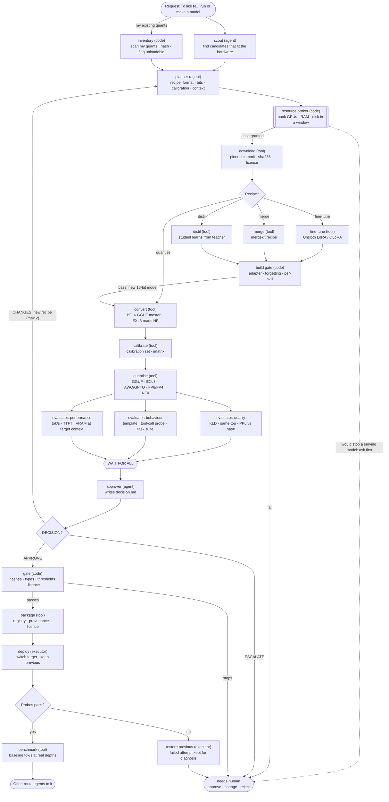
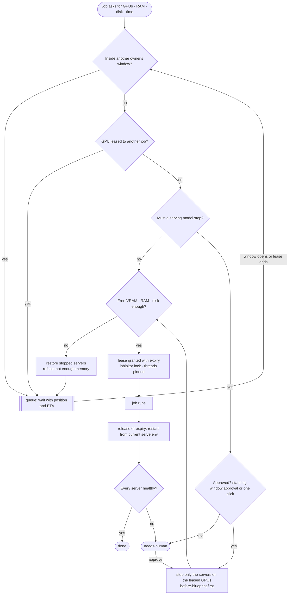

# Model Factory

The Model Factory is one line of **Seraphina OS Harness** (DESIGN.md §29 and
§31.1). It is a set of AI agents and deterministic gates that finds, downloads,
converts, quantises, evaluates, packages, deploys and benchmarks local language
models that fit the machine they run on. Fine-tunes, merges and distillation
run as side branches of the same line. A novice should be able to install the
Harness and get a model that fits their GPUs. An expert who has quantised most
of their own models should get the same tools, with every command, number and
file visible.

Written 2026-10-21 from four research areas (quantise, build, evaluate,
deploy) and one end-to-end CPU feasibility run. **This is a design. Nothing in
it ships in the v1 Software Factory yet.** Every step in
[`catalog.json`](catalog.json) carries a `verified_here` flag: `true` means it
ran in the research sandbox (CPU only, tiny models), and `false` means it was
read from source or documentation only. Section 10 lists what needs the
owner's GPUs to verify.

**The persona lineage line**, a branch that imprints a persona's own corpus
onto a pristine base for that persona's decision, is designed separately in
[LINEAGE.md](LINEAGE.md). It reuses the fine-tune, quantise and deploy stages
below.

Target machine ("matrix"): 2x RTX 3090 24 GB (48 GB, NVLink, sm_86),
i9-12900KS, 64 GB RAM, Ubuntu. It serves TabbyAPI (EXL3, about 100 tok/s),
Strata (Qwen3.8-Flash-Next GGUF with experts in VRAM), llama.cpp and
gpt-oss-120b, at 262,144-token contexts, and is reached only over Tailscale.
A read-only capture of it on 2026-10-25 (observed) adds what the toolchain
must plan for: Ubuntu 26.04 with **Python 3.14.4 only**, and no `uv`,
`python3.13`, `cmake`, `nvcc` or `git-lfs` on the host (gcc 15.2 is there); the
system disk has about 71 GB free while the models disk has about 680 GB; both
cards are capped at 325 W; each card sits on a PCIe x8 link; and NVLink shows
as NV4 (§3.0, §3.1, §11 item 12).

**Contents.** 1. What it is · 2. The Grid Card · 3. Stage procedures · 4.
Choosing a format · 5. Will it fit? · 6. Registry and manifest · 7. Resource
broker rules · 8. Gate policy · 9. Feasibility run in this sandbox · 10. What
needs the owner's GPUs · 11. Findings that affect the owner now · 12. Open
questions · 13. Files.

---

## 1. What it is

### 1.1 For a novice

A language model is a very large file of numbers. The original file is usually
too big for a home GPU. A **quant** is a smaller copy: the numbers are stored
with fewer bits (for example 4 instead of 16), so the model fits and runs
faster, at a small cost in quality. Choosing how to shrink a model has many
expert knobs. The Model Factory turns them into a few questions:

1. **Say what you want.** "A better coding model", "run Qwen3 on my GPUs", or
   "make my existing models work with the new TabbyAPI".
2. **See what fits.** The factory already knows your GPUs, RAM and disk. It
   shows cards such as "fits at 128K context, about 60 tokens a second, agrees
   with the original 96% of the time". It never offers something that cannot
   fit.
3. **Approve once.** The factory books the GPUs at a time that does not
   interrupt the models you are using. It downloads the model, makes the quant
   and tests it against the original.
4. **Get a verdict in plain words.** "Agrees with the original 96% of the time,
   calls tools correctly 10 out of 10, 62 tokens a second at 128K." A quant
   that fails a test is never deployed.
5. **Use it, or put the old one back.** The new model goes live with the
   previous one kept. **Restore** puts the old model back in one click. Then
   the factory offers to point your agents at the new model.

You never have to type a command. Every command the factory runs is shown, so
you can learn from it or hand it to an expert.

### 1.2 For an expert who quantises their own models

You keep full control. The factory just stops you losing track:

- **Every format you use, in one line.** GGUF K-quants and IQ-quants with
  imatrix, per-tensor and MoE-expert overrides (`--tensor-type`), MXFP4_MOE;
  EXL3 at any bpw with `-hb`, `-hq`, recipes and calibration traces; EXL2 for
  legacy files; compressed-tensors W4A16/FP8/MXFP4A16/NVFP4A16 for vLLM; GPTQ;
  NF4; HQQ; LoRA adapters; Ollama packages.
- **Measured, not assumed.** KL-divergence and same-top-token agreement
  against BF16 (or Q8_0 when BF16 does not fit) on a fixed held-out text, with
  the KV-cache type the server will really use. The template-parity and
  tool-call probes go through the real server. Tokens/s, time to first token
  and VRAM are measured at 0, 32K, 128K and 262K. PPL is a secondary report,
  because it misleads at low bits (§9).
- **Provenance you can rebuild from.** Every variant has a manifest: base repo
  and 40-hex commit, parent variant, imatrix and calibration hashes, the exact
  command, tool git commits, venv lock hashes, gates and benchmarks. A quant
  with a manifest can be rebuilt instead of backed up (research lesson L70 in
  `docs/seraphina/research/real-server-lessons.md`).
- **Your existing collection first.** The inventory scans the quants you
  already made. It records their format and imatrix provenance from the GGUF
  or EXL3 metadata, hashes them, and flags what current servers can no longer
  load. **TabbyAPI main dropped EXL2 and GPTQ on 2026-07-14** (§11). It also
  flags quants whose BF16 source is gone, so that source can be re-downloaded
  by pinned commit.
- **The GPUs are shared safely.** A resource broker books GPU, RAM and disk.
  It never stops a serving model without approval and puts every stopped
  server back healthy (§7).

### 1.3 Thinking bigger: what the factory makes

"Make a quant" is only the first job. With the same line and gates, the
factory does all of these:

| Job | What the user asks | What the line does |
| --- | ------------------ | ------------------ |
| Run a model that fits | "Run X on my machine" | scout → fit → choose a ready quant or make one → evaluate → deploy |
| Make a ladder | "Give me Q8_0 to IQ2_M of X" | one BF16 master and one imatrix; every rung KLD-gated; the ladder must be monotonic |
| Expert mixes | "Experts at IQ3_XXS, attention Q8_0" | per-tensor regex overrides, checked tensor by tensor against the plan |
| Migrate a collection | "Make my EXL2s work on the new TabbyAPI" | inventory → re-download BF16 by commit → EXL3 at matching bpw → KLD against the old EXL2 and BF16 → deploy, keeping the old TabbyAPI pinned until done |
| Fine-tune | "Teach it our coding style" | dataset gate → LoRA/QLoRA → merge into 16-bit → forgetting gate → back into the quantise line |
| Merge | "Blend these two fine-tunes" | mergekit recipe → identity/determinism checks → per-skill eval vs each parent → quantise line |
| Distil | "A small fast model that answers like the big one" | layer-pruned student → on-policy distillation → KL gate → quantise line |
| Ship small | "Store this fine-tune as an add-on" | LoRA extraction + round-trip check; GGUF LoRA for llama.cpp |
| Package | "Put it in Ollama" / "publish it" | Modelfile with a pinned num_ctx that keeps the GGUF's own tool template; private Hub upload behind a publish gate |
| Re-check after upgrades | (automatic) | after any engine upgrade, re-run smoke + tool probes for every deployed model; drift between registry, servers and routing becomes a Housekeeping card (§31.5) |
| Rebuild from recipe | "The disk died" | every manifest is a recipe; the factory re-fetches by commit, rebuilds with the recorded command and tool commit, then compares sha256, or tensor names/shapes/types plus KLD when the bytes differ (rebuild determinism is not verified yet) |

Two principles carry over from the Software Factory. **Agents interpret, code
decides**: agents choose recipes and explain results, but deterministic gates
re-check every number and no agent can deploy past a failed one.
**Everything has a way back** (§30): deploying keeps the previous model, and
stopping a server for a job is an "undo instantly" action with a
before-blueprint.

### 1.4 How this was made, and its limits

- **Sandbox:** Ubuntu 24.04, 4 shared vCPUs, about 15 GB RAM, no GPU, egress
  through a proxy. GitHub and PyPI worked. huggingface.co, hf-mirror.com,
  modelscope.cn, download.pytorch.org and registry.ollama.ai were refused
  (CONNECT 403). So **no real model was downloaded**. All runs used tiny models
  built locally (a 3.67M-parameter chat model trained for this purpose, a
  4.2M-parameter Llama, a 246K-parameter fixture and a random 4-expert
  Mixtral).
- **Read from source, not run:** exllamav3/exllamav2 (they JIT-compile a CUDA
  extension on import, so even `--help` fails without CUDA), TabbyAPI model
  loading, vLLM, llm-compressor AWQ, Unsloth training, every CUDA flag of
  llama.cpp, and every Hub call.
- **Versions** are exact, as found on 2026-10-21 (§3.0 and `catalog.json`
  `versions`). Flags were read from captured `--help` output where a binary
  could run, otherwise from the argparse source at the pinned commit.
- **Prototype scripts** (gates, fit calculator, broker, deploy, manifest) were
  written and tested in the research scratchpad. They are **not** in this
  repository. `catalog.json` `prototypes` lists where each one is. The design
  names them so they can be ported into the Harness.

---

## 2. The Grid Card

The Grid Card is the canonical map of the line (DESIGN.md §26). It is
delivered to every Model Factory agent with its own node marked (`class <node>
here`), and the GUI renders it from this Mermaid source. Both this map and the
broker map (§7) pass the real Mermaid 11.4.1 parser and the GUI's own subset
parser (`swfactory/web/flows.js` `parseMermaid`: 28 nodes, 38 edges).



**How to read it.**

1. **Agents** (scout, planner, the three evaluators, approver) think and write
   files. **Code** (inventory, broker, build gate, gate) decides. **Tools**
   (download, convert, calibrate, quantise, package, benchmark) run pinned
   commands from a recipe and never free shell. The **executor** (deploy,
   restore) is the only stage that changes a live service. It applies an
   approved change bundle with a before-blueprint (§27, §30).
2. **The three evaluators run in parallel, and the line waits for all of
   them**, as the Software Factory's reviewers do. Each evaluator writes
   `round-<N>/review-<quality|behaviour|performance>.md`, whose first line is
   `VERDICT: PASS` or `VERDICT: CHANGES`, plus its gate JSON files.
3. **CHANGES goes back to the planner** with a concrete recipe change (for
   example "IQ4_XS → Q5_K_M", "cache 4,4 → 8,8" or "imatrix from a larger
   calibration set"). This happens at most 2 times, then needs-human.
4. **The branches** (fine-tune, merge, distil) produce a new 16-bit HF model.
   It passes the build gate and then enters the main line at convert, so it
   is quantised and evaluated like any downloaded model.
5. **The broker can always say "not now".** A job that would stop a serving
   model waits for approval (§7) instead of interrupting the owner.

**Job folder.** Model jobs use the same layout as software jobs (DESIGN §3),
under `<data_dir>/jobs/models/<job-id>/`: `job.json` (orchestrator only),
`request.md`, `candidates.md` (scout), `plan.md` + `plan.json` (planner),
`round-<N>/review-*.md` and `gates/*.json` (evaluators), `decision.md`
(approver), `logs/`. Weights never go in the job folder. They live in the
registry (§6), and scratch files go in `$REG/work/<job-id>/`.

**Factory definition** (the §29 schema; illustrative):

```json
{
  "id": "model",
  "title": "Model Factory",
  "grid_card": "maps/model-line.mmd",
  "stages": [
    {"agent": "model-scout"},
    {"agent": "model-planner"},
    {"broker": "acquire"},
    {"tool": "download", "gate": "snapshot+template"},
    {"branch": {"quantise": [], "finetune": ["ft.dataset", "ft.train", "ft.merge-adapter"],
                "merge": ["merge.mergekit"], "distil": ["distill.trl"]},
     "rejoin": {"gate": "build-gate", "at": "convert"}},
    {"tool": "convert"}, {"tool": "calibrate"}, {"tool": "quantise", "gate": "artifact"},
    {"parallel": ["model-eval-quality", "model-eval-behaviour", "model-eval-performance"]},
    {"agent": "model-approver"},
    {"gate": "model-gate"},
    {"tool": "package"},
    {"executor": "model-server.switch", "on_fail": "model-server.restore"},
    {"tool": "benchmark"},
    {"offer": "route-agents"},
    {"broker": "release"}
  ],
  "loops": [{"on": "CHANGES", "resume": "model-planner", "max": 2}],
  "resources": {"gpu": "lease", "ram": "reserve", "disk": "reserve", "threads": "pinned"},
  "privileges": "executor bundles: model-server.switch, model-server.restore, service.stop/start via the broker",
  "outputs": "registry variant + model profile + optional routing change"
}
```

**Agents and their outputs.**

| Agent | Writes | Reads | Can it change anything live? |
| ----- | ------ | ----- | ---------------------------- |
| model-scout | `candidates.md` (each with commit, licence, gated, params, fit rows) | `request.md`, `hardware.json`, Hub metadata, inventory | no |
| model-planner | `plan.md` (plain language) + `plan.json` (recipe: format, type/bpw, overrides, calibration id, eval id, context, KV type, server, placement flags) | candidates, fit output, engine table, policy | no |
| model-eval-quality | `review-quality.md` + KLD/PPL gate JSON | logs from `llama-perplexity` / exllamav3 / `hf_kld.py` | no |
| model-eval-behaviour | `review-behaviour.md` + smoke, template-parity, tool-probe, task JSON | scratch server on a private port | no (scratch server only, under the lease) |
| model-eval-performance | `review-performance.md` + bench, served-latency, memory JSON | scratch server, nvidia-smi | no |
| model-approver | `decision.md` (`DECISION: APPROVE` / `CHANGES` / `ESCALATE`) + `scorecard.json` | all of the above | no |

---

## 3. Stage procedures

Each stage below has a short description, a working procedure, the commands,
the gate checks, the resources it needs and what was verified. The full detail
of every step (inputs, outputs, every pitfall) is in `catalog.json` under the
step id shown. Variables used in commands:

| Variable | Meaning |
| -------- | ------- |
| `$MF` | Model Factory tool home, e.g. `/opt/seraphina/model-factory` (`venvs/`, `llama.cpp/`, `exllamav3/`, `tabbyAPI/`, `recipes/`, `locks/`, `help/`) |
| `$SF` | the harness checkout (this repository), where `bin/factory` is |
| `$MFS` | the factory's gate and step scripts (prototypes today; see §13) |
| `$LLAMA` / `$LCPP` | llama.cpp source tree / its `build-cuda/bin` (GPU) or `build/bin` (CPU) |
| `$REG` | registry root on the large models filesystem, e.g. `/srv/models` (never the root filesystem) |
| `$NAME`, `$SRC`, `$BF16` | registry model name; `$REG/models/$NAME/hf/bf16`; `$REG/models/$NAME/gguf/BF16/$NAME-BF16.gguf` |
| `$OUT`, `$WORK` | the variant being made; `$REG/work/<job-id>` |
| `$CAL`, `$EVAL`, `$IM` | `$REG/data/calib/<id>.txt`; `$REG/data/eval/<id>.txt`; `$REG/models/$NAME/_shared/imatrix-<calib-id>.gguf` |

Gate scripts run as `python3 -I script.py <paths>`: isolated mode, with every
path passed as an argument and never run from inside a downloaded model
folder. The llama.cpp converters are the one exception. They import their own
sibling package, so they run without `-I`, from the pinned checkout. Gate exit
codes: **0 pass, 1 fail, 2 unparseable** (re-run up to 2 times).

### 3.0 Toolchain (once per machine)

**Tools.** git, cmake, uv 0.11.32, Python 3.13; llama.cpp 8baabd5 (b11785); exllamav3 v1.6.4; exllamav2 0.3.2; TabbyAPI a270c55; Ollama v0.40.7.

Installs the tools in separate, pinned environments, because their library
versions clash. The Setup wizard runs this once and records every version in
the Blueprint.

**When the host lacks the toolchain** (the target machine: no `uv`,
`python3.13`, `cmake`, `nvcc` or `git-lfs`, and only the system's Python 3.14;
observed), the steps below cannot run as written. Two ways, the owner's choice:
(a) an install step the owner runs once, as himself: `uv` (which brings a
managed CPython 3.13 for the venvs, `uv venv -p 3.13`), `cmake`, and a CUDA
toolkit for sm_86, each pinned and recorded; or (b) the whole toolchain in a
pinned CUDA development container, with the models folder bound in and the
registry and `$MF` on the models disk, never a floating image tag. The
`toolchain.*` steps check for each tool first and stop with the missing list
and both choices; they never install system packages themselves. Either way
`$MF`, the venvs and the uv cache go on the models disk (`UV_CACHE_DIR` set
there too), never on the system disk: the venvs and cache alone are
tens of GB (Resources below), and the target's system disk has about 71 GB
free and is shared with Docker (judgement from those figures).

1. **Build llama.cpp at a pinned commit.** Clone, record `git rev-parse HEAD`,
   build the CPU targets, and on a GPU box the CUDA targets for sm_86. Never
   use the build number as the version: a shallow clone always says "build 1".
2. **Create one venv per tool family.** convert, quant, core (build and
   evaluate), merge, lmeval, and on the GPU box unsloth and vllm. Freeze each
   to a lock file and store the lock's sha256.
3. **Fetch the CUDA-only tools at pinned commits.** exllamav3 v1.6.4,
   exllamav2 0.3.2 (legacy only), TabbyAPI a270c55. Keep a second TabbyAPI
   checkout at `79126f9` while any EXL2 model is still served.
4. **Install Ollama** for users who want it, with a private model store bound
   to loopback.
5. **Capture every `--help`** into `$MF/help/`, so agents and gates can check
   flags against the installed build rather than against memory.

```bash
git clone --depth 1 https://github.com/ggml-org/llama.cpp.git $MF/llama.cpp && git -C $MF/llama.cpp rev-parse HEAD
cmake -S $MF/llama.cpp -B $MF/llama.cpp/build -DGGML_NATIVE=ON -DLLAMA_CURL=OFF -DLLAMA_BUILD_TESTS=OFF -DGGML_RPC=ON -DCMAKE_BUILD_TYPE=Release
cmake --build $MF/llama.cpp/build -j4 --target llama-quantize llama-imatrix llama-perplexity llama-gguf-split \
  llama-server llama-bench llama-batched-bench llama-fit-params llama-cli llama-gguf-hash ggml-rpc-server
# GPU box (NOT verified here): -DGGML_CUDA=ON -DCMAKE_CUDA_ARCHITECTURES=86 into build-cuda
uv venv -p python3.13 $MF/venvs/convert && VIRTUAL_ENV=$MF/venvs/convert uv pip install torch==2.11.0 'numpy~=2.2.6' \
  'sentencepiece>=0.1.98,<0.3.0' transformers==4.57.6 'protobuf>=4.21.0,<5.0.0' safetensors tokenizers jinja2 -e $MF/llama.cpp/gguf-py
uv venv -p python3.13 $MF/venvs/quant && VIRTUAL_ENV=$MF/venvs/quant uv pip install torch==2.11.0 transformers==5.17.0 \
  llmcompressor==0.14.0 compressed-tensors==0.19.0 gptqmodel==7.6.0 hqq==0.2.8.post1 bitsandbytes==0.50.2 optimum==2.3.0 sentencepiece
uv venv -p python3.13 $MF/venvs/core && VIRTUAL_ENV=$MF/venvs/core uv pip install torch==2.14.1 transformers==5.20.2 peft==0.21.2 \
  trl==1.16.0 datasets==5.1.0 accelerate==1.15.0 safetensors==0.8.0 gguf==0.19.0 huggingface_hub==2.2.0 hf-xet==1.7.0 sentencepiece protobuf jinja2 numpy
uv venv -p python3.13 $MF/venvs/merge && VIRTUAL_ENV=$MF/venvs/merge uv pip install mergekit==0.1.5
uv venv -p python3.13 $MF/venvs/lmeval && VIRTUAL_ENV=$MF/venvs/lmeval uv pip install 'lm-eval[api]==0.4.13' 'gguf==0.19.0'
git clone --depth 1 --branch v1.6.4 https://github.com/turboderp-org/exllamav3.git $MF/exllamav3   # then: uv venv && uv sync --extra cu128 (CUDA)
git clone https://github.com/theroyallab/tabbyAPI $MF/tabbyAPI && git -C $MF/tabbyAPI checkout a270c55
mkdir -p /opt/ollama && curl -fsSL https://github.com/ollama/ollama/releases/download/v0.40.7/ollama-linux-amd64.tar.zst | zstd -dc | tar -x -C /opt/ollama
for v in convert quant core merge lmeval; do VIRTUAL_ENV=$MF/venvs/$v uv pip freeze > $MF/locks/$v.txt; done; sha256sum $MF/locks/*.txt > $MF/locks/SHA256SUMS
```

| venv | Pins (2026-10-21) | Why separate |
| ---- | ----------------- | ------------ |
| convert | torch 2.11.0, transformers 4.57.6, protobuf <5, numpy 2.2.6, gguf-py from the llama.cpp checkout (0.19.0) | llama.cpp's converter pins transformers 4.57.6 |
| quant | torch 2.11.0, transformers 5.17.0, llmcompressor 0.14.0, compressed-tensors 0.19.0, gptqmodel 7.6.0, hqq 0.2.8.post1, bitsandbytes 0.50.2, optimum 2.3.0 | llmcompressor needs transformers 5.15-5.17 and compressed-tensors 0.19.0 |
| core | torch 2.14.1, transformers 5.20.2, peft 0.21.2, trl 1.16.0, datasets 5.1.0, huggingface_hub 2.2.0 (`hf` CLI only), gguf 0.19.0 | latest training and Hub stack |
| merge | mergekit 0.1.5 (git c91c787) | its own torch |
| lmeval | lm-eval[api] 0.4.13, gguf 0.19.0 | evaluation harness |
| unsloth (GPU) | unsloth 2026.10.7 + unsloth_zoo 2026.10.7 | needs transformers <=5.17.0, trl <=1.15.0, datasets <5.0.0, torch <2.15.0 |
| vllm (GPU) | vllm 0.32.0 | pins torch 2.13.0, compressed-tensors 0.17.0, transformers <5.20; never install llmcompressor here |

**Gate checks.** `llama-cli --version` shows the pinned commit. Every target's
`--help` exits 0, and `llama-quantize --help` lists Q4_K_M, IQ4_XS, MXFP4_MOE
and Q1_0. Every venv imports its packages at exactly the pinned versions.
`unsloth --version` prints `unsloth 2026.10.7`. `ollama --version` shows
0.40.7.

**Resources.** llama.cpp CPU build: 7-15 min on 4 shared vCPUs (measured
three times), about 5 GB RAM, 80 MB build dir. Venvs: 4.6-5.7 GB each for the
torch ones, because the PyPI torch wheel pulls about 4-5 GB of CUDA 13
libraries even on CPU. uv hard-links its cache, so a venv on the same torch
version costs almost nothing. The uv cache is about 8 GB. Ollama: 1.5 GB
download, about 4 GB on disk with GPU libraries.

**Pitfalls.** llama-server's web UI is downloaded from huggingface.co at build
time. Offline, the build still succeeds but embeds 0 assets (the API works, a
novice gets no page). Without protobuf, transformers 5 fails on SentencePiece
tokenizers with a misleading "`tiktoken` is required" error. **Unsloth's
`unsloth_cli/*` and `studio/*` are AGPL-3.0-only** although the wheel says
Apache-2.0, so do not bundle Unsloth Studio without a licence decision. Pin
`OMP_NUM_THREADS` and llama.cpp `-t` per job: oversubscription made a torch
step 20x slower (10 s vs 0.5 s) on the shared box.

**Verified here:** CPU llama.cpp build, every CPU venv, Ollama CPU extract.
**Not verified:** CUDA build, exllamav3/TabbyAPI runtime, unsloth and vllm
venvs. Steps: `toolchain.llamacpp`, `toolchain.venvs`,
`toolchain.exllama-tabby`, `toolchain.ollama`.

### 3.1 Request, hardware and inventory

**Tools.** nvidia-smi; `llama-server --list-devices` (b11785); `gguf_gate.py` and `hf_quant_gate.py` (stdlib + gguf-py 0.19.0; headers only).

The user says what they want. Code records the hardware, and for an existing
collection, what is already there.

1. **Record the request verbatim** in `request.md` (goal, task, preferred
   server, context, users at once).
2. **Detect the hardware** into `hardware.json`: GPUs by UUID (never by
   index: the target's index order changed between two boots, observed), free
   VRAM per GPU *and which services hold it*, each card's enforced power limit
   (`power.limit`; the target's cards are capped at 325 W, observed) and its
   PCIe link width (x8 on the target, observed), NVLink, RAM, CPU threads, free
   disk on `$REG`.
3. **Inventory existing quants** when asked (or on first install). It reads
   headers only, never loads weights, records the format, bpw, imatrix
   provenance, EXL3 version and bits, and sha256 per file. It quarantines
   truncated or missing shards.
4. **Flag what current servers cannot load**: `quant_method` exl2 or gptq on
   TabbyAPI after c8b9a8f. Also flag quants with no BF16 parent (the source must
   be re-downloaded by commit, never re-quantised from the quant), and owner
   quants with no recipe (these must stay in the backups until a manifest
   exists).

```bash
nvidia-smi --query-gpu=index,uuid,name,memory.total,memory.free,power.limit,pcie.link.gen.current,pcie.link.width.current --format=csv,noheader,nounits
nvidia-smi topo -m                                        # NV# between GPU0 and GPU1 = NVLink
nvidia-smi --query-compute-apps=pid,gpu_uuid,used_memory --format=csv,noheader,nounits
$LCPP/llama-server --list-devices
grep -E 'MemTotal|MemAvailable' /proc/meminfo; nproc; df -B1 --output=avail $REG
for f in $(find $MODELS -name '*.gguf' | grep -v -E -- '-000(0[2-9]|[1-9][0-9])-of-'); do
  $MF/venvs/convert/bin/python -I $MFS/gguf_gate.py "$f" --sha256 --json "$REG/inventory/$(basename "$f").json"; done
for d in $(find $MODELS -name config.json -printf '%h\n' | sort -u); do
  python3 -I $MFS/hf_quant_gate.py "$d" --sha256 --json "$REG/inventory/$(basename "$d").json"; done
```

**Gate checks.** The nvidia-smi rows match the CUDA devices llama.cpp lists.
`gguf_gate` exit 2 means a truncated or unreadable file or a missing shard
(verified by deleting shard 2 of 3), and the file is quarantined. A
`file_type` other than F32/F16/BF16 means "quantized": never a source for
further quantisation. An IQ1/IQ2/IQ3_XXS/Q2_K_S file without imatrix keys is
flagged. `hf_quant_gate`: index consistent, tokenizer present, chat template
present.

**Resources.** Seconds per model for headers. sha256 runs at disk speed, about
1-2 GB/s on NVMe (70 GB in about a minute). No GPU.

**Pitfalls.** Free VRAM is a moment in time: record which services held it.
De-duplicate by tensor names, shapes and types, because a split-then-merged
GGUF is not byte-identical (verified). In this sandbox nvidia-smi exists but
fails with rc=9. That is a real "GPU state unknown" case, and it must fail
closed.

**Verified here:** inventory gates on locally made GGUF and HF quants,
including a deleted-shard test. **Not verified:** nvidia-smi on a real driver.
Steps: `hw.detect`, `inventory.existing-quants`.

### 3.2 Scout (agent): find candidates that fit

**Tools.** agent model-scout; `hf` CLI and `HfApi` (huggingface_hub 2.2.0); `fetch_pinned.py --plan-only`; `fit_calc.py`.

1. **Search the Hub** by family, size range, pipeline tag and runtime
   (`--apps llama.cpp` for ready GGUF repos), sorted by downloads or trend.
2. **Pin every candidate**: 40-hex `sha`, licence (`cardData.license`, and
   `license_name` + `license_link` for "other"), gated status, parameter count
   from `safetensors.total`, file list, `config.auto_map` (custom code), pickle
   files.
3. **Run the fit calculator on each** from its `config.json` and a target bpw
   (§5). Drop what cannot fit at the requested context.
4. **Check access and licence.** Log in with the user's read token. Run
   `auth_check`, which raises until a gated licence is accepted on the website.
   Compare the licence with the allow-list. Anything custom, gated or
   non-commercial becomes a plain-language card.
5. **Write `candidates.md`**: for each one, what fits, what it costs (context,
   speed, co-resident models) and whether a quant must be made or a ready one
   exists.

```bash
hf models ls --search qwen3 --author Qwen --pipeline-tag text-generation --num-parameters min:6B,max:40B --sort downloads \
  --limit 20 --expand sha,gated,cardData,safetensors,downloads,lastModified,library_name,baseModels --format json > $WORK/candidates.json
hf models ls --apps llama.cpp --search qwen3 --sort trending_score --limit 20 --format json
hf models info <repo> --expand sha,gated,cardData,safetensors,siblings,config,baseModels --format json > $WORK/info.json
hf models card <repo> --metadata --format json
hf auth login --token "$HF_TOKEN"; hf auth whoami
$MF/venvs/core/bin/python -I -c "from huggingface_hub import HfApi; HfApi().auth_check('<repo>')"
$MF/venvs/core/bin/python -I $MFS/fetch_pinned.py <repo> $SRC --plan-only --allow-licenses apache-2.0,mit,bsd-3-clause
```

**Gate checks.** `sha` matches `^[0-9a-f]{40}$`. A licence is present ("other"
needs a name and link). Gated status is recorded, and anything but `false`
needs the user. The estimated BF16 download (2 × params) is at most 90% of
free disk. `auto_map` present means custom code (needs-human). Pickle files
are excluded by default. `fetch_pinned.py --plan-only` exits 0 ok, 1 licence
not allowed, 2 network, 3 gated (a needs-human card with the model URL), 4 not
found, 5 disk.

**Resources.** Metadata only; seconds; no GPU.

**Pitfalls.** Gated "manual" approval can take days, so the job waits (it is
resumable) rather than failing. `HF_TOKEN` in the environment overrides the
stored token. huggingface_hub 2.2.0 has only the `hf` CLI (no
`huggingface-cli`). Pre-made community quants are allowed as candidates, but
they get the same gates as the factory's own quants.

**Verified here:** none against the Hub (blocked). The flags come from `hf
--help`, and the exit-2 network path ran. Steps: `scout.search`,
`scout.access-licence`.

### 3.3 Planner (agent): recipe, context and fit

**Tools.** agent model-planner; `fit_calc.py`; `llama-quantize --dry-run` and `llama-fit-params` (b11785); exllamav3 `util/size_estimation.py` (1.6.4); the engine table.

1. **Match the engine to the format** before anything is downloaded: GGUF →
   llama-server (first), Ollama or Strata; EXL3 → TabbyAPI main; EXL2 → only
   the pinned old TabbyAPI; AWQ/GPTQ/compressed-tensors/FP8/gpt-oss MXFP4 →
   vLLM. Refuse W8A8 FP8 and W4A4 FP4 on sm_86, or fall back to weight-only.
2. **Choose the format with §4**, then the bits. Choose the KV-cache type at
   the same time, because at 262K the KV cache can be larger than the weights.
3. **Run the fit calculator** for each candidate recipe at each target context
   (§5). For MoE, find the smallest `--n-cpu-moe` and the matching `-ts`.
4. **Plan calibration**: which calibration set (a fresh one or an existing id),
   which held-out eval text, and whether an imatrix is needed. It is required
   for IQ1_*/IQ2_XXS/XS/S/IQ3_XXS/Q2_K_S and an A/B option for others.
5. **Book resources** through the broker (§3.4), with GPU minutes, VRAM, RAM,
   disk and threads estimated from §5.
6. **Write `plan.md` and `plan.json`.** The plain-language card goes first
   ("Q5_K_M, fits 128K on both GPUs with 13 expert layers in RAM, about 40 GB
   of disk, about 25 minutes"). Then the exact recipe: commands, flags, and
   the gates with their thresholds.

```bash
$MF/venvs/convert/bin/python -I $MFS/fit_calc.py --hf-config $WORK/config.json --bpw 4.25 --head-bits 8 \
  --gpus 24576,24576 --ram 65536 --ctx 131072 --ncmoe auto                      # before download/quantising
$MF/venvs/convert/bin/python -I $MFS/fit_calc.py --hf-config $WORK/config.json --bpw 4.0 --engine exl3 --cache-bits 8,8 \
  --gpus 24576,24576 --ctx 262144 --split tensor                                # TabbyAPI/EXL3
$MF/venvs/convert/bin/python -I $MFS/fit_calc.py --gguf $OUT/model.gguf --gpus 24576,24576 --ram 65536 \
  --ctx 32768,131072,262144 --ctk q8_0 --ctv q8_0 --np 1 --ubatch 512 --ncmoe auto --margin 1024 --server --out $WORK/fit.json
$LCPP/llama-quantize --dry-run $BF16 Q4_K_M                                    # 'quant size = X MiB (Y BPW)', writes nothing
$LCPP/llama-fit-params -m $OUT/model.gguf -c 131072 -ctk q8_0 -ctv q8_0 -fa on --fit-print on   # exact, on the target box
```

**Gate checks.** The format is in the chosen engine's accepted list. Every
GPU passes: weights + KV + compute + 1024 MiB ≤ free VRAM. Hybrid MoE:
CPU-resident experts + `--cache-ram` + 8 GiB headroom ≤ RAM. No
imatrix-required type is planned without an imatrix. A context larger than
`n_ctx_train` warns (llama-server would cap it). The calculator agrees with
`llama-fit-params` within max(2 MiB, 5%), or the job is flagged "calculator
drift" for that architecture.

**Resources.** Milliseconds to 2 s; no GPU (the dry run needs the BF16 GGUF
to exist).

**Verified here:** the calculator agreed with `llama-fit-params` on two tiny
models over two RPC devices standing in for GPUs (for `-ngl 99`, `-ts 3,1`,
`-ngl 2`, q8_0 KV and `-ncmoe 0/1/2`), and the dry run worked. **Not
verified:** EXL3 size estimation, and real GPUs. Steps: `plan.engine-match`,
`plan.fit-estimate`, `plan.fit-exact`.

### 3.4 Resource broker booking (code)

**Tools.** `mf_broker.py` (prototype, stdlib, flock-serialised JSON state); nvidia-smi; `systemd-inhibit` (systemd 255).

1. **Ask for a lease**: job id, owner, GPUs, minutes, VRAM, RAM, disk, CPU
   threads.
2. **Refuse inside another owner's window** (exit 10) or on a GPU leased to
   another job (exit 11). The job waits in the queue with its position and
   ETA.
3. **Ask before stopping a serving model.** If a serving model must stop, the
   lease needs a standing approval on the current maintenance window for that
   service, or a one-click approval. Without one, the job becomes needs-human
   and waits.
4. **Stop only what is on the leased GPUs**, after a before-blueprint. Then
   poll until VRAM stops falling, and check VRAM, RAM and disk. If short,
   restore the servers and refuse (exit 12). If nvidia-smi fails, treat GPU
   state as unknown and refuse (exit 12).
5. **Grant the lease with an expiry**, take a logind inhibitor lock, and pin
   `OMP_NUM_THREADS` / `-t`.

```bash
python3 -I $MFS/mf_broker.py --dir $REG/broker acquire --job quant-0142 --owner model-factory --gpus 1 --minutes 90 --vram-gib 22
python3 -I $MFS/mf_broker.py --dir $REG/broker status
systemd-inhibit --what=shutdown:sleep --who=seraphina-model-factory --why="quantising <name> to EXL3" --mode=block <job command>
```

**Gate checks.** Exit 0 granted, 10 window, 11 busy, 12 not enough VRAM or GPU state unknown (stopped services restored), 13 a service did not come back. After a grant, each stopped service's `is_running_cmd` fails while services on other GPUs still answer `/health` (verified).

**Resources.** Negligible for the broker itself. Stopping a serving model costs its reload later (about 10 s to several minutes for 40-60 GB from NVMe).

The full rules are in §7. **Verified here:** windows, busy GPUs, VRAM
shortfall, unknown GPU state, restore after failure, release and reaping, with
sandbox services and a fixture nvidia-smi. **Design only:** the approval rule,
RAM/disk/thread reservations, the queue. Steps: `broker.acquire`,
`broker.release`.

### 3.5 Download (tool) and pre-GPU checks (code)

**Tools.** `fetch_pinned.py` or `hf download` + `hf cache verify` (huggingface_hub 2.2.0, hf-xet 1.7.0); `mf_gates.py snapshot`; `template_probe.py` (transformers 5.20.2, jinja2 3.1.6).

1. **Resolve the branch to a commit once**, then download by commit. Fetching
   `main` twice can mix files from two commits.
2. **Download only what is needed**: safetensors, JSON configs, `*.jinja`,
   tokenizer files, LICENSE, README. Exclude `original/*` and pickles.
3. **Verify every byte.** LFS files are checked by sha256 against the Hub;
   other files by git blob sha1 (`sha1('blob <size>\0' + bytes)`, the same as
   `git hash-object`). Write `source.json`.
4. **Gate the folder before any GPU time.** Each safetensors header must
   account for the file size. The index must agree with the shards. The
   tokenizer must load, the eos token must match the generation config, and
   the context must be supported.
5. **Probe the chat template offline.** Multi-turn kept, generation prompt
   appended, tool schema, tool call and tool result rendered. Record the
   template sha256, so later steps prove the template was not changed.

```bash
$MF/venvs/core/bin/python -I $MFS/fetch_pinned.py <repo> $SRC --revision main --include '*.safetensors' --include '*.json' \
  --include '*.jinja' --include 'tokenizer*' --include 'LICENSE*' --include 'README.md' --exclude 'original/*' --allow-licenses apache-2.0,mit
hf download <repo> --revision <40-hex sha> --local-dir $SRC --include '*.safetensors' --include '*.json' --include 'tokenizer*' --max-workers 8
$MF/venvs/core/bin/python -I $MFS/fetch_pinned.py --verify-only $SRC
$MF/venvs/core/bin/python -I $MFS/mf_gates.py snapshot $SRC --load-tokenizer --expect-ctx 262144
$MF/venvs/core/bin/python -I $MFS/template_probe.py $SRC --require-tools
```

**Gate checks.** `source.json.commit` is 40-hex and equals the pin. Every
file's hash and size match the Hub. A 1-byte corruption fails and names the
shard (verified). No pickles. The snapshot gate catches a truncated shard, a
missing shard, `pytorch_model.bin`, an eos mismatch and a wrong index
`total_size` (each verified). The template probe fails hard if a turn is lost,
and for agent models if the tool schema, call or result is not rendered.

**Resources.** Disk about 2 bytes/param for BF16 (8B ≈ 16 GB, 32B ≈ 64 GB,
70B ≈ 141 GB), plus 5% plus 1 GiB. Hashing is one full read. The gates take
seconds at any size. No GPU.

**Findings from 10 real templates.** None has `` markers, so
TRL assistant-only loss fails on all of them. Qwen3, Qwen3.5 and gpt-oss are
not prefix-stable. DeepSeek-V3.1 does not render the `tools=` schema. Mistral
needs 9-character alphanumeric tool-call ids. Mistral-Nemo appends no
assistant header (by design).

**Pitfalls.** `hf download --local-dir` writes `.cache/huggingface/` metadata,
which `hf cache verify --fail-on-extra-files` reports as extra (reproduced).
transformers 5 keeps the template in `chat_template.jinja`, older repos in
`tokenizer_config.json`, so check all three places.

**Verified here:** the verifier (offline), the snapshot gate, the template
probe. **Not verified:** the download itself. Steps: `download.pinned`,
`download.snapshot-gate`, `download.template-probe`.

### 3.6 Convert (tool)

**Tools.** `convert_hf_to_gguf.py` from llama.cpp 8baabd5 with its bundled gguf-py (venvs/convert: transformers 4.57.6, torch 2.11.0); `llama-gguf-split`; `gguf_gate.py`.

1. **Convert HF to a BF16 GGUF master** with the pinned llama.cpp converter,
   run from its own checkout. Pass a `--metadata` file, so `general.name`,
   licence and base models are right inside the file.
2. **Split when needed** (`--split-max-size 48G`), keeping the
   `-0000k-of-0000N` names that llama-server and Ollama rely on.
3. **Gate the master** against the HF folder: tensor count, block count,
   context length, vocabulary, chat template, eos and add_bos.
4. **Keep the HF folder as the real master.** EXL3, llm-compressor and
   GPTQModel read safetensors directly, and the BF16 GGUF can be pruned after
   the ladder because it re-converts in minutes.

```bash
$MF/venvs/convert/bin/python $LLAMA/convert_hf_to_gguf.py $SRC --outtype bf16 --outfile $BF16 --metadata $WORK/gguf-meta.json
$MF/venvs/convert/bin/python $LLAMA/convert_hf_to_gguf.py $SRC --outtype bf16 --split-max-size 48G --outfile $WORK/$NAME-BF16.gguf
$MF/venvs/convert/bin/python -I $MFS/gguf_gate.py $BF16 --expect-ftype BF16 --require-chat-template --sha256
$LCPP/llama-gguf-split --merge <first-shard> <merged.gguf>     # or --split --split-max-size 48G IN OUTPREFIX
```

**Gate checks.** Exit 0 and "Model successfully exported". No
`BPE pre-tokenizer was not recognized` and no `chkhsh` line: an unknown BPE
tokenizer gave exit 1 and no file (verified). In that case, show the chkhsh
and upgrade llama.cpp rather than patching it. GGUF version 3. Architecture as
expected (Mixtral reports `llama`, so gate MoE on the expert tensors).
`tensor_count` equals the safetensors count. Norms stay F32. `block_count` and
`context_length` match `config.json`. `chat_template` is present. eos is the
chat end token (`<|im_end|>` = 4 on the feasibility model). Every shard is
present.

**Resources.** CPU only. Output about 2 bytes/param. RAM is modest in lazy
mode (`--use-temp-file` if it is killed for memory). I/O-bound: a few minutes
per 50 GB on NVMe (estimate); 6 s for the 3.7M model.

**Pitfalls.** Some new models need transformers 5 in the convert venv, which
breaks the pin, so record it in the manifest. gpt-oss MXFP4 experts are
repacked losslessly, so never re-quantise gpt-oss. FP8 checkpoints are
dequantised to BF16 unless `--fp8-as-q8` is given. Other converter flags:
`--mtp/--no-mtp`, `--fuse-gate-up-exps`, `--remote`, `--dry-run`,
`--print-supported-models`, `--mmproj` (vision projector, not verified).

**Verified here:** conversion of three tiny models, auto and bf16 out-types,
split and merge, the metadata file, and the BPE negative test. Steps:
`convert.gguf`, `convert.gguf-split`.

### 3.7 Calibrate and imatrix (tool)

**Tools.** `llama-imatrix` (b11785); `build_calib.py` (to be written); `sort`, `comm`, `sha256sum`.

1. **Build the calibration text** from mixed prose, code, multilingual text
   and the model's **own chat template** rendered over sample conversations,
   including tool calls. Aim for 100-200 chunks × 512 tokens for an imatrix,
   and 256-512 samples × 2048 tokens for GPTQ/AWQ.
2. **Build or reuse the held-out eval text.** It is fixed and versioned, the
   same for every candidate, and has no line in common with the calibration
   text.
3. **Compute one imatrix per model** for the whole ladder, so the quants
   differ only by type. Use `--parse-special` when the text contains special
   tokens.
4. **Check coverage.** The entry count must equal the quantisable weights. No
   non-expert tensor may be skipped. For MoE, every expert tensor must have at
   least 50% coverage (an assumed threshold).
5. **A/B the imatrix**: quantise one type with and without it and compare KLD
   (§3.9). Keep it only if it helps.

```bash
sort -u $CAL > $WORK/c && sort -u $EVAL > $WORK/e && comm -12 $WORK/c $WORK/e | grep -c .   # must print 0
sha256sum $CAL $EVAL > $REG/data/data.sha256
$LCPP/llama-imatrix -m $BF16 -f $CAL -o $IM -c 512 --chunks 200 -ngl 99 -t 8 --parse-special
$LCPP/llama-imatrix -m $BF16 --in-file $IM --show-statistics
# MoE larger than VRAM: add -ot 'exps=CPU' or --n-cpu-moe N; BF16 larger than VRAM+RAM: use -m <Q8_0.gguf>
```

**Gate checks.** The calibration and eval texts overlap in 0 lines. The
calibration text has at least chunks × ctx tokens. The imatrix GGUF has
`general.type == imatrix`, `imatrix.chunk_count` at least the planned chunks
and `imatrix.datasets == [$CAL]` (verified). "Final estimate: PPL" is finite.
A missing token_embd entry is expected with tied embeddings when
`--process-output` is off.

**Resources.** One forward pass over chunks × ctx tokens (about 100K tokens).
Minutes all-GPU. MoE with experts on CPU is about 5-20x slower (estimate).
CPU only for the text work.

**Pitfall, measured.** Too little calibration text is worse than none. The
feasibility run's 1,664-token set made Q4_K_M slightly *worse* with the
imatrix (KLD 0.001028) than without (0.001004). With a larger set on another
tiny model, the imatrix helped (0.00157 vs 0.00172).

**Verified here:** imatrix on dense and MoE tiny models, statistics and
provenance keys. **Not verified:** `build_calib.py` (not written yet) and GPU
runs. Steps: `calib.data`, `calib.imatrix`.

### 3.8 Quantise (tool) and the artifact gate (code)

**Tools.** `llama-quantize` (b11785); exllamav3 1.6.4 `convert.py`, `util/recompile.py`, `sc_*.py`; exllamav2 0.3.2; llm-compressor 0.14.0 + compressed-tensors 0.19.0; GPTQModel 7.6.0; bitsandbytes 0.50.2; hqq 0.2.8.post1; `gguf_gate.py`, `hf_quant_gate.py`.

Quantisation writes into `$WORK`. The variant is moved into the registry only
after the gates pass.

**GGUF (llama-quantize, CPU).**

1. **Quantise from the BF16 master only.** Re-quantising a quant needs
   explicit approval (`--allow-requantize` "can severely reduce quality").
2. **Use the imatrix** for every IQ type, and for others when the A/B says so.
3. **Apply per-tensor overrides** in the order planned. The first matching
   regex wins (`std::regex_search` on the tensor name), so specific patterns
   go first.
4. **Read the log.** Parse `quant size = X MiB (Y BPW)` and any `N of M
   tensor(s) required fallback quantization`. Label the variant by the
   *measured* BPW.
5. **Run the artifact gate**: same tensor names and shapes as BF16, expected
   types for the quant and for each override, imatrix keys present, template
   and vocabulary unchanged, sha256 recorded.

```bash
$LCPP/llama-quantize $BF16 $OUT/$NAME-Q4_K_M.gguf Q4_K_M $(nproc)                                  # in [out] type [threads]
$LCPP/llama-quantize --imatrix $IM $BF16 $OUT/$NAME-IQ4_XS.gguf IQ4_XS $(nproc)
$LCPP/llama-quantize --imatrix $IM --output-tensor-type q8_0 --token-embedding-type q6_K $BF16 $OUT/$NAME-Q4_K_M-hq.gguf Q4_K_M $(nproc)
$LCPP/llama-quantize --imatrix $IM --tensor-type 'ffn_(gate|up)_exps=iq3_xxs' --tensor-type 'ffn_down_exps=iq4_xs' \
  --tensor-type 'attn_.*=q8_0' --tensor-type 'shexp=q8_0' $BF16 $OUT/$NAME-moe-mix.gguf Q4_K_M $(nproc)   # MoE mix
$LCPP/llama-quantize $BF16 $OUT/$NAME-MXFP4_MOE.gguf MXFP4_MOE                                         # experts MXFP4, rest Q8_0
$LCPP/llama-quantize --keep-split $WORK/$NAME-BF16-00001-of-00003.gguf $OUT/$NAME-Q4_K_M.gguf Q4_K_M  # sharded in, sharded out
$MF/venvs/convert/bin/python -I $MFS/gguf_gate.py $OUT/$NAME-Q4_K_M.gguf --base $BF16 --expect-ftype MOSTLY_Q4_K_M \
  --expect-type 'ffn_down_exps=Q5_K' --require-imatrix --sha256 --json $WORK/gate-Q4_K_M.json
```

Relative quantise time against Q4_K_M with imatrix (measured): Q8_0 0.05x,
Q6_K 0.2x, IQ4_XS 1.8x, IQ3_XXS 4.8x, IQ2_XXS 5.1x, IQ2_M 7.1x, IQ1_M 11.7x.
RAM stays well below model size (the input is mmap'd and one tensor is
processed at a time; `--max-buffer-size` defaults to 8192 MiB).

**EXL3 (exllamav3 1.6.4, CUDA).**

1. **Convert from the HF folder** (never from EXL2 or GGUF) into a fresh `-o`
   folder, because an existing one is overwritten. Use `-d 0,1` to use both
   3090s.
2. **For MoE, consider `-hq`**, which promotes attention and shared experts
   (+0.05-0.10 bpw per the docs). Quantise the embeddings afterwards with
   `util/recompile.py -eb 4` if VRAM is tight.
3. **Resume with `-r`.** It checkpoints every 120 s (`-cpi`).
4. **(Expert, experimental) Optimise a recipe.** Use `sc_trace` → `sc_rfn_probe` →
   `sc_measure` → `sc_optimize` → `convert -rcp`. Keep the result only if its
   KLD beats the plain quant of the same size. Upstream says it is untested on
   MoE, and it fits 2x24 GB only up to about 14B (estimate).
5. **Gate the folder.** `quant_method == exl3`, bits and head_bits as asked,
   `version` = the installed exllamav3, `quantization_config.json` and
   `tokenizer.json` present, size ratio about bits/16.

```bash
cd $MF/exllamav3 && python convert.py -i $SRC -o $WORK/exl3-4.00bpw -w $WORK/exl3-4.00-work -b 4.0 -hb 6 -d 0,1
python convert.py -i $SRC -o $WORK/exl3-4.00bpw-hq -w $WORK/hq-work -b 4.0 -hq -d 0,1      # MoE
python convert.py -w $WORK/exl3-4.00-work -r                                              # resume
python util/recompile.py -i $WORK/exl3-4.00bpw -o $WORK/exl3-4.00bpw-eb4 -eb 4
python3 -I $MFS/hf_quant_gate.py $WORK/exl3-4.00bpw --expect-method exl3 --expect-bits 4.0 --base $SRC
```

Other flags (from the argparse source, because `-h` needs CUDA): `-mb` (MTP
bits), `-vb` (vision bits), `-ngb/-ngf` (n-gram tables for PLE models such as
Qwen3.8-Flash-Next), `-cd/-cr/-cc` (calibration trace, rows and columns),
`-ss` (shard size, an int in the code, not a float as the docs say), `-hb` (a
float in the code), `--out_scales`, `-hess`. Docs: "a couple of minutes for
smaller models, up to a few hours for larger ones (70B+) on a single
high-end consumer GPU".

**vLLM formats (llm-compressor 0.14.0, GPTQModel 7.6.0).**

1. **Choose a scheme that runs on Ampere**: W4A16 (GPTQ or AWQ), FP8_DYNAMIC
   or FP8_BLOCK (vLLM runs it as weight-only W8A16), MXFP4A16 or NVFP4A16. Not
   W4A4 MXFP4/NVFP4: on the tiny model W4A4 MXFP4 had 13x the KLD of NVFP4A16.
2. **Calibrate GPTQ/AWQ** on a local dataset. Named datasets need the Hub. AWQ
   needs CUDA.
3. **For huge or new models with data-free schemes**, use `model_free_ptq`. It
   needs no transformers class.
4. **Gate the folder**: `quant_method` compressed-tensors (or gptq), the format
   matches the scheme, `lm_head` is ignored, and `recipe.yaml` is saved.

```bash
OMP_NUM_THREADS=8 $MF/venvs/quant/bin/python -I $MFS/quant_hf.py llmc-w4a16-gptq $SRC $WORK/w4a16 $CAL
python3 -I $MFS/hf_quant_gate.py $WORK/w4a16 --expect-method compressed-tensors --base $SRC
# GPTQModel: GPTQModel.load(SRC, GPTQConfig(bits=4, group_size=128)).quantize(texts, batch_size=1); .save(OUT)
python3 -I $MFS/hf_quant_gate.py $WORK/gptq --expect-method gptq --expect-bits 4 --expect-suffix qweight
```

**NF4 and HQQ.** bitsandbytes NF4 (`BitsAndBytesConfig(load_in_4bit=True,
bnb_4bit_quant_type='nf4', bnb_4bit_use_double_quant=True)`) is a QLoRA base,
not a serving format. HQQ uses the hqq library directly, because transformers
5.17's `HqqConfig` raises NotImplementedError. No owner server loads HQQ.

**EXL2 (legacy).** exllamav2 0.3.2 with measurement reuse (`-om` once, then
`-m` for every bitrate). Only for the pinned old TabbyAPI.

**Resources.** GGUF quantising is CPU-only, and RAM stays well below model size. Disk = params × bpw / 8 per variant. A 70B K-quant takes roughly 5-15 min on an i9-12900KS (estimate). EXL3 needs CUDA ≥ 12.4, a work dir at least the output size, and RAM equal to the shard size (8192 MB by default). VRAM by width is about 8 GB for 7B and 24 GB for 70B (the EXL2-era guide; an estimate for EXL3). llm-compressor holds one decoder layer plus activations on the GPU and the whole bf16 model in RAM (use disk offload or `model_free_ptq` past 64 GB). GPTQ/AWQ at 512 × 2048 takes tens of minutes for 8B and hours for 70B (estimate). Tiny-model CPU timings: FP8_DYNAMIC 6.5 s, W4A16 GPTQ 25 s, GPTQModel 107 s, NF4 8.4 s, HQQ 8.1 s.

**Gate checks (all formats).** Exit 0. An imatrix-required type without an
imatrix exits 1 with "this quantization requires an importance matrix!"
(verified). The source is BF16/F16/F32. The bpw is within ±0.15 of the plan.
Tensor names and shapes match the base. Every planned override shows up as
the actual type. The template and vocabulary are unchanged. The gate JSON is
written.

**Pitfalls, measured.** K/IQ quants need rows divisible by 256 (32 for
Q8_0/IQ4_NL). Width 576 (e.g. SmolLM2-135M) turned "Q4_K_M" into 5.98 BPW
through fallbacks, and IQ4_XS into iq4_nl at 5.03 BPW, both with exit 0. In a
tiny model `token_embd` (q6_K) dominates the size, so the measured BPW looks
high (Q4_K_M 5.07).

**Verified here:** GGUF Q8_0 down to IQ1_M, overrides, MXFP4_MOE, dry-run,
keep-split; llm-compressor FP8_DYNAMIC, W4A16 GPTQ, MXFP4, NVFP4A16,
model_free FP8_BLOCK; GPTQModel GPTQ; NF4; HQQ. **Not verified:** EXL3, EXL3
recipes, EXL2, AWQ (all CUDA). Steps: `quant.gguf`, `quant.artifact-gate`,
`quant.exl3`, `quant.exl3-recipe`, `quant.exl2-legacy`, `quant.llmcompressor`,
`quant.gptqmodel`, `quant.bnb-nf4`, `quant.hqq`.

### 3.9 Evaluators in parallel, then WAIT FOR ALL

Three evaluator agents run at the same time, each under the job's broker
lease. Each one runs deterministic tools, writes gate JSON files, and writes a
review whose first line is `VERDICT: PASS` or `VERDICT: CHANGES`. The line
waits for all three. The gate (§3.11) re-checks every number from the JSON
files, so an evaluator's prose cannot pass a failed number.

#### 3.9a Quality: KLD, same-top-token and PPL against the base

**Tools.** agent model-eval-quality; `llama-perplexity` (b11785); `ppl_kld_gate.py`; exllamav3 `eval/model_diff.py` and `eval/ppl.py`; `hf_kld.py` (transformers 5.17.0).

1. **Make the reference once per model and eval text.** Run BF16 (or Q8_0
   when BF16 does not fit VRAM+RAM, recorded as the reference) over the
   held-out text. Save its log-probabilities and its own plain PPL.
2. **Sanity-check the reference.** The base measured against itself must give
   KLD 0. This catches a wrong reference file.
3. **Measure every candidate against it** with the same `-c`. Never pass
   `--chunks` in KLD mode, because the tokens come from the reference file.
   One run per candidate gives KLD, same-top and PPL(Q).
4. **Measure the KV-cache cost** with the cache type the server will run
   (`-ctk/-ctv q8_0` or `q4_0`; TabbyAPI `cache_mode`).
5. **Check the ladder.** Within one family, a higher-bpw quant must not be
   more than 10% worse than a lower one. The imatrix variant must not be
   worse than the same type without it (a warning).
6. **EXL3 and HF formats** use their own tools on the **same eval text**, so
   all formats sit on one chart: `eval/model_diff.py` and `eval/ppl.py -g`
   (llama.cpp-equivalent PPL) for EXL3, and `hf_kld.py` for compressed-tensors,
   GPTQ, NF4 and FP4.

```bash
$LCPP/llama-perplexity -m $BF16 -f $EVAL -c 512 -b 512 --chunks 100 -ngl 999 -fa on --fit off -t 8 \
  --kl-divergence-base $WORK/$NAME-base.kld > $WORK/ppl-base.log 2>&1
$LCPP/llama-perplexity -m $BF16 --kl-divergence-base $WORK/$NAME-base.kld --kl-divergence -c 512 -b 512 -t 8    # self-check: KLD 0
$LCPP/llama-perplexity -m $OUT/$NAME-Q4_K_M.gguf --kl-divergence-base $WORK/$NAME-base.kld --kl-divergence -c 512 -b 512 \
  -ngl 999 -fa on --fit off -t 8 [-ctk q8_0 -ctv q8_0] > $WORK/kld-Q4_K_M.log 2>&1
python3 -I $MFS/ppl_kld_gate.py --kld-log $WORK/kld-Q4_K_M.log --max-mean-kld 0.05 --max-p99-kld 0.6 --min-same-top 92 \
  --max-ppl-ratio 1.04 --json $WORK/gates/quality-Q4_K_M.json
cd $MF/exllamav3 && python eval/model_diff.py -ma $SRC -mb $OUT/exl3-4.00bpw -r 100 -l 2048 -d 0   # EXL3 (CUDA)
python eval/ppl.py -m $OUT/exl3-4.00bpw -g -c 512                                                   # EXL3 on the GGUF scale
python eval/model_diff.py -ma $OUT/exl3-4.00bpw -mb $OUT/exl3-4.00bpw -cqs                          # TabbyAPI cache_mode sweep
OMP_NUM_THREADS=8 $MF/venvs/quant/bin/python -I $MFS/hf_kld.py $SRC $OUT/<hf-quant> $EVAL --windows 200 --ctx 2048 --device cuda
```

**Gate checks.** The log contains `====== KL divergence statistics ======` and
`Same top p:`, otherwise exit 2 and re-run (llama-perplexity exited 0 without
the block in 1 of 3 identical runs). Mean KLD, p99 KLD and same-top are within
the class (§8). The PPL ratio uses the base's *own* plain PPL: the KLD-mode
"Mean PPL(base)" came out 0.58% low. It is secondary, and report-only at 3
bits and below. The corpus sha256, ctx and chunks are identical to the
reference.

**Resources.** Reference logit file = `chunks × (n_ctx/2 − 1) × (2 ×
ceil_even(n_vocab) + 8) + chunks × n_ctx × 4 + 20` bytes. That is exact here:
67,108,372 B for 64 × 512 with a 2,048 vocab, and 62.9 MB for 60 × 512. For a
151,936 vocab at 100 × 512 it is about 7.7 GB, so check the disk first and
delete the file afterwards. Compute is one forward pass of chunks × n_ctx
tokens per candidate (GPU minutes). On CPU the tiny models took 3-7.5 s per
pass.

**Why KLD and not PPL (measured).** IQ2_XXS had a PPL ratio of 1.001 (another
run 0.956, "better than base") but the worst KLD and 83.6% top-1. Q8_0 scored
a lower PPL than f16 (102.30 vs 102.31, inside the ±1.76 error bar).

**Verified here:** the full GGUF path on three tiny models (ladder Q8_0
0.00002 / 99.39% → Q4_K_M 0.00128 / 96.11% → Q2_K 0.02039 / 87.73% → IQ2_XXS
0.03197 / 86.03%), KV-cache cost (q8_0 KV +0.000034; q4_0 KV 0.00155, about
the damage of Q4_K_M weights), and `hf_kld.py` for every HF quant. **Not
verified:** exllamav3 eval (CUDA). Steps: `eval.quality-gguf`,
`eval.quality-exl3`, `eval.quality-hf`.

#### 3.9b Behaviour: template parity, tool calls and a small task suite

**Tools.** agent model-eval-behaviour; llama-server (b11785) or TabbyAPI (a270c55) on a scratch port; `probe_toolcall.py`; lm-eval 0.4.13; `llama-perplexity --hellaswag/--winogrande`; `factory models test` and `factory run` (Software Factory v1).

1. **Serve the candidate on a scratch port** (loopback, under the lease), with
   the planned context, slots and cache type. Pass `--host`, `--port`, `-c`
   and `-np` explicitly, set `--fit off`, and poll `/health`.
2. **Check it serves what was planned.** `/v1/models` lists the alias.
   `/props` shows the gated file, the quant type, `chat_template_caps` with
   tools, and `n_ctx` per slot at least the target.
3. **Prove template parity.** The server's `/apply-template` output must
   byte-match the HF jinja rendering of the same messages and tools.
4. **Probe tool calling** at temperature 0, 3 repeats. Cases that must call a
   tool check the right name, JSON that validates against the schema, and the
   *right values*. A case with no tool must produce no tool call and no tool
   markup. After a tool result, the model must answer in text using the
   returned value.
5. **Diff against the base.** The same greedy probe set runs on the base. A
   drop of more than 10 points blocks agent routing.
6. **Run the small task suite**: local generate-until tasks through lm-eval,
   llama.cpp's own multiple-choice scorers, and, for agent models, the
   Software Factory's own todo job on the candidate (3 runs).

```bash
$LCPP/llama-server -m $OUT/$NAME-Q4_K_M.gguf --host 127.0.0.1 --port 18431 -a $NAME-q4km -c 131072 -np 1 \
  -ctk q8_0 -ctv q8_0 -fa on --fit off --metrics -lv 4 --no-webui > $WORK/server.log 2>&1 &
curl -s http://127.0.0.1:18431/health; curl -s http://127.0.0.1:18431/v1/models; curl -s http://127.0.0.1:18431/props; curl -s http://127.0.0.1:18431/slots
curl -s http://127.0.0.1:18431/apply-template -d @$WORK/probe-messages.json
python3 -I $MFS/probe_toolcall.py --base-url http://127.0.0.1:18431/v1 --model $NAME-q4km --repeats 3 --min-pass 0.9 --out $WORK/gates/probe.json
HF_DATASETS_OFFLINE=1 HF_HUB_OFFLINE=1 $MF/venvs/lmeval/bin/lm_eval run --model local-chat-completions \
  --model_args model=$NAME-q4km,base_url=http://127.0.0.1:18431/v1/chat/completions,num_concurrent=4,tokenizer_backend=None \
  --apply_chat_template --include_path $MF/tasks/mf --tasks mf_gen_local --output_path $WORK/lmeval --log_samples
$LCPP/llama-perplexity -m $OUT/$NAME-Q4_K_M.gguf -f hellaswag_val_full.txt --hellaswag --hellaswag-tasks 400 -c 512 -ngl 999
FACTORY_CONFIG=$WORK/cand-config.json $SF/bin/factory models test <key>
FACTORY_CONFIG=$WORK/cand-config.json $SF/bin/factory run todo-fixture \
  'Add clearCompleted() to src/todo.js with a test, and a Clear completed button' --delivery branch
```

**Gate checks.** `/health` 200 within the load timeout. The served id, file
and quant type are correct. Every slot has `n_ctx` ≥ the target (verified
trap: `-c 4096 -np 2` on a model with `n_ctx_train` 1024 gave 1024 per slot
and logged "capping"). Template parity holds. Tool-probe pass rate ≥ 0.9 with
no markup leak and a text answer after the round trip. Task metric ≥ base −
max(0.02, 2 × combined standard error), with identical `task_hashes` and
lm-eval version. The agentic job exits 0 and `node --test` passes.

**Resources.** Model load time plus about 8 requests per repeat. Task suites
scale with samples × generation length (gsm8k single-stream at 100 tok/s is
about 45-90 min; estimate). The agentic job takes minutes to tens of minutes
on one slot.

**Verified here, honestly.** The mechanics only. A mock server passed 4/4,
and the tiny models failed as they should. In the feasibility run the tool
*was* called, with the right name, valid JSON and a schema-valid argument, but
the wrong value ("Europe/London" for Tokyo). With no tools offered it emitted
raw `<tool_call>` markup, and after the tool result it emitted
`<tool_response>` text instead of an answer. f16, Q8_0 and Q4_K_M gave
byte-identical outputs. **IQ4_XS diverged ("America/New_York") at a KLD of
only 0.0012**, which is why behaviour is gated separately. lm-eval
*likelihood* tasks fail against llama-server ("KeyError: 'token_logprobs'"),
so multiple-choice uses llama-perplexity's scorers. **Not verified:** a real
model passing; the agentic job. Steps: `eval.serve-smoke`,
`eval.toolcall-probe`, `eval.task-suite`, `eval.agentic-e2e`.

#### 3.9c Performance: tokens/s, time to first token, VRAM at the target context

**Tools.** agent model-eval-performance; `llama-bench`, `llama-batched-bench` (b11785); `bench_server.py`; `parse_llama_mem.py`; nvidia-smi.

1. **Sweep the bare engine** with llama-bench at depths 0, 8K, 32K and 128K,
   per KV type and split option. Use `-r ≥ 5`, an idle machine, and an
   exclusive broker window.
2. **Measure through the API** what users feel: time to first token and
   decode tok/s at 512, 8K, 32K, 128K and 262K, with a unique nonce and
   `cache_prompt: false` so the prefix cache cannot fake a fast prefill.
3. **Measure real memory.** Parse llama.cpp's own per-device breakdown
   (`-lv 4`) and sample nvidia-smi during the longest run. Compare both with
   the plan's prediction.
4. **Fix the calculator, not the user.** If prediction and reality differ by
   more than max(2 MiB, 5%), flag "calculator drift" for that architecture.

```bash
$LCPP/llama-bench -m $OUT/a.gguf,$OUT/b.gguf -p 512 -n 128 -d 0,8192,32768,131072 -r 5 -fa on -ctk f16,q8_0 -ctv f16,q8_0 \
  -ngl 999 -sm layer -ts 1/1 -o json > $WORK/gates/bench.json        # llama-bench -ts uses '/', -ot uses ';'
$LCPP/llama-batched-bench -m $OUT/model.gguf -c 32768 -b 2048 -ub 512 -npp 512,4096 -ntg 128 -npl 1,2,4 --output-format jsonl
python3 -I $MFS/bench_server.py --base-url http://127.0.0.1:18431/v1 --model $NAME-q4km --depths 512,8192,32768,131072,262144 \
  --gen 128 --repeats 3 --timeout 1800 --out $WORK/gates/bench-server.json
nvidia-smi --query-gpu=timestamp,index,memory.used --format=csv,noheader,nounits -lms 500 > $WORK/vram-peak.csv &
python3 -I $MFS/parse_llama_mem.py $WORK/server.log --predicted $WORK/fit.json --ctx-index 0 --tol 0.05 > $WORK/gates/mem.json
```

**Gate checks.** Every row has `avg_ts > 0` and CV (`stddev_ts / avg_ts`) ≤
0.05. Here the CV reached 136-150% on the shared CPU, which shows why this
check is needed. `build_commit` is the pinned commit. Decode at the target
depth is ≥ the floor (25 tok/s for agent use, owner-set). TTFT at the largest
depth is recorded and shown in words. Per GPU, actual memory is within max(2
MiB, 5%) of predicted, with predicted compute ≥ actual. Peak `memory.used` ≤
total − 256 MiB. No "failed to allocate" lines.

**Resources.** 128K-depth rows dominate. A 262K prefill at 2,000 tok/s is
about 130 s (estimate). One GPU lease.

**Verified here:** the JSON fields, depth sweeps, the noisy-CV case, served
latency against llama-server, and memory accounting against prediction over
two RPC devices. **Not verified:** any real GPU number. Steps:
`eval.perf-engine`, `eval.perf-served`, `eval.perf-memory`.

### 3.10 Approver (agent)

**Tools.** agent model-approver; the scorecard builder (code; design only).

1. **Read every review and gate JSON**, and build `scorecard.json` and its
   card in plain words: "Q4_K_M: agrees with the original 96% of the time,
   fits 128K on your two GPUs with 13 expert layers in RAM, 62 tok/s, tool
   calls 10/10".
2. **Decide.** APPROVE when every required gate passed. CHANGES with one
   concrete recipe change when a better recipe is likely to pass (for example
   a higher bpw, an 8-bit cache, a larger calibration set, or `-hq` for MoE).
   ESCALATE when it needs the user (licence, a trade-off only they can make,
   two CHANGES rounds used up).
3. **Never override a number.** The approver explains and recommends; the
   gate decides.

**Gate checks.** Every required evaluator JSON exists, is newer than the artifact and has `pass == true`. The recorded build commit and tool versions equal the pins. Every score carries its settings (corpus sha256, ctx, chunks, cache type, build). CHANGES loops at most 2 times.

**Resources.** Negligible.

```text
DECISION: CHANGES
Recipe change: IQ4_XS -> Q5_K_M (same imatrix). Why: same-top 90.8% < 92 (class 4); tool probe 0.83 < 0.9.
Expected: about 1.2 GB more VRAM; still fits 128K with -ncmoe 13 -ts 24,13.
```

(An example of the `decision.md` format; the numbers are illustrative.)

The deterministic promotion rule is: artifact.pass and quality.pass and
(behaviour.pass or not agent_use) and fit.pass and memory.pass and perf.pass
and task_delta_ok. **Design only.** Step: `approve.scorecard`.

### 3.11 Gate (code)

**Tools.** `mf_manifest.py verify` (stdlib, with a built-in GGUF reader; gguf-py 0.19.0 when importable); `policy.json`.

1. **Re-hash every file** and compare it with the manifest (size and sha256).
2. **Re-read the GGUF header with two parsers** (a built-in stdlib reader and
   gguf-py). Tensor count, type histogram and `general.file_type` must match
   the manifest.
3. **Check the layout and the licence.** The path must be
   `<name>/<format>/<quant>`, no unlisted files, a licence id present (and a
   human decision for licences outside the allow-list).
4. **Check every threshold** in `policy.json` for the quant's class (§8), the
   behaviour floor for agent models, and at least one benchmark row.
5. **Run again right before every deploy.** This also catches bitrot and
   partial copies.

```bash
python3 -I $MFS/mf_manifest.py verify $REG/models/$NAME/gguf/Q4_K_M/manifest.json --require-evals --require-bench --policy $REG/policy.json
```

**Gate checks.** Exit 0 pass, or 1 fail with a `failed[]` list naming each check. Deploy refuses unless the latest run, on the current files, exited 0.

**Resources.** Disk-bound re-hashing (about 15-30 s for a 30 GB variant). The header parse takes under 1 s even for 100+ GB models.

**Verified here:** one flipped byte fails. A Q8_0 renamed as Q4_K_M fails on
size, sha, tensor types (`{F32: 9, Q8_0: 30}`) and `file_type` 7. Step:
`gate.registry`.

### 3.12 Package (tool)

**Tools.** `mf_manifest.py create`; `make_card.py` and `mf_gates.py card` (huggingface_hub 2.2.0); `ollama create/show` (0.40.7); `sha256sum`.

1. **Move the variant into the registry** with an atomic rename on the same
   filesystem: `$REG/models/<name>/<format>/<quant>/`.
2. **Copy the licence, README and chat template** from the source. Write
   `SHA256SUMS`.
3. **Write `manifest.json`** with provenance (base repo and commit, parent
   manifest sha256, imatrix and calibration ids and hashes), the exact
   command, tool versions and git commits, venv lock hashes, the gate results,
   the hardware, duration, status and an empty `deployments[]` (schema in §6).
   Copy what the file already records about itself (GGUF
   `quantize.imatrix.*`, EXL3 `quantization_config`) instead of re-deriving it.
4. **Write the model card** (`README.md` with Hub front matter, including
   `base_model` and an explicit `base_model_relation`) and `provenance.json`.
   Tool-generated cards are always regenerated: TRL and mergekit write local
   paths or an empty `base_model`.
5. **For Ollama users**, write a Modelfile with a **pinned `num_ctx`** and no
   TEMPLATE line, so the GGUF's own jinja template (with tools) is used. Run
   `ollama create` and prove the blob is the same file.

```bash
python3 -I $MFS/mf_manifest.py create $REG/models/$NAME/gguf/Q5_K_M --name $NAME --format gguf --quant Q5_K_M --licence apache-2.0 \
  --base-repo <repo> --base-revision <40-hex sha> --parent $REG/models/$NAME/hf/bf16/manifest.json --imatrix $IM \
  --imatrix-dataset <calib-id> --tool llama-quantize --tool-version 'b11785 (8baabd5)' --command '<exact argv>'
$MF/venvs/core/bin/python -I $MFS/make_card.py $OUT --name <name> --relation quantized --base <repo>@<40-hex sha> --license apache-2.0 \
  --eval $WORK/scorecard.json --command '<exact argv>' --tool-git $MF/llama.cpp
$MF/venvs/core/bin/python -I $MFS/mf_gates.py card $OUT --derived --allow apache-2.0,mit --require license,base_model_relation
printf 'FROM %s\nPARAMETER num_ctx 262144\nLICENSE """apache-2.0"""\n' $OUT/<file>.gguf > $OUT/Modelfile
ollama create mf-$NAME:q5_k_m -f $OUT/Modelfile && ollama show --modelfile mf-$NAME:q5_k_m | grep '^FROM'
curl -s http://127.0.0.1:11434/api/show -d '{"model":"mf-<name>:q5_k_m"}'
```

**Gate checks.** `manifest.json` parses and lists every file. The parent
sha256 matches. The base revision is 40-hex. The licence file is present. The
card gate fails a derived model whose only base is a local path and refuses
unpinned bases such as `Qwen/Qwen3-8B@main` (verified). The Ollama blob digest
equals the registry sha256 (verified). `/api/show` capabilities include
`tools` (a Go TEMPLATE override without `.Tools` dropped it to `completion`;
verified). `num_ctx` is as planned.

**Resources.** Hashing at disk speed. Ollama copies the GGUF (a second copy
on disk).

**Verified here:** manifest create and verify, card gates, the Ollama package.
**Design:** the extra provenance fields. Steps: `package.manifest`,
`package.card`, `package.ollama`.

### 3.13 Deploy (executor), with the previous model kept

**Tools.** the executor; `mf_deploy.py`, `mf_tabby_load.py`; llama-server (b11785), TabbyAPI (a270c55), vLLM 0.32.0, Ollama 0.40.7; systemd 255 (`systemd-analyze verify`).

Deploying changes a live service, so it is an **executor change bundle** of
class "undo instantly" (§30), with a before-blueprint. The user approves it,
unless a standing approval covers this target in the current window.

1. **Render the server settings and lint them without loading.**
   - **llama-server**: `serve.env` (file and served name) and
     `serve.flags.env` (`LLAMA_ARG_*`), linted with `llama-server --version`.
     That fails on a bad flag (verified: `--no-mmap`, a bare `-fa`,
     `-ctk q3_k`, `LLAMA_ARG_FIT=maybe`).
   - **TabbyAPI**: a `tabby_config.yml` beside the EXL3 weights, checked with
     `GET /v1/model/load_config`, whose `ignored` list catches typos
     (verified: `gpu_spilt`, `no_mmap`).
   - **vLLM**: a full `vllm serve` argv with `--quantization`,
     `--tensor-parallel-size 2`, `--max-model-len` and a registered
     `--tool-call-parser`.
   - **Ollama**: a `:previous` tag.
2. **Re-run the gate**, then switch atomically: save `previous`, point
   `current` at the new variant (temp + rename), and restart (or hot-load
   TabbyAPI).
3. **Prove the new model is the one answering.** `/health` 200, the served id
   is listed, `/props model_path` is under the new variant (this catches an old
   process still answering under the same name), `n_ctx` per slot ≥ target, a
   plain chat works, the tool probe passes, and decode tok/s ≥ the floor.
4. **On any hard failure, restore.** Capture the logs first, then put `current`
   and `serve.env` back, restart, and check the old model the same way (exit
   2). If the restore itself fails, exit 3 and needs-human.
5. **Restore later in one click** for each engine: the symlink toggle for
   llama.cpp/systemd, `ollama cp …:previous …:live`, the previous TabbyAPI
   `model_name`, or `router.ini.prev`.

```bash
(set -a; . $REG/deployments/gpu0-llama/serve.flags.env; set +a; $LCPP/llama-server --version)    # lint
systemd-analyze verify --man=no ~/.config/systemd/user/mf-llama@gpu0-llama.service
python3 -I $MFS/mf_deploy.py deploy --deploy-root $REG/deployments --target gpu0-llama --variant $REG/models/$NAME/gguf/Q5_K_M \
  --restart-cmd 'systemctl --user restart mf-llama@gpu0-llama' --base-url http://127.0.0.1:18081/v1 --model-id $NAME-Q5_K_M \
  --api-key-env LLAMA_KEY --tool-probe required --min-ctx 262144 --min-tps 25 --health-timeout 900
python3 -I $MFS/mf_tabby_load.py --base-url http://127.0.0.1:5000 --admin-key-env TABBY_ADMIN_KEY --model-name $NAME-exl3-4.0bpw --unload-first --timeout 1800
python3 -I $MFS/mf_deploy.py rollback --deploy-root $REG/deployments --target gpu0-llama \
  --restart-cmd 'systemctl --user restart mf-llama@gpu0-llama' --base-url http://127.0.0.1:18081/v1 --api-key-env LLAMA_KEY
```

Example `serve.flags.env` for one GGUF on GPU 0 at 262K:

```bash
LLAMA_ARG_PORT=18081
LLAMA_ARG_CTX_SIZE=262144
LLAMA_ARG_N_PARALLEL=1
LLAMA_ARG_N_GPU_LAYERS=all
LLAMA_ARG_FLASH_ATTN=on
LLAMA_ARG_CACHE_TYPE_K=q8_0
LLAMA_ARG_CACHE_TYPE_V=q8_0
LLAMA_ARG_JINJA=1
LLAMA_ARG_FIT=off
LLAMA_ARG_ENDPOINT_METRICS=1
LLAMA_ARG_API_KEY_FILE=/etc/ai-stack/llama.keys
```

Example `tabby_config.yml` beside an EXL3 variant:

```yaml
model:
  max_seq_len: 262144
  cache_size: 262144
  cache_mode: 8,8
  tensor_parallel: true
  tensor_parallel_backend: nccl
  gpu_split: [22, 24]
  tool_format: auto
```

**Gate checks.** The lint exits 0. Host is loopback or the tailnet only.
`LLAMA_ARG_CTX_SIZE` = context per slot × slots. The TabbyAPI `ignored` list
is empty, `cache_size` is a multiple of 256, and `cache_mode` matches
`^[2-8],[2-8]$` or FP16/Q8/Q6/Q4. The TabbyAPI load stream shows status
`finished`, because **TabbyAPI answers HTTP 200 even when the load fails**
(verified). `history.jsonl` gets one row per attempt. Concurrent deploys on
one target are refused by flock (verified).

**Resources.** Downtime is one restart (the model load time) plus probes (under 10 s on GPU). A failed deploy costs two restarts. A TabbyAPI hot-load needs no restart (tens of seconds for 15-30 GB from NVMe). vLLM takes `gpu_memory_utilization` (0.92) of each GPU up front and 1-5 min to start.

**Traps found.** `-c` is the *total* context shared by the slots, so 262K per
agent with 2 slots needs `-c 524288`. `--fit` is on by default and can
silently cut the context. `--no-mmap`/`--mlock` are gone (use `--load-mode`),
so old unit files fail. The default port is 9931. `/health` is unauthenticated
even with a key. TabbyAPI exits if its port is taken. With `--unload-first`, a
failed TabbyAPI load leaves *nothing* loaded, so the restore must run
immediately. The first prototype left `previous == current` after an
auto-rollback, making Restore a no-op (fixed; kept as a test).

**Verified here:** the full llama-server cycle (deploy → failed tool probe →
auto-rollback → manual Restore), router mode, the Ollama `:previous` tag, and
TabbyAPI lint and load errors without exllamav3. **Not verified:** a TabbyAPI
EXL3 load, tensor parallel over NVLink, any vLLM run. Steps:
`deploy.render-llamacpp`, `deploy.render-tabbyapi`, `deploy.render-vllm`,
`deploy.switch-and-verify`, `deploy.tabby-hotload`, `deploy.rollback-restore`.

### 3.14 Benchmark (tool)

**Tools.** `llama-bench` (b11785); `bench_server.py`; llama-server `/metrics`; nvidia-smi.

1. **Benchmark the deployed model with the production flags**: the same
   cache types, flash-attn setting and split as serving. Depths 0, 32K, 128K
   and 262K, with `-r 3` or more.
2. **Record the baseline** in the manifest's `benchmarks[]` and in the model
   profile (one record, §31.5), with the build commit, GPUs and flags.
3. **Compare with the previous model on the same target.** Decode must be at
   least 0.85x of it, or the user is told plainly what they traded for what.

```bash
$LCPP/llama-bench -m <file>.gguf -ngl 999 -fa on -ctk q8_0 -ctv q8_0 -sm layer -ts 1/1 -p 512 -n 128 -d 0,32768,131072 -r 3 -o json > $WORK/bench.json
python3 -I $MFS/bench_server.py --base-url http://127.0.0.1:18081/v1 --model $NAME-Q5_K_M --api-key "$LLAMA_KEY" \
  --depths 512,32768,131072,262144 --gen 128 --repeats 3 --out $WORK/bench-prod.json
curl -s -H "Authorization: Bearer $LLAMA_KEY" http://127.0.0.1:18081/metrics | grep -E '^llamacpp:(prompt_tokens_seconds|predicted_tokens_seconds)'
```

**Resources.** One GPU lease. Each depth costs one prefill of that many tokens: a 128K prefill takes about 1-3 min at 1-2K tok/s on 3090s (estimate); tg128 takes seconds.

**Gate checks.** The CV is < 0.1. `build_commit` equals the running server.
VRAM after the deepest run is ≤ 0.97 × total per GPU. **Verified here:** the
JSON and timings plumbing on CPU only. Step: `bench.baseline`.

### 3.15 Offer to route agents (the user clicks)

**Tools.** Software Factory `swfactory.settings.update_config`, `factory models`, `factory models test`, `factory doctor --probe` (v1 tree).

1. **Add a provider and a model entry** through the Harness's validated save
   path (`settings.update_config`), with `max_concurrency` = the server's slots
   and `context_tokens` ≤ the per-slot `n_ctx`.
2. **Run the Harness's own Test probes**: `factory models test <key>` (a plain
   reply and a tool call).
3. **Offer, don't switch.** Show the card and let the user choose which tiers
   or agents move. Nothing moves without both probes passing. There is never a
   silent fallback to a hosted model.

```bash
factory models
factory models test <key>      # exit 0 only if it answers AND calls the tool
factory doctor --probe --json
```

**Gate checks.** `factory models test <key>` exits 0 and reports tool calls. `context_tokens` ≤ the per-slot `n_ctx` from `/props`. `max_concurrency` equals the server's slots. An unauthenticated `GET <base_url>/models` is rejected (doctor rule for keyed local servers).

**Resources.** Two short model calls; no downtime.

**Verified here:** `update_config` refuses a bad patch (an unknown provider,
`context_tokens: "lots"`) and saves nothing. `factory models test` fails
cleanly on a tiny model ("tool calls: NO", exit 1). Step: `route.into-harness`.

### 3.16 Watch (scheduled, after deploy)

**Tools.** a systemd timer; `mf_manifest.py verify`; `/health`, `/props`, `/metrics`; `factory doctor --probe`; `ss -ltnpH`.

1. **Check every target on a schedule.** The manifest sha256 equals
   `serve.env MANIFEST_SHA256`, the served id equals the Harness model entry,
   `n_ctx` ≥ `context_tokens`, the slots equal `max_concurrency`, and decode is
   within 15% of the baseline.
2. **Re-run smoke and tool probes after every engine upgrade.** This is how
   the TabbyAPI EXL2 removal would have been caught.
3. **Re-hash deployed and rollback variants weekly** (bitrot).
4. **Turn every mismatch into a Housekeeping card** with the fact, the
   binding and the fix, never a silent problem (§31.5).

```bash
sha256sum $REG/models/<name>/<format>/<quant>/manifest.json            # must equal MANIFEST_SHA256 in serve.env
python3 -I $MFS/mf_manifest.py verify $REG/models/<name>/<format>/<quant>/manifest.json   # weekly bitrot check
curl -s http://127.0.0.1:18081/health; curl -s -H "Authorization: Bearer $KEY" http://127.0.0.1:18081/metrics | grep '^llamacpp:'
curl -s http://127.0.0.1:5000/health                                  # TabbyAPI: status + issues
factory doctor --probe --json; ss -ltnpH                             # nothing beyond 127.0.0.1 / tailnet
```

**Gate checks.** The manifest sha256 matches `serve.env`. The `/v1/models` id equals `MODEL_ID` and the Harness entry. `n_ctx` ≥ `context_tokens`. The slots equal `max_concurrency`. `llamacpp:predicted_tokens_seconds` is within 15% of the baseline. No listener beyond loopback or the tailnet. Idle unloads (`--sleep-idle-seconds`, `OLLAMA_KEEP_ALIVE`) are recorded, so that a slow first call is not reported as a regression.

**Resources.** Seconds per check. The weekly re-hash is disk-bound.

**Design** (the individual probes are verified). Step: `ops.monitor-drift`.

### 3.17 Branch: fine-tune (LoRA / QLoRA)

**Tools.** `mf_gates.py dataset/adapter/diff/ppl`; Unsloth 2026.10.7 (GPU) or TRL 1.16.0 + PEFT 0.21.2 (reference path); `merge_adapter.py`; `mergekit-extract-lora` (0.1.5); llama.cpp `convert_lora_to_gguf.py`.

1. **Gate the dataset.** Format detected, roles valid, last turn is the
   assistant, ≤ 1% over max length, duplicates reported, **0 eval rows in
   training**. Convert to prompt/completion rows: none of the 10 real
   templates has `` markers, so assistant-only loss fails.
2. **Check the recipe without a GPU** (`unsloth train --dry-run`), and store
   the sha256 of the resolved config.
3. **Train on the GPUs under a lease.** QLoRA up to about 14B fits on one
   3090 with room to spare. A dense 27B may fit on one card (Unsloth's guide
   says 24 GB), but the sources conflict, so a dry run on the owner's box
   decides ([LINEAGE.md](LINEAGE.md) §7.2). A 32B (about 26 GB) and a 70B
   are split over both (`device_map='unsloth_balanced'`). 16-bit LoRA only at
   8B or below on one card. For MoE models, see LINEAGE.md §7.2. Check NVLink
   P2P (`nvidia-smi topo -m` shows NV#) before relying on it.
4. **Gate the adapter**: shapes match the base, pair count = layers × target
   modules, safetensors (not .bin).
5. **Merge into the 16-bit base**, never the 4-bit QLoRA base. Prove the
   merged logits equal base+adapter within 1e-4 (fp32), and that only the
   adapted tensors changed.
6. **Gate forgetting and gain**: general-text PPL ≤ base × 1.10 (warn at
   1.05), and answer loss and exact match better than the base on held-out
   rows. Then the model enters the main line at convert.

```bash
$MF/venvs/core/bin/python -I $MFS/mf_gates.py dataset $REG/data/ft/<id>/train.jsonl --tokenizer $SRC --eval-file $REG/data/ft/<id>/eval.jsonl --max-length 4096 --max-trunc 0.01
unsloth doctor --gpus && unsloth train -c $MF/recipes/qlora.yaml --dry-run && unsloth train -c $MF/recipes/qlora.yaml
unsloth export $WORK/outputs/<run> $WORK/<name>-merged -f merged-16bit
$MF/venvs/core/bin/trl sft --config $MF/recipes/sft_lora.yaml            # CPU-verified reference path
$MF/venvs/core/bin/python -I $MFS/mf_gates.py adapter $WORK/lora-<skill> --base $SRC --expect-modules <layers x modules>
$MF/venvs/core/bin/python -I $MFS/merge_adapter.py $SRC $WORK/lora-<skill> $WORK/merged-<skill> --dtype bfloat16 --atol 1e-4
$MF/venvs/core/bin/python -I $MFS/mf_gates.py diff $SRC $WORK/merged-<skill> --expect changed
$MF/venvs/core/bin/python -I $MFS/mf_gates.py ppl $WORK/merged-<skill> --text $REG/data/eval/general.txt --chat $REG/data/ft/<id>/eval.jsonl
HF_HUB_OFFLINE=1 $MF/venvs/merge/bin/mergekit-extract-lora --model $WORK/merged-<skill> --base-model $SRC --out-path $WORK/extracted-lora --max-rank 8
```

**Gate checks.** Dataset: 0 leaked eval rows, ≤ 1% over max length, valid roles (verified: 9 leaked rows and 97% duplicates were found in a synthetic set). Recipe: `--dry-run` exit 0. Training: no NaN, and the last loss is below the first. Adapter: shapes and pair count. Merge: logit difference ≤ 1e-4, only adapted tensors changed (verified 28 changed / 11 identical). Forgetting: PPL ≤ base × 1.10, with gain on held-out rows. Extraction: the round trip is within bf16 rounding.

**Resources.** The Unsloth docs' minimum VRAM (from search results; the page
could not be fetched): QLoRA 8B ≈ 6 GB, 14B ≈ 8.5 GB, 32B ≈ 26 GB, 70B ≈ 41
GB; 16-bit LoRA 8B ≈ 22 GB, 14B ≈ 33 GB, 32B ≈ 76 GB, 70B ≈ 164 GB (the 14B
and 32B rows read from search results on 2026-10-25, which corrected an
earlier "32B fits on one 3090"). A rank-16 all-linear adapter for 8B is about 87 MB (computed).
The merge needs 2-4 bytes/param of RAM and one more model copy on disk.

**Measured here (fixture, CPU).** TRL LoRA SFT: loss 3.695 → 1.098 in 60
steps (13.6 s). The adapter was 77.8 KB. The merge logit difference was 7.2e-6.
**The forgetting gate fired correctly**: general PPL 8.56 → 18.68 (+118%)
while answer loss fell from 6.46 to 1.25. LoRA extraction round trip: max
diff 0.00195 (bf16 rounding). **Not verified:** Unsloth training (only the
dry run). Steps: `ft.dataset`, `ft.unsloth`, `ft.trl-peft`, `ft.merge-adapter`,
`ft.eval-forgetting`, `ft.extract-lora`.

### 3.18 Branch: merge (mergekit)

**Tools.** `mergekit-yaml` 0.1.5 (git c91c787, LGPL-3.0-only); `mf_gates.py diff/ppl`.

1. **Check the parents.** Same architecture and vocabulary (or a
   `tokenizer:` block), full precision. Task-vector methods need the common
   ancestor as `base_model`. slerp takes exactly 2 models; model_stock needs 3
   or more.
2. **Run the recipe** with `HF_HUB_OFFLINE=1`. mergekit calls the Hub while
   writing its card and crashes offline after the weights are written.
3. **Prove the merge did what the recipe says.** slerp with t=0 must be
   bit-identical to the base. A seeded dare_ties must be deterministic.
   Task-vector merges must change only the tensors where the parents differ.
   Passthrough must have the layer count of its slices.
4. **Evaluate per skill against each parent**: each skill's loss ≤ the best
   parent's × 1.15, plus the forgetting gate. Regenerate the card (mergekit
   leaks absolute paths into its README).

```bash
HF_HUB_OFFLINE=1 $MF/venvs/merge/bin/mergekit-yaml $MF/recipes/m_slerp.yaml $WORK/m-slerp --quiet
HF_HUB_OFFLINE=1 $MF/venvs/merge/bin/mergekit-yaml $MF/recipes/m_dare_ties.yaml $WORK/m-dare --random-seed 42 --quiet
$MF/venvs/core/bin/python -I $MFS/mf_gates.py diff <base> $WORK/m-slerp_t0 --expect identical
# GPU options (not run): --cuda | --device cuda:1 | --multi-gpu | --gpu-rich; --out-shard-size 5B
```

**Gate checks.** Exit 0 and `mergekit_config.yml` equals the recipe (sha256). Identity, determinism and the changed-tensor set (item 3). Passthrough layer and tensor counts. The snapshot gate and template sha. Each skill's loss ≤ the best parent's × 1.15. Forgetting PPL ≤ base × 1.10.

**Resources.** CPU is enough: mergekit streams tensors (885 MiB peak RSS on the fixture), so RAM stays far below model size. Disk is one output copy (70B BF16 ≈ 141 GB). `--cuda`/`--gpu-rich` speed up large merges (not verified).

**Measured here (fixture).** slerp t=0: 39/39 tensors identical. dare_ties
with the same seed: identical; with another seed, 28 changed. Per skill (text
PPL / capitals loss / colours loss): capitals parent 18.68/1.25/3.82; colours
parent 18.09/5.12/1.27; slerp 13.27/3.56/1.46; ties 16.20/2.89/1.55; dare_ties
34.44/4.09/2.42; passthrough 22.25/1.34/3.50. Each merge trades skills
differently: the eval decides, not the method's name. About 10-12 s per merge
and 885 MiB peak RSS, because mergekit streams tensors. Step:
`merge.mergekit`.

### 3.19 Branch: distil

**Tools.** mergekit 0.1.5 passthrough (student init); `trl distillation` (TRL 1.16.0); `kl_gate.py`.

1. **Make the student** by layer-pruning the teacher's family with a
   mergekit passthrough recipe (same tokenizer).
2. **Distil on-policy** with TRL (`trl distillation`, generalized JSD: beta 0
   is forward KL, 0.5 JSD, 1 reverse KL) on prompt-only data.
3. **Gate.** Teacher and student vocabularies are identical. Teacher-vs-self
   KL is 0. Mean token KL(teacher‖student) ≤ 0.9 × the student-init value.
   Top-1 agreement improves. The clipped-completion ratio is < 0.5 (the
   student must learn to stop).

```bash
$MF/venvs/merge/bin/mergekit-yaml $MF/recipes/m_student_prune.yaml $WORK/student-init --quiet
$MF/venvs/core/bin/trl distillation --config $MF/recipes/distill.yaml
$MF/venvs/core/bin/python -I $MFS/kl_gate.py <teacher> $WORK/student-distilled --chat <eval.jsonl>
```

**Resources.** Generation dominates the time, because the trainer is on-policy. vLLM integration (`--use_vllm`) exists but was not tested.

**Measured here (fixture).** KL 4.014 → 3.281 (−18%) and top-1 0.253 → 0.323
in 10 steps (2.4 s). The clipped ratio stayed at 1.0 (the tiny student never
emitted EOS), which must fail a real run. Teacher and student must both be
resident: a 32B teacher in BF16 (about 64 GB) does not fit in 48 GB, so use a
4-bit teacher or a teacher server (`trl.experimental.server_distillation`, not
run). Step: `distill.trl`.

### 3.20 Optional: publish to the Hub

**Tools.** `mf_gates.py publish`; `hf repos create`, `hf upload`, `hf repos tag create`, `hf cache verify` (huggingface_hub 2.2.0).

1. **Run the publish gate.** No pickles, no `hf_` tokens, no local paths
   (`/home/`, `/root/`, `/tmp/`, `C:\Users\`), and every file matches
   `provenance.json`.
2. **Upload privately** with a write token from the secret store. `hf upload`
   is resumable and multi-commit.
3. **Tag the commit and verify the upload byte for byte.**

```bash
$MF/venvs/core/bin/python -I $MFS/mf_gates.py publish $WORK/pub/<name>
hf repos create <user>/<name> --private --exist-ok
hf upload <user>/<name> $WORK/pub/<name> . --exclude 'training_args.bin' --exclude '*.pt' --exclude '.cache/*'
hf repos tag create <user>/<name> v1 --revision <sha> -m 'Model Factory build v1'
hf cache verify <user>/<name> --revision <sha> --local-dir $WORK/pub/<name> --fail-on-missing-files
```

**Gate checks.** After the upload, `model_info(sha).sha` equals the tagged sha, `hf cache verify` exits 0 with 0 mismatches, and the card's licence and `base_model` match. A gated-licence derivative is needs-human before upload.

**Resources.** Upload bandwidth (the model size once). CPU only.

**Verified here:** the publish gate offline (a raw TRL folder fails, a
mergekit card fails on a path leak, a file edited after carding fails, a clean
folder passes). **Not verified:** the upload. Step: `publish.hub`.

---

## 4. Choosing a format

**The novice path** (what the planner does by default on the owner's box):

1. **Does the model plus its KV cache at the target context fit entirely in
   the 48 GB of VRAM?** If yes, use **EXL3** on TabbyAPI, with tensor parallel
   over NVLink and an 8-bit cache. This is the fastest single-user option.
2. **If not, or for a MoE whose experts must live in RAM**, use **GGUF** on
   llama-server or Strata, with `--n-cpu-moe` and a q8_0 cache. Start at
   Q4_K_M or Q5_K_M. Use IQ-quants with an imatrix only when nothing bigger
   fits.
3. **Many users at once?** Use **compressed-tensors W4A16** (or FP8 as W8A16)
   on vLLM.
4. **An Ollama user?** Use the same GGUF, packaged with a pinned `num_ctx`.
5. **gpt-oss?** Use its native MXFP4, converted losslessly, and never
   re-quantise it.
6. **Fine-tuning?** NF4 is only the QLoRA base. The result is merged into
   16-bit and enters the line again.

| Format | Served by | Bits | Quality (measured here or upstream) | When to choose |
| ------ | --------- | ---- | ----------------------------------- | -------------- |
| **HF safetensors BF16** | transformers; vLLM; TabbyAPI unquantised | 16 | the reference | always kept (or pinned) as the master; serve only small models |
| **GGUF BF16 master** | llama.cpp, Ollama, Strata | 16 | lossless vs BF16 (norms stay F32) | input to every GGUF quant and llama.cpp KLD; prunable |
| **GGUF Q8_0 / Q6_K** | llama.cpp, Ollama, Strata | 8.5 / 6.56 bpw (8B) | near lossless; upstream PPL +0.003 / +0.022 at 8B; tiny model Q8_0 KLD 0.00006, 98.9% same-top | best quality that still fits; reference when BF16 is too big |
| **GGUF Q5_K_M / Q4_K_M** | llama.cpp, Ollama, Strata | 5.70 / 4.89 bpw (8B) | upstream +0.057 / +0.175 PPL at 8B; tiny model Q4_K_M KLD 0.0010, 96.2% | the novice default; anything that mixes GPU and CPU |
| **GGUF IQ4_XS / IQ3_* / IQ2_* / IQ1_*** (+ imatrix) | llama.cpp, Ollama | 4.46 / 3.25-3.76 / 2.38-2.93 / 2.00-2.15 bpw (8B) | IQ2_M beat Q2_K at lower bpw on a tiny model (0.0069 vs 0.019 KLD); IQ4_XS changed a greedy tool-call value despite KLD 0.0012 | 100B+ MoE on 48 GB + 64 GB; IQ4_XS as a smaller Q4_K_M |
| **GGUF MXFP4_MOE** | llama.cpp, Ollama | experts ~4.25 bpw, rest Q8_0 | RTN-like for non-gpt-oss MoEs: measure against Q4_K_M+imatrix | MoE where experts dominate; gpt-oss (lossless repack) |
| **EXL3** | TabbyAPI main; exllamav3 | any 1-8 bpw, head 6 | upstream: lower KLD than GGUF at equal VRAM (not verified here) | fits fully in VRAM; fastest single-user; the owner's ~100 tok/s path |
| **EXL2** (legacy) | exllamav2; TabbyAPI ≤ 79126f9 only | 2-8 bpw | current TabbyAPI refuses it | only until re-made as EXL3 |
| **compressed-tensors W4A16** (GPTQ/AWQ) | vLLM (Marlin), transformers | ≈ 4.25 bpw on linears | tiny model GPTQ KLD 0.00017 | multi-user throughput on vLLM |
| **GPTQ** (GPTQModel) | vLLM, SGLang, transformers+optimum | 2/3/4/8, g32-128 | same as above (0.00017) | GPTQ ecosystems, per-module bits; not current TabbyAPI |
| **FP8** (dynamic / block) | vLLM (weight-only W8A16 on Ampere) | 8 | tiny model KLD 0.00042 | data-free near-lossless 8-bit on vLLM; no Ampere speed-up |
| **MXFP4A16 / NVFP4A16** | vLLM (Marlin FP4 on Ampere; not verified on a 3090) | 4 (float) | NVFP4A16 KLD 0.00064; W4A4 MXFP4 0.0085 (13x worse) | weight-only FP4 on vLLM; never W4A4 on a 3090 |
| **gpt-oss native MXFP4** | vLLM (`openai` tool parser), llama.cpp after conversion | 4 (experts) | native, no extra loss | gpt-oss as published |
| **NF4** (bitsandbytes) | transformers; QLoRA trainers; vLLM via plugin | ≈ 4.1-4.5 | tiny model KLD 0.00062, no calibration | QLoRA bases and experiments only |
| **HQQ** | hqq library | 1-8 | not measured | quick data-free experiments; no owner server loads it |
| **PEFT LoRA adapter** | PEFT, Unsloth, llama.cpp after conversion | 16 (adapter only) | equal to the merge only on its own base | ship skills small; swap per request |
| **GGUF LoRA** | llama.cpp `--lora` | F16 / q8_0 | approximate on heavy quants | add a skill to an existing GGUF base |
| **Ollama model** | Ollama `/api`, `/v1` | as the GGUF | sha256-identical blob, so GGUF gates carry over | novice one-command use |

All formats and their maker/evaluator steps are in `catalog.json` `formats`.

---

## 5. Will it fit? The calculator

Every "fits" answer comes from three tiers, cheapest first. The GUI shows one
sentence per context ("fits at 128K with 13 expert layers in RAM; first word
at 128K about N s") and the exact flags under it.

1. **Analytic** (`fit_calc.py`): from `config.json` and a target bpw before
   anything is downloaded, or from the exact GGUF tensor index once the file
   exists. It runs in milliseconds and needs no GPU.
2. **Exact** (`llama-fit-params --fit-print on`): llama.cpp plans its own
   memory on the target box without loading weights (about 1 s).
3. **Measured** (`llama-server -lv 4` breakdown + nvidia-smi peak): compared
   with tier 1 after load. A difference beyond max(2 MiB, 5%) is "calculator
   drift" for that architecture and gets fixed.

### 5.1 Inputs

GPUs (free MiB each, recorded with what held memory), RAM available, disk
free, NVLink. Model: layers, which layers are full attention / sliding window
(SWA) / recurrent, `n_head_kv`, `head_dim` (k and v), `n_embd`, `n_ff`, vocab,
experts, `n_ctx_train`. Recipe: format, bpw (or exact GGUF tensor sizes),
target contexts, KV types, slots (`-np`), ubatch, split mode, `-ngl`,
`--n-cpu-moe`.

### 5.2 Formulas

```text
Weights
  GGUF (exact)        W = sum of tensor n_bytes from the header, assigned to devices by placement (below)
  planning            W ≈ N_params × bpw / 8
  EXL3 (planning)     W ≈ N_params × bits / 8 + head_bits × vocab × hidden / 8        (embeddings at -eb, default 16 bits)

KV cache, llama.cpp (per device, for the layers on that device)
  KV = Σ_attn layers  cells × n_head_kv × (k_dim × B(ctk) + v_dim × B(ctv))
  B(type) bytes/elem: f16, bf16 = 2 · q8_0 = 34/32 · q5_1 = 24/32 · q5_0 = 22/32 · q4_1 = 20/32 · q4_0, iq4_nl = 18/32
  full-attention cells = pad256(ctx)            where ctx = -c, the TOTAL shared by all slots
  SWA cells            = pad256(min(ctx_seq, n_swa × (unified ? np : 1) + ubatch))   per stream
  recurrent layers     = np × ((d_conv − 1) × (d_inner + 2 × n_group × d_state) + d_state × d_inner) × 4 bytes   (no ctx term)
  MLA (DeepSeek/Kimi)  ≈ (kv_lora_rank + 64) × B × cells per layer                   (approximation, unverified)
  dense shorthand      KV = 2 × L_attn × n_head_kv × head_dim × ctx × B

KV cache, EXL3 / TabbyAPI
  bytes/elem = bits/8 + 2/32 for a quantised cache (cache_mode k,v in 2..8), 2 for FP16
  KV = L_attn × n_head_kv × head_dim × cache_size × (e_k + e_v),   cache_size a multiple of 256

Compute buffer, llama.cpp (heuristic, conservative)
  C = 1.25 × P × (ub × ctx × 2 + ub × n_vocab × 4 + ub × n_ff × 8 + ub × n_embd × 16  [+ largest host tensor with op-offload])
  P = 4 only when >1 device, all layers and the output offloaded, split = layer, KV offloaded and no -ot / --n-cpu-moe; else 1

Placement, llama.cpp
  i_gpu_start = max(n_layer + 1 − ngl, 0);   layer il → GPU upper_bound(cumsum(ts)/sum(ts), (il − i_gpu_start) / n_offloaded)
  token_embd stays in host RAM; the output layer counts as layer n_layer (last GPU)
  --n-cpu-moe N moves the expert tensors of layers 0..N−1 to host RAM; then re-pack -ts so the GPUs balance

Host RAM
  H = host-resident weights (token_embd + CPU layers + CPU experts) + --cache-ram (default 8192 MiB) + hybrid context checkpoints + 8 GiB OS headroom

Fit rule
  every GPU g:  W_g + KV_g + C_g + margin (1024 MiB, = --fit-target default) ≤ free_g
  host:         H ≤ RAM available
  vLLM:         weights/TP + activations ≤ gpu_memory_utilization (0.92) × VRAM per GPU; the rest becomes KV; max_model_len must fit it (unverified)

Disk (reserve before the job)
  D = download (2 B/param) + BF16 GGUF (2 B/param, prunable) + Σ quants (N_params × bpw / 8)
      + KLD reference [chunks × (n_ctx/2 − 1) × (2 × ceil_even(n_vocab) + 8) + chunks × n_ctx × 4 + 20]
      + Ollama copy + EXL3 work dir (≥ output) ;  refuse unless free ≥ D × 1.05 + 1 GiB and the filesystem stays < 90% full
```

### 5.3 Output and checks

`fit.json`: for each context, per-GPU weights/KV/compute MiB, host MiB, fits,
`n_cpu_moe`, `ts`, the suggested flags, the largest context that fits, and
the layer kinds. Exit 0 if every requested context fits, 1 if not. It warns
when `ctx > n_ctx_train`, and rejects an imatrix-required type with no
imatrix planned.

### 5.4 Worked examples

1. **Dense 32B at 262K** (shaped like Qwen2.5-32B: 64 layers, 8 KV heads, head
   dim 128). KV per token at f16 = 2 × 64 × 8 × 128 × 2 B = 256 KiB, so 262,144
   tokens need **64 GiB**: no weight quant makes that fit in 48 GB. With q8_0
   it is 34 GiB, and with a 4-bit cache (q4_0, or EXL3 4,4) 18 GiB. Weights at
   4.5 bpw are about 18 GB. So EXL3 4.5 bpw with a 4-bit cache is about 35 GiB
   plus overhead, which fits across both cards. With an f16 cache, the same
   weights fit only about 100-115K of context.
2. **Check against llama.cpp's own CUDA sample** (Qwen3-30B-A3B: 48 layers,
   4 KV heads, head dim 128, f16, 4,096 context): 48 × 2 × 4 × 128 × 2 × 4096
   = **384 MiB**, exactly the reported "context 384". At 262,144 that is 24
   GiB at f16, 12.75 GiB at q8_0.
3. **gpt-oss-120b** (illustrative; the config was written from memory, not
   downloaded): 18 full and 18 SWA layers (window 128), 8 KV heads, head dim
   64. Full layers: 36 KiB/token, so 4,608 MiB at 131,072. SWA layers hold
   pad256(128 + 512) = 768 cells: 27 MiB. Total 4,635 MiB at f16. At 4.25 bpw
   on 2x24 GB + 64 GB RAM, the calculator suggests `-ncmoe 10 -ts 23,14` at
   32K and `-ncmoe 13 -ts 24,13` at 128K. Confirm with `llama-fit-params` on
   the box.
4. **Hybrid / linear-attention models** (such as the owner's
   Qwen3.8-Flash-Next) keep KV only for their full-attention layers, plus a
   fixed recurrent state. That is why 262K fits for them and not for a dense
   32B. The planner must read the config, never assume.

### 5.5 Traps the calculator must model

1. **`-c` is the total across slots.** `-c 1024 -np 2` gives 512 per slot.
   262K per agent with 2 slots needs `-c 524288`.
2. **`--fit` is on by default** and silently lowers `-c` down to `--fit-ctx`
   (default 4096) to fit. The factory sets `-fit off` (or `-fitc <ctx>`) and
   asserts `n_ctx` from `/props`.
3. **Any `-ot` or `--n-cpu-moe` turns off pipeline parallelism**, so the
   compute buffer drops (verified: 28 → 8 MiB on one RPC device).
4. **SWA patterns are hard-coded per architecture** in llama.cpp (gpt-oss 2,
   gemma3 6, cohere2 4, llama4 4 chunked 8192, exaone4 4; layer il is SWA iff
   `il % n < n − 1`). An unknown architecture is treated as all full
   attention: an upper bound.
5. **The CUDA context (0.3-0.6 GiB per GPU) is not in any formula**, hence the
   1024 MiB margin.

Steps: `plan.fit-estimate`, `plan.fit-exact`, `eval.perf-memory`.

---

## 6. Registry and manifest

### 6.1 Layout

```text
$REG/                                     e.g. /srv/models, on the large models filesystem (never root)
  policy.json                             gate thresholds per family (§8), owner-tunable
  models/<name>/
    hf/bf16/                              pinned HF snapshot + source.json + manifest.json
    gguf/BF16/                            BF16 GGUF master (prunable; manifest kept)
    gguf/Q4_K_M/  gguf/IQ4_XS-imat/  …     one variant per folder: weights + side files + manifest.json (+ Modelfile)
    exl3/4.00bpw-h6/                      EXL3 + tabby_config.yml + manifest.json
    exl2/4.0bpw-h6/                       legacy (imported by the inventory)
    ct/w4a16-gptq/  fp8/dynamic/  nvfp4/a16/  mxfp4/native/  gptq/4bit-g128/  nf4/dq/
    lora/<skill>-r16/                     PEFT adapters (and GGUF LoRA)
    _shared/                              imatrix-<calib-id>.gguf, EXL3 traces and recipes, exl2 measurement.json
  data/
    calib/<calib-id>.txt                  + sha256 and source licences
    eval/<eval-id>.txt                    fixed, versioned held-out texts
    ft/<dataset-id>/{train,eval}.jsonl
  inventory/<artifact>.json               scan of pre-existing quants
  deployments/<target>/                   current -> ../../models/…, previous, serve.env, serve.env.previous,
                                          serve.flags.env, history.jsonl (append-only)
  deployments/router/router.ini (+ .prev) llama-server router presets
  tabby-models/<served-name>              symlink -> ../models/<name>/exl3/<quant>  (TabbyAPI model_dir)
  ollama/                                 OLLAMA_MODELS (blob store; a second copy)
  broker/                                 services.json, windows.json, state.json, queue.json, broker.lock
  work/<job-id>/                          scratch; deleted after packaging (logs stay in the job folder)
<data_dir>/jobs/models/<job-id>/          the job folder (§2); never weights
```

`format` is one of hf, gguf, exl3, exl2, ct, awq, gptq, fp8, mxfp4, nvfp4,
nf4, hqq, lora. `quant` names the variant: `BF16`, `Q4_K_M`, `IQ4_XS-imat`,
`4.00bpw-h6`, `w4a16-gptq`. The gate checks that the path equals
`<name>/<format>/<quant>`.

### 6.2 Manifest (`seraphina.model-manifest/1`)

**What the prototype writes today.** This is the real manifest from the test
registry (tiny-llama Q4_K_M, made in the sandbox), shortened only by leaving
out the LICENSE file row and one null field:

```json
{
  "schema": "seraphina.model-manifest/1",
  "name": "tiny-llama",
  "format": "gguf",
  "quant": "Q4_K_M",
  "created_at": "2026-10-21T08:23:59+00:00",
  "created_by": {"tool": "llama-quantize", "tool_version": "b11785 (8baabd5)",
                 "command": "llama-quantize tiny-llama-bf16.gguf tiny-llama-Q4_K_M.gguf Q4_K_M", "host": "vm"},
  "provenance": {"base_repo": null, "base_revision": null, "parent": "../../hf/bf16/manifest.json",
                 "parent_sha256": "275ddb1a449d6f2dd7b49224fd041f8c8b9eca8557718d0954c4de42900cd92b", "imatrix": null},
  "licence": {"id": "apache-2.0", "file": "LICENSE"},
  "files": [{"path": "tiny-llama-Q4_K_M.gguf", "size": 2666592,
             "sha256": "0e1d182eed02aee9d9ec8437446e9d388432bb4d4c70508aec96c1af4e43679e"}],
  "evals": {}, "benchmarks": [], "deployments": [], "status": "candidate",
  "gguf": [{"file": "tiny-llama-Q4_K_M.gguf", "gguf_version": 3, "architecture": "llama", "name": "Tiny Llama",
            "file_type": 15, "tensor_count": 39, "tensor_types": {"F32": 9, "Q4_K": 25, "Q6_K": 5},
            "context_length": 1024, "block_count": 4, "expert_count": null, "split_count": 1, "split_no": 0,
            "has_chat_template": true,
            "chat_template_sha256": "5875dc31f4b023c58d43ff8ded039eaf555533b0c7b47d8e333d7518721dfff6",
            "template_mentions_tools": false, "license": null, "base_model_repo": null, "gguf_py_tensor_count": 39}]
}
```

For safetensors variants it adds `safetensors[]` (per-file tensor counts and
dtypes) and `hf_config` (`architectures`, `model_type`,
`max_position_embeddings`, `quantization_config`).

**What the design adds** (placeholders in angle brackets; filled by the
stages named):

```json
{
  "created_by": {"git_commit": "<40-hex of the tool checkout>", "job": "models/<job-id>", "duration_s": "<int>",
                 "locks": {"<venv>": "<sha256 of locks/<venv>.txt>"},
                 "hardware": {"gpus": ["<name>"], "nvlink": "<bool>", "ram_gib": "<int>"}},
  "provenance": {"base_repo": "<org/repo>", "base_revision": "<40-hex>", "source_json_sha256": "<sha256>",
                 "relation": "quantized | finetune | merge | adapter | distilled",
                 "imatrix": {"file": "imatrix-<calib-id>.gguf", "sha256": "<sha256>", "dataset": "<calib-id>",
                             "chunks": "<int>", "ctx": "<int>"},
                 "calibration": {"id": "<calib-id>", "sha256": "<sha256>"},
                 "recipe": {"type": "<GGUF type | bits>", "overrides": ["<regex=type>"], "flags": ["<flag>"]}},
  "licence": {"decision": "auto-allowed | {by, at, reason}"},
  "evals": {"reference": "bf16 | q8_0", "eval_id": "<eval-id>", "eval_sha256": "<sha256>", "ctx": "<int>",
            "chunks": "<int>", "kv_type": "<f16 | q8_0 | 8,8>",
            "kld": {"mean": "<float>", "p99": "<float>", "same_top_p": "<float>"},
            "ppl": {"base": "<float>", "q": "<float>", "ratio": "<float>"},
            "tool_probe": {"ok": "<bool>", "pass_rate": "<float>", "repeats": 3},
            "template_parity": "<bool>",
            "tasks": {"<task>": {"metric": "<float>", "stderr": "<float>", "task_hash": "<hash>"}},
            "gates": {"artifact": "<sha256 of gates/artifact.json>", "quality": "<sha256>",
                      "behaviour": "<sha256>", "performance": "<sha256>"}},
  "fit": [{"ctx": "<int>", "ctk": "<type>", "fits": "<bool>", "per_gpu_mib": ["<int>"], "host_mib": "<int>",
           "flags": "<suggested flags>"}],
  "benchmarks": [{"engine": "<llama.cpp | tabbyapi | vllm | ollama>", "build": "<commit>", "gpus": "<desc>",
                  "flags": "<flags>", "depth": "<int>", "pp_tps": "<float>", "tg_tps": "<float>",
                  "ttft_s": "<float>", "vram_mib": ["<int>"], "measured_at": "<iso>"}],
  "deployments": [{"target": "<target>", "at": "<iso>", "by": "<user>", "history_row": "<int>"}]
}
```

The gate (`mf_manifest.py verify --require-evals`) already reads
`evals.kld.mean`, `evals.ppl.ratio`, `evals.kld.same_top_p` and
`evals.tool_probe.ok`, so the evaluators must write those keys.

### 6.3 Status, backups and clean-up

1. **Status** moves: `imported` (inventory, incomplete provenance) or
   `candidate` → `deployable` (the gate passed) → `deployed` → `retired` →
   `pruned` (weights deleted, manifest kept, rebuildable from it).
   `quarantined` marks a failed integrity check.
2. **What to back up.** Base HF snapshots are re-downloadable by commit, so
   back them up only if the repo is gated or licence-limited, or could vanish.
   **Owner quants with no recipe are backed up** until a factory rebuild proves
   equal. Factory quants with full provenance need only their manifest backed
   up; the weights are rebuilt on demand (research lesson L70). Deployed and
   rollback variants stay on disk (a ZFS snapshot when available).
3. **Clean-up never deletes** anything a `deployments/*/current` or
   `previous` link resolves to. It deletes `work/<job>` after packaging, `.kld`
   reference files after evaluation, and BF16 GGUF masters after a ladder
   (manifest kept, status `pruned`).

---

## 7. Resource broker rules

The broker is part of the Harness core (§29), not of this factory. The Model
Factory is its heaviest user, so the rules are written here.



1. **One broker per machine; everyone goes through it.** Model servers are
   registered services with their GPUs, stop/start commands, a
   `is_running_cmd` and a health URL. Every GPU job of every factory asks for a
   lease. A Software Factory job routed to a local model counts as *serving*
   use of that server.
2. **A lease is explicit and always expires.** It records the job, owner,
   GPUs, VRAM, RAM, disk, CPU threads, minutes and expiry. A reaper runs every
   5 minutes and releases expired leases. Long jobs checkpoint (EXL3 `-cpi`,
   GPTQModel `CheckpointConfig`) so a lease can end and the job resume later.
3. **Windows follow the owner's maintenance modes** (§31.3): *manual* (run
   now, the user is present), *scheduled* (the user picks the time) or
   *automatic* (the factory picks within allowed hours). A global toggle sets
   the mode and per-service toggles override it. A window names its owner and
   GPUs. Inside someone else's window the broker refuses (exit 10) and the job
   waits.
4. **Never preempt serving without approval.** If a lease would stop a serving
   model, it needs a *standing approval* (the per-service toggle "the Model
   Factory may stop this service during <window>") or a *one-click approval*
   card: "Stop TabbyAPI (Flash-Next) for about 40 min to quantise X? It comes
   back automatically; you can undo instantly." With neither, the job is
   needs-human and waits. It never just stops a service. Automatic mode only
   acts on services whose toggle allows it.
5. **Never preempt another job.** If a GPU is leased, the request waits
   (exit 11). The broker never takes a GPU from a running job, and an extension
   that would run into a serving window needs the same approval as rule 4.
6. **Stop only what is on the leased GPUs**, after a before-blueprint. Then
   poll nvidia-smi until used memory stops falling (or the compute-apps list
   is empty) before measuring.
7. **Fail closed.** Not enough VRAM, RAM or disk → restore what was stopped
   and refuse (exit 12). An unknown GPU state (nvidia-smi failing) → refuse,
   never guess.
8. **Always restore.** On release, expiry, crash or any exception after a
   stop, restart each stopped service **from its deployment's current
   `serve.env`** (so a release after a deploy brings back the new model) and
   wait for health. A service that does not come back is exit 13: a
   needs-human card plus a System factory finding. It is never left silently
   down.
9. **Jobs see only their GPUs.** The runner starts every GPU command with
   `CUDA_VISIBLE_DEVICES` set to the leased GPUs, `OMP_NUM_THREADS` and `-t`
   pinned, and a logind inhibitor lock (`systemd-inhibit --what=shutdown:sleep
   --who=seraphina-model-factory`) so maintenance reboots wait.
10. **CPU-only stages still reserve.** Convert, GGUF quantise, hashing and
    gates need no GPU lease, but they reserve threads, RAM and disk. They run
    under `nice`/`ionice`, so serving latency is not hurt while models keep
    serving (design).
11. **The queue is fair and visible.** Priorities: (1) restoring a serving
    model, (2) an approved deploy, (3) evaluation and benchmarks of an
    approved job, (4) GPU quantise and convert, (5) fine-tune and distil, (6)
    experiments. FIFO within a priority, with age boosting so nothing starves.
    The GUI shows each job's position and ETA and who owns each GPU for the
    next 24 hours. The user can reorder.
12. **Disk is reserved before start.** Need + 5% + 1 GiB, always on the models
    filesystem, and refused above 90% full.

| Exit | Meaning |
| ---- | ------- |
| 0 | lease granted, or released with every service healthy |
| 10 | blocked by another owner's window (nothing stopped) |
| 11 | GPU already leased (nothing stopped) |
| 12 | not enough free VRAM, or GPU state unknown (stopped services restored) |
| 13 | a service did not come back healthy (needs-human) |

**Verified here** (prototype `mf_broker.py`, sandbox services, fixture
nvidia-smi): rules 3, 5, 6 (single measurement), 7 and 8, plus reaping. A
first version left a server down after an exception, which is why rule 8 is
written in try/except. **Design only:** the approvals in rule 4, rules 9-12,
and VRAM settle polling.

---

## 8. Gate policy (starting thresholds)

These are **starting heuristics**, owner-tunable per model family in
`$REG/policy.json`. Recalibrate each family against its own Q8_0 on the
owner's GPUs before trusting them (§10). The class is the *nominal* bits of
the planned type, not the measured bpw, because tiny or narrow models inflate
the measured bpw.

| Class | Examples | max mean KLD | max p99 KLD | min same-top % | max PPL ratio |
| ----- | -------- | ------------ | ----------- | -------------- | ------------- |
| 8 | Q8_0, FP8, W8A16, EXL3 ≥ 7.5 | 0.005 | 0.06 | 98 | 1.005 |
| 6 | Q6_K, EXL3 6.x | 0.01 | 0.12 | 97 | 1.01 |
| 5 | Q5_K_S/M, EXL3 5.x | 0.02 | 0.24 | 95 | 1.02 |
| 4 | Q4_K_S/M, IQ4_XS/NL, MXFP4_MOE, EXL3 4.x, W4A16, NF4, MXFP4A16/NVFP4A16 | 0.05 | 0.6 | 92 | 1.04 |
| 3 | Q3_K_*, IQ3_*, EXL3 3.x | 0.12 | 1.44 | 88 | report only |
| 2 | Q2_K, IQ2_*, IQ1_*, TQ*, EXL3 2.x | 0.35 | 4.2 | 80 | report only |

- **p99 limits** are 12 × the mean limit (the 4-bit pair 0.05/0.6 from the
  quantise research). This is an assumption.
- **Ladder:** within one family, a higher bpw is never more than 10% worse in
  mean KLD. **imatrix:** never worse than without (a warning). **KV:** gate
  the cache type the server runs.
- **Behaviour:** template parity required. Tool probe ≥ 0.9 pass rate over 3
  repeats at temperature 0. No tool markup without tools. A text answer after
  the round trip. At most 10 points below the base. Tasks ≥ base − max(0.02,
  2 × combined SE). The agentic job passes 2 of 3 runs (a proposal).
- **Performance:** engine CV ≤ 0.05 (deployed ≤ 0.1). Decode ≥ 25 tok/s at
  the target depth for agent routing (owner-set). ≥ 0.85x the previous model
  on the same target. Peak VRAM ≤ 0.97 × total. Prediction within max(2 MiB,
  5%).
- **Build branches:** forgetting PPL ≤ base × 1.10 (warn 1.05). Merge
  per-skill loss ≤ best parent × 1.15. Distil KL ≤ 0.9 × init with top-1 up.
  Adapter merge logit difference ≤ 1e-4 (fp32).
- **Licence:** apache-2.0, mit and bsd-3-clause pass automatically. "other",
  Llama/Gemma/Qwen-research terms and cc-by-nc-* need a recorded human
  decision. The LICENSE file goes into every derivative.

The prototype `mf_manifest.py` uses slightly different defaults (PPL 1.10 /
1.30 at 3 / 2 bits; same-top 0.97 … 0.70). Align it with this table when
porting. The machine-readable version is `catalog.json` `policy`.

---

## 9. Feasibility run in this sandbox

> **CPU-only, tiny synthetic model.** No GPU, and no Hub access (huggingface.co
> and download.pytorch.org were refused by the proxy). So a 3,672,320-parameter
> chat model was trained locally to run the whole GGUF line end to end. These
> numbers prove that the commands, file formats and gates work. **They say
> nothing about real-model quality or speed.**

**The model.** "tinychat-4m": LlamaForCausalLM, hidden 256, 4 layers, 4 heads
/ 2 KV heads, n_ff 768, tied embeddings, bf16. SentencePiece BPE vocabulary of
2,048 with byte fallback (`<|im_start|>` = 3, `<|im_end|>` = 4, `<tool_call>`
= 5). Qwen2.5-7B-Instruct chat template (from llama.cpp `models/templates`).
Trained for 400 steps (seq 512, batch 16, AdamW 3e-3, 19 min 17 s on 4 CPUs,
loss 7.67 → 2.59). The data was llama.cpp docs (MIT), 90% of the CPython 3.13
stdlib (PSF) and 2,500 synthetic ChatML chats, 45% of them `get_current_time`
tool calls. Held-out text: 3 llama.cpp docs plus every 10th stdlib file (641
KB). Calibration text: 4,398 hand-written bytes (13 chunks × 128 tokens).
sha256 of `model.safetensors`: `32cabbb2…361d04d`.

**Toolchain.** llama.cpp `eb182d85c0e304a69ecc0be0c5e12884691c116a`
(0.7.0-dev, ggml 0.27.0, GNU 13.3.0); gguf-py 0.19.0, transformers 4.57.6,
torch 2.11.0 (PyPI), sentencepiece 0.2.2, numpy 2.2.6, Python 3.13. (The area
research used llama.cpp `8baabd5`, the same day; both report 0.7.0-dev.)

| Variant | Size MB | BPW | PPL (±1.76) | PPL ratio | mean KLD | p99 KLD | same-top % | tg tok/s (CV) | pp tok/s (CV) | Greedy tool call | §8 quality | §8 behaviour / perf |
| ------- | ------- | --- | ----------- | --------- | -------- | ------- | ---------- | ------------- | ------------- | ---------------- | ---------- | ------------------- |
| f16 (reference) | 7.397 | 16.01 | 102.3144 | 1 | 0 (self 0.000000) | – | 99.98 (self) | 1,118.9 (44%) | 4,646.7 (40%) | `{"timezone": "Europe/London"}` for Tokyo: wrong value | – | fail (wrong value, markup leak, no round-trip answer) / fail (CV) |
| Q8_0 (imatrix passed, ignored) | 3.957 | 8.51 | 102.3005 | 0.9999 | 0.000061 | 0.000227 | 98.935 | 988.7 (22%) | 4,698.6 (42%) | identical to f16 | pass (class 8) | fail, as f16 |
| Q4_K_M + imatrix | 2.375 | 5.07 | 102.4496 | 1.0013 | 0.001028 | 0.003794 | 96.216 | 1,150.8 (41%) | 8,084.3 (23%) | identical to f16 | pass (class 4); imatrix warning (worse than no imatrix) | fail, as f16 |
| IQ4_XS + imatrix | 2.159 | 4.60 | 102.3955 | 1.0008 | 0.001216 | 0.004683 | 95.634 | 975.3 (22%) | 8,150.9 (16%) | `{"timezone": "America/New_York"}`: diverged from f16 | pass (class 4) | fail; also diverges from base |
| Q4_K_M, no imatrix (control) | 2.375 | 5.07 | 102.4411 | 1.0012 | 0.001004 | 0.003914 | 96.196 | – | – | – | pass (class 4) | not run |

Throughput is the median of 10 llama-bench repeats at `-t 2` (`-p 128 -n
32`), with the coefficient of variation in brackets. On this busy 4-core box
the CV was 16-44% at `-t 2` and up to 150% at `-t 4`, so **absolute tok/s here
means nothing**, and the performance gate (CV ≤ 5%) correctly fails. The
server's first plain chat ran at 78 tok/s prompt / 17.5 tok/s generation. The
PPL ratio uses each variant's plain PPL run divided by f16's.

**What the run shows.**

1. **The quality gate and the behaviour gate measure different things.** Every
   quant passed its quality class, yet the line would stop at the gate on
   behaviour. That is correct for a 4M-parameter model that over-learned tool
   calls. The probe caught a wrong argument value, `<tool_call>` markup with
   no tools offered, and `<tool_response>` text instead of an answer after the
   tool result.
2. **KLD hides behaviour changes that a greedy diff finds.** IQ4_XS had a KLD
   of only 0.0012 but changed the tool argument. f16, Q8_0 and Q4_K_M gave
   byte-identical outputs.
3. **PPL cannot rank these quants.** Q8_0 scored a *lower* PPL than f16, inside
   the error bar. KLD and same-top ranked them in bpw order.
4. **A small calibration set can hurt.** With 1,664 tokens, the imatrix made
   Q4_K_M slightly worse (0.001028 vs 0.001004).
5. **Template parity held.** The served `/apply-template` output was
   byte-identical to the jinja2 rendering used in training. llama-server was
   healthy in 0.55 s.
6. **The negative tests fired.** An unrecognised BPE tokenizer: convert exit 1,
   no file, chkhsh shown. Width 576: "Q4_K_M" exit 0 but 12 of 20 tensors fell
   back, giving 5.98 BPW. IQ4_XS without an imatrix fell back to iq4_nl at 5.03
   BPW.

**Exact commands** (run from `$W`; per-step wall times are in
`$W/logs/commands.tsv`):

```bash
W=/tmp/claude-0/-home-user/03a51815-8655-5582-9e2d-e5c582ed1208/scratchpad/model-factory/e2e-cpu ; B=$W/src/llama.cpp/build/bin ; M=tinychat-4m
curl -sS -o /dev/null -w '%{http_code}' https://huggingface.co/api/models/HuggingFaceTB/SmolLM2-135M-Instruct   # curl: (56) CONNECT tunnel failed, response 403
git clone --depth 1 https://github.com/ggml-org/llama.cpp.git src/llama.cpp                                   # 3.9 s, 219 MB, HEAD eb182d8
cmake -S src/llama.cpp -B src/llama.cpp/build -DGGML_NATIVE=ON -DLLAMA_CURL=OFF -DLLAMA_BUILD_TESTS=OFF -DCMAKE_BUILD_TYPE=Release
cmake --build src/llama.cpp/build --config Release -j4 --target llama-quantize llama-perplexity llama-imatrix llama-server llama-bench llama-cli llama-gguf-hash   # 7 min 15 s
uv venv --python 3.13 venv && VIRTUAL_ENV=$W/venv uv pip install --link-mode=hardlink 'torch==2.11.0' 'numpy~=2.2.6' \
  'sentencepiece>=0.1.98,<0.3.0' 'transformers==4.57.6' 'protobuf>=4.21.0,<5.0.0' safetensors jinja2 -e src/llama.cpp/gguf-py
venv/bin/python -I scripts/build_data.py src/llama.cpp data                                                   # 4.5 s
venv/bin/python -I scripts/train_tiny.py data models/tinychat-4m 400 src/llama.cpp/models/templates/Qwen-Qwen2.5-7B-Instruct.jinja 2400   # 19 min 17 s
sha256sum models/tinychat-4m/* > out/hf-sha256.txt
venv/bin/python src/llama.cpp/convert_hf_to_gguf.py models/tinychat-4m --outtype f16 --outfile out/tinychat-4m-f16.gguf   # 6.1 s; bos=1, eos=4
$B/llama-imatrix -m out/$M-f16.gguf -f data/calibration.txt -o out/$M-imatrix.gguf -c 128 -b 128 --parse-special -t 4    # 0.29 s, 28 entries
$B/llama-imatrix -m out/$M-f16.gguf --in-file out/$M-imatrix.gguf --show-statistics
$B/llama-quantize --imatrix out/$M-imatrix.gguf out/$M-f16.gguf out/$M-Q8_0.gguf Q8_0 4                        # 0.07 s
$B/llama-quantize --imatrix out/$M-imatrix.gguf out/$M-f16.gguf out/$M-Q4_K_M.gguf Q4_K_M 4                    # 0.31 s
$B/llama-quantize --imatrix out/$M-imatrix.gguf out/$M-f16.gguf out/$M-IQ4_XS.gguf IQ4_XS 4                    # 0.54 s
$B/llama-quantize out/$M-f16.gguf out/$M-Q4_K_M-noimat.gguf Q4_K_M 4                                           # 0.26 s
$B/llama-perplexity -m out/$M-f16.gguf -f data/heldout.txt -c 512 -b 512 --chunks 60 -t 4 --kl-divergence-base out/$M-f16.kld   # 3.8 s, 62.9 MB
$B/llama-perplexity -m out/$M-<Q>.gguf -f data/heldout.txt -c 512 -b 512 --chunks 60 -t 4                                       # 3.3-7.5 s
$B/llama-perplexity -m out/$M-<Q>.gguf --kl-divergence-base out/$M-f16.kld --kl-divergence -c 512 -b 512 -t 4                   # 3.0-4.7 s
$B/llama-perplexity -m out/$M-f16.gguf --kl-divergence-base out/$M-f16.kld --kl-divergence -c 512 -b 512 -t 4                   # self: KLD 0.000000
$B/llama-server -m out/$M-Q4_K_M.gguf --host 127.0.0.1 --port 18931 --jinja -c 2048 -np 1 -t 4 &                               # /health in 0.55 s
venv/bin/python -I scripts/probe.py http://127.0.0.1:18931 out/probe-Q4_K_M.json      # then f16, Q8_0, IQ4_XS on port 18932
$B/llama-bench -m out/$M-f16.gguf,out/$M-Q8_0.gguf,out/$M-Q4_K_M.gguf,out/$M-IQ4_XS.gguf -p 128 -n 32 -r 5 -t 4 -o json > out/bench.json      # CV 9-150%
$B/llama-bench -m out/$M-f16.gguf,out/$M-Q8_0.gguf,out/$M-Q4_K_M.gguf,out/$M-IQ4_XS.gguf -p 128 -n 32 -r 10 -t 2 -o json > out/bench-t2.json  # CV 16-44%
venv/bin/python src/llama.cpp/convert_hf_to_gguf.py models/bpe-negative --outtype f16 --outfile out/bpe-negative.gguf   # NEGATIVE: exit 1, no file
$B/llama-quantize out/odd-576-f16.gguf out/odd-576-Q4_K_M.gguf Q4_K_M 4                                       # NEGATIVE: exit 0, 12 of 20 fell back, 5.98 BPW
sha256sum out/*.gguf > out/gguf-sha256.txt ; python3 -I scripts/collect.py .                                  # out/results.json
```

**Verified in the area research as well** (other tiny models, llama.cpp
8baabd5):

- **Quantise:** the GGUF ladder Q8_0 down to IQ1_M, MoE expert overrides,
  MXFP4_MOE, split/merge, the KLD ladder, llm-compressor (FP8_DYNAMIC, W4A16
  GPTQ, MXFP4, NVFP4A16, model_free FP8_BLOCK), GPTQModel, NF4, HQQ, and
  Ollama from GGUF.
- **Build:** TRL LoRA SFT, adapter merge and equivalence, the forgetting gate,
  mergekit slerp/ties/dare_ties/passthrough, LoRA extraction, TRL
  distillation, cards and the publish gate.
- **Evaluate:** the fit calculator against llama-fit-params on two RPC devices,
  the artifact gate negatives, KV-cache KLD cost, lm-eval with local tasks,
  llama.cpp HellaSwag, served latency, and memory accounting.
- **Deploy:** the registry gate, broker, flag lint, router mode, the Ollama
  package, TabbyAPI API behaviour without exllamav3, the full deploy → failed
  probe → auto-rollback → Restore cycle, and Harness `update_config` and
  `factory models test`.

---

## 10. What needs the owner's GPUs (or Hub access) to verify

Run these on matrix, in this order, before the factory is trusted. Each one
names the catalog steps it unblocks (`catalog.json` `needs_owner_gpu`).

| # | What | How | Passes when |
| - | ---- | --- | ----------- |
| 1 | CUDA build at the pinned commit; both 3090s and NVLink visible | `cmake … -DGGML_CUDA=ON -DCMAKE_CUDA_ARCHITECTURES=86`; `llama-server --list-devices`; `nvidia-smi topo -m` | two CUDA devices; NV# between them |
| 2 | Calculator vs llama.cpp on real models: dense, MoE with `--n-cpu-moe`, hybrid (Qwen3.8-Flash-Next), gpt-oss-120b | `llama-fit-params … --fit-print on` vs `fit_calc.py --gguf …`; then the `-lv 4` breakdown after load | within max(2 MiB, 5%) |
| 3 | imatrix on GPU, including a MoE with `-ot 'exps=CPU'` | `llama-imatrix … -ngl 99 --parse-special` | no skipped non-expert tensors; expert coverage ≥ 50%; time recorded |
| 4 | **Calibrate the §8 thresholds**: a real KLD ladder (Q8_0 … IQ2_M) for each family the owner uses, against BF16 or Q8_0 | the two `llama-perplexity` passes of §3.9a | `policy.json` updated with measured values; ladder monotonic |
| 5 | EXL3 with exllamav3 1.6.4 (an 8B at 4.0 bpw), loaded by the owner's TabbyAPI (which pins 1.6.3) | `convert.py … -b 4.0 -hb 6 -d 0,1`; `eval/model_diff.py`; `eval/ppl.py -g` | convert exit 0; TabbyAPI load stream says `finished`; KLD within class; EXL3 and GGUF on one PPL scale |
| 6 | TabbyAPI hot-load success, tensor parallel with nccl over NVLink, `cache_mode` sweep, the ~100 tok/s baseline at 262K | `mf_tabby_load.py`; `model_diff.py -cqs`; `bench_server.py` to 262144 | `/v1/model` max_seq_len ≥ 262144; tok/s recorded per depth |
| 7 | AWQ on CUDA; vLLM 0.32.0 serving W4A16, FP8 (weight-only), MXFP4A16/NVFP4A16 and gpt-oss MXFP4 on sm_86 with tool parsers | `vllm serve … -tp 2 --enable-auto-tool-choice --tool-call-parser …` | `/health` 200; `max_model_len` as planned; tool probe passes; `hf_kld` within class |
| 8 | Unsloth QLoRA on 2x3090 (`unsloth_balanced`), `doctor --gpus`, merged-16bit export | `unsloth doctor --gpus`; `unsloth train -c …`; `unsloth export … -f merged-16bit` | loss falls; adapter, forgetting and snapshot gates pass |
| 9 | **The PASS path of the tool probe** and the agentic todo job with the owner's real instruct models | `probe_toolcall.py --repeats 3`; `factory run todo-fixture …` | real models pass; quants within 10 points of base; sets realistic floors |
| 10 | Real throughput: llama-bench and served TTFT/decode at 0/32K/128K/262K with production flags; VRAM peaks | `llama-bench … -d 0,32768,131072 -r 5`; nvidia-smi sampling | CV ≤ 5% on an idle box; baselines stored |
| 11 | The broker against the real driver: nvidia-smi output format, VRAM settle after stop, the inhibitor lock, the real units | `mf_broker.py acquire/release` on a 5-minute test lease | lease only after VRAM settles; every unit healthy after release |
| 12 | Strata loads factory GGUFs with experts in VRAM; its restart command and health URL | Strata restart + `/health` + `/v1/models` | serves the gated GGUF; probes pass |
| 13 | (Network, not GPU) Hub search, gated check, pinned download, private upload/tag/verify | `hf models info …`; `fetch_pinned.py …`; `hf upload …` | exit codes behave as designed; sha256 verify passes |
| 14 | Inventory of the owner's real model folders | `gguf_gate.py` / `hf_quant_gate.py` over the model disks | every model has a card: format, loadable by, BF16 source found or missing, migration plan |

---

## 11. Findings that affect the owner now

1. **TabbyAPI main no longer loads EXL2 or GPTQ.** The ExLlamaV2 backend was
   removed in `c8b9a8f` (2026-07-14), and the error was reproduced. Upgrading
   TabbyAPI silently breaks every EXL2 model it serves. Either pin
   `79126f904c2e00aece026b36bb70bbb87e4892b2`, or re-quantise to EXL3 from the
   BF16 sources first. This should be a tracked housekeeping commitment (§31.5).
2. **TabbyAPI pins exllamav3 1.6.3 while 1.6.4 is tagged.** An EXL3 made with
   a newer exllamav3 must be load-tested on the TabbyAPI actually running.
3. **llama-server defaults changed** in this build. The port is 9931 (not
   8080), `--fit` is on and can silently shrink the context, `-np` is auto (4
   slots), `--jinja` is on, and `--cache-ram` is 8192 MiB.
   `--no-mmap`/`--mlock` are gone (use `--load-mode`), so old unit files fail
   with "invalid argument".
4. **`-c` is the total context across slots.** 262K per agent with 2 slots is
   `-c 524288`. The factory asserts `n_ctx` per slot from `/props`.
5. **262K on a dense model does not fit 48 GB** whatever the weight quant: a
   dense 32B needs 64 GiB of f16 KV. Hybrid and linear-attention models (such
   as Qwen3.8-Flash-Next) are why the owner's 262K works.
6. **Quants without a BF16 source cannot be improved, fine-tuned or merged.**
   Re-quantising a quant "can severely reduce quality". The inventory flags
   them, and they stay in the backups until a factory rebuild exists.
7. **Ollama:** always pin `num_ctx`, because otherwise it picks 4K/32K/256K
   from VRAM. Never add a TEMPLATE line, because that can drop the `tools`
   capability.
8. **TabbyAPI answers HTTP 200 to a failed model load**, so read the event
   stream. With `--unload-first`, a failed load leaves nothing loaded.
9. **PPL is not a quality gate.** Gate on KLD and same-top. llama-perplexity
   can exit 0 without printing its statistics, so parse the log.
10. **lm-eval likelihood tasks fail against llama-server.** Use
    llama-perplexity's scorers, or HF-format evals.
11. **Unsloth's CLI and Studio are AGPL-3.0-only**, so bundling Unsloth Studio
    in the Harness needs a licence decision.
12. **Check `nvidia-smi topo -m` shows NV#** before relying on P2P. On PCIe
    P2P under IOMMU, transfers can be silently dropped and look like a broken
    quant (Unsloth's NVLINK_P2P.md). The target machine shows NV4 (observed,
    25 Oct), which satisfies this check; its cards are on PCIe x8 links, so
    anything that does not use NVLink moves data at half the x16 rate.
13. **huggingface_hub 2.x** has only the `hf` CLI (no `huggingface-cli`) and no
    `upload_large_folder`.

---

## 12. Open questions

1. **Strata's interface.** Its restart command, health and models endpoints,
   the GGUF types it loads, and how it places experts. The broker and deploy
   need all four.
2. **Thresholds.** §8 is a starting point. Which families does the owner use
   most, so that they are calibrated first (§10 item 4)?
3. **Where the code lives.** The prototypes are stdlib Python like
   `swfactory`. A `modelfactory/` package in the Harness core with the gates as
   modules, plus `kits/model-factory/` for venv recipes, would keep the
   no-dependency rule for the core.
4. **Backups.** The retention and offsite policy for owner quants that cannot
   be re-downloaded (also open in `docs/seraphina/research/platforms-ai.md`,
   question 8).
5. **Community quants.** Deploy them after the same gates, or always make our
   own? The design allows both, and both are gated.
6. **Approval budget.** How often will the owner approve GPU-stop requests?
   This sets how much standing approval each maintenance window should carry.
7. **vLLM.** It is not in the owner's stack today. Install it for multi-user
   serving, or keep it as an option for other users of the Harness?
8. **Calibration corpus.** Which sources (with licences) `build_calib.py`
   should use for the owner's domains (code, security, tool use).

---

## 13. Files

| File | What it is |
| ---- | ---------- |
| `docs/model-factory/MODEL_FACTORY.md` | this design |
| `docs/model-factory/LINEAGE.md` | the persona lineage line: a persona's corpus imprinted onto a pristine base, for her decision (design only) |
| `docs/model-factory/catalog.json` | every step (62, deduplicated from 69 research steps plus the feasibility run) and format (17), each with `verified_here`; the policy, versions, maps (Mermaid), feasibility results and the GPU verification list. Schema `seraphina.model-factory-catalog/1` |
| `DESIGN.md` §26-§31 | Grid Cards, the System factory, Blueprint, factories, reversibility classes, the owner's decisions |
| `docs/seraphina/research/*.md` | earlier research this builds on (drift and model profiles, maintenance windows, platforms, real-server lessons) |

**Research workspace** (session scratchpad, **not** in this repository; copy
it before it is cleaned up):
`/tmp/claude-0/-home-user/03a51815-8655-5582-9e2d-e5c582ed1208/scratchpad/model-factory/`

- `quantise/scripts/`: `gguf_gate.py`, `hf_quant_gate.py`, `ppl_kld_gate.py`, `hf_kld.py`, `quant_hf.py`, `server_probe.py`, `make_tiny_models.py`
- `build/scripts/`: `mf_gates.py`, `fetch_pinned.py`, `template_probe.py`, `merge_adapter.py`, `kl_gate.py`, `make_card.py`; recipes in `build/recipes/`
- `evaluate/scripts/`: `fit_calc.py`, `gguf_inspect.py`, `parse_llama_ppl.py`, `parse_llama_mem.py`, `probe_toolcall.py`, `bench_server.py`
- `deploy/scripts/`: `mf_manifest.py`, `mf_deploy.py`, `mf_broker.py`, `mf_tabby_load.py`; units in `deploy/units/`
- `e2e-cpu/`: the feasibility run (`out/results.json`, `logs/commands.tsv`, `scripts/`)
- `*/help/` and `logs/`: captured `--help` text of every tool that could run
- `catalog_build/`: the generator for `catalog.json` and the Mermaid sources
